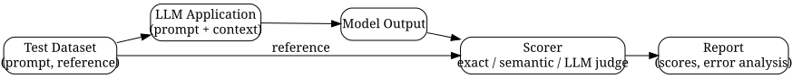

# A Practical Guide to LLM Evals: Testing AI Applications in Production

*Reading time: 8 min · 1,597 words*

> LLM outputs are non-deterministic, so shipping prompt changes or model swaps without a safety net is risky. This article explains how to build a practical eval harness — from curating test datasets and choosing metrics to integrating evals into CI — and walks through a real-world customer support chatbot example.

## Table of Contents
- [Why Your LLM Needs Evals](#why-your-llm-needs-evals)
- [Core Concepts: What Makes Up an Eval](#core-concepts-what-makes-up-an-eval)
  - [Types of Evals](#types-of-evals)
- [Choosing Metrics: How to Score an Output](#choosing-metrics-how-to-score-an-output)
  - [String-Based Metrics](#string-based-metrics)
  - [Semantic Similarity](#semantic-similarity)
  - [LLM-as-Judge](#llm-as-judge)
  - [Task-Specific Metrics](#task-specific-metrics)
- [Building an Eval Harness](#building-an-eval-harness)
  - [1. Curate Your Dataset](#1-curate-your-dataset)
  - [2. Write the Runner](#2-write-the-runner)
  - [3. Attach Scorers](#3-attach-scorers)
  - [4. Aggregate and Report](#4-aggregate-and-report)
- [The Evaluation Pipeline](#the-evaluation-pipeline)
- [Integrating Evals Into CI](#integrating-evals-into-ci)
- [Real-World Example: A Customer Support Chatbot](#real-world-example-a-customer-support-chatbot)
- [Common Pitfalls](#common-pitfalls)
- [Key Takeaways](#key-takeaways)
- [Frequently Asked Questions](#frequently-asked-questions)

## Why Your LLM Needs Evals

Large language models are powerful, but they are also non-deterministic. The same prompt can produce different answers across calls, and a small change to your system prompt, retrieval logic, or model version can silently degrade output quality. Unlike traditional software, where you can assert on function return values, LLM outputs are open-ended. This makes regression testing fundamentally harder — and much more important.

An eval (short for evaluation) is a systematic process for measuring how well your LLM application performs against a defined set of expectations. Evals are the unit tests of the AI era. They give you a safety net when you change prompts, swap models, update embeddings, or modify your retrieval pipeline.

> **Note:** Evals are not a one-time exercise. They are a continuous practice that should be embedded into your development workflow, just like unit tests and code review.

## Core Concepts: What Makes Up an Eval

Every eval has three ingredients:

1. **A test dataset** — a set of input scenarios with expected behavior (reference answers, labels, or rubrics).
2. **A runner** — the code that feeds each scenario to your application and captures the output.
3. **A scorer** — the logic that compares the output to the expected behavior and produces a score.

### Types of Evals

| Type | What it tests | Example |
| --- | --- | --- |
| Golden evals | Known-good behavior on curated cases | "Answer this refund question correctly" |
| Unit evals | Narrow, atomic behaviors | "Never mention competitors" |
| Adversarial evals | Edge cases, jailbreaks, tricky inputs | "Refuse a prompt injection" |
| Human evals | Subjective quality (tone, helpfulness) | Panel rates 50 responses |
| Online evals | Live traffic sampling | Score 1% of production requests |

Most teams start with golden and unit evals, then layer in adversarial and online evals as the system matures.

## Choosing Metrics: How to Score an Output

The scoring step is where most eval efforts succeed or fail. A metric must be reliable, cheap to compute, and aligned with what actually matters for your users.

### String-Based Metrics

For tasks with exact expected outputs — classification, extraction, formatting — simple metrics work well:

- **Exact match** — the output equals the reference.
- **F1 / token overlap** — partial credit for overlapping tokens.
- **ROUGE / BLEU** — n-gram overlap, useful for summarization and translation.

These are fast and transparent, but they miss semantic equivalence. "The sky is blue" and "Blue is the color of the sky" get a low score despite meaning the same thing.

### Semantic Similarity

Embedding-based similarity measures how close the output's vector representation is to the reference's. This catches paraphrases. However, it can be fooled by short, generic answers that are similar to many things, so it's best used as a soft signal rather than a hard gate.

### LLM-as-Judge

The most popular modern approach uses another LLM to grade the output against a rubric. You give the judge the prompt, the output, and a scoring rubric, and it returns a score (e.g., 1–5) with a brief justification.

```python
def judge_score(prompt, output, rubric):
    judge_prompt = f"""
    You are an expert evaluator. Score the assistant's response
    on a scale of 1-5 using this rubric:
    {rubric}

    User prompt: {prompt}
    Assistant response: {output}

    Return JSON: {{"score": int, "reason": str}}
    """
    result = call_llm(judge_prompt)
    return json.loads(result)
```

Pros: scalable, nuanced, and can evaluate subjective qualities like tone and helpfulness. Cons: judges have biases — they tend to prefer verbose answers, favor their own style, and exhibit position bias in pairwise comparisons.

> **Caution:** Never treat an LLM judge as ground truth. Validate your judge against a small set of human-rated examples first, and periodically re-calibrate it. If the judge disagrees with humans more than ~10% of the time, fix the rubric before trusting its scores.

### Task-Specific Metrics

Sometimes the right metric is domain-specific: retrieval recall for RAG pipelines, tool-call accuracy for agents, or refusal rate for safety policies. Define these explicitly rather than forcing everything through a generic scorer.

## Building an Eval Harness

A good harness is boring, repeatable, and integrated. Here's a practical blueprint.

### 1. Curate Your Dataset

Start small but representative. For each feature you care about, collect 20–50 scenarios. Cover happy paths, edge cases, and known failure modes. Store them as versioned files (JSONL or YAML) in your repository so they can be reviewed in pull requests.

### 2. Write the Runner

The runner iterates over the dataset, invokes your application, and collects outputs. Keep it deterministic: fix the temperature to 0 for eval runs, and pin model versions.

### 3. Attach Scorers

Attach one or more scorers per scenario. You can mix types — exact match for classification, LLM judge for tone, semantic similarity for paraphrase tolerance.

### 4. Aggregate and Report

Aggregate scores per slice (by feature, by difficulty, by input type). Track the aggregate over time so you can spot regressions. A single global number hides problems; always break down by category.

## The Evaluation Pipeline



## Integrating Evals Into CI

Your eval suite should run automatically on every pull request that touches prompts, retrieval code, or model configuration. Treat a drop in scores like a failing unit test: block the merge until someone fixes it.

A few practical tips:

- **Pin the model version** in CI so results are comparable.
- **Use a fixed seed and temperature 0** for reproducibility.
- **Run a quick smoke eval** (10–20 cases) on every PR, and a full eval nightly or before release.
- **Store results** in a database or artifact store so you can chart trends.

## Real-World Example: A Customer Support Chatbot

Let's make this concrete. Suppose you run an e-commerce site with a support chatbot that answers questions about orders, returns, and shipping.

You define four eval slices:

1. **Order lookup** — does the bot correctly retrieve order status given an order ID? (exact match on status + LLM judge on helpfulness)
2. **Return policy** — does it quote the correct window (30 days) and conditions? (semantic similarity + fact check)
3. **Tone** — is the response empathetic and professional? (LLM judge with rubric)
4. **Safety** — does it refuse to provide personal data or execute injected instructions? (adversarial cases, pass/fail)

You start with 40 scenarios per slice. After a prompt rewrite that adds "be concise," the order-lookup slice drops from 92% to 71%. Inspection shows the new prompt causes the bot to skip the confirmation step and guess the status. Because evals caught this in CI, you revert the change before it reaches users — a regression that would have been invisible in manual testing.

This is the core value: evals turn vague "it feels worse" feedback into a precise, actionable signal.

## Common Pitfalls

- **Tiny datasets.** 10 examples produce noisy scores. Aim for at least 20–50 per slice, and understand the confidence interval.
- **Judge drift.** LLM judges change when the underlying model updates. Re-run calibration regularly.
- **Overfitting to evals.** If you tune prompts until evals pass, you may game the metrics. Rotate scenarios and add fresh ones.
- **Ignoring cost.** LLM judges are cheap per call but add up across thousands of scenarios. Budget accordingly.
- **No human review.** Evals complement, not replace, human judgment. Spot-check outputs weekly.

## Key Takeaways

- Evals are the unit tests for LLM applications; build them early and run them continuously.
- Use a mix of metrics: exact match for structured tasks, semantic similarity for paraphrase tolerance, and LLM-as-judge for subjective quality.
- Validate your LLM judge against human-rated examples before trusting it.
- Start with 20–50 curated scenarios per feature slice, and version your datasets in the repo.
- Integrate evals into CI: block merges on score regressions.
- Track scores over time and break them down by slice to find where quality degrades.

## Frequently Asked Questions

Q: How many eval cases do I need to start?
A: Start with 20–50 scenarios per behavioral slice. That's enough to catch major regressions, though you'll want more as the system grows. Small sets are noisy, so treat early scores as directional.

Q: Should I use an LLM as a judge or human raters?
A: Use both, in layers. LLM judges scale and are great for CI. Use human raters on a small sample to validate the judge and to catch issues the judge misses. Re-calibrate the judge whenever its underlying model changes.

Q: What's the difference between an eval and observability?
A: Evals measure output quality against expectations (offline or online). Observability tracks runtime signals like latency, token usage, and errors. They're complementary: evals tell you *what* is wrong; observability helps you find *where* and *why*.

Q: Can evals prevent prompt injection attacks?
A: Not fully. Adversarial evals can test known attack patterns and help you build defenses, but attackers evolve. Combine evals with input sanitization, output filtering, and least-privilege tool access.

Q: How do I evaluate a RAG pipeline?
A: Evaluate retrieval and generation separately. For retrieval, measure recall and precision of retrieved chunks against gold-standard passages. For generation, score groundedness (does the answer cite retrieved context?) and faithfulness (does it contradict the context?).

## Frequently Asked Questions

**Q: How many eval cases do I need to start?**

A: Start with 20–50 scenarios per behavioral slice. That's enough to catch major regressions, though you'll want more as the system grows. Small sets are noisy, so treat early scores as directional.

**Q: Should I use an LLM as a judge or human raters?**

A: Use both, in layers. LLM judges scale and are great for CI. Use human raters on a small sample to validate the judge and to catch issues the judge misses. Re-calibrate the judge whenever its underlying model changes.

**Q: What's the difference between an eval and observability?**

A: Evals measure output quality against expectations (offline or online). Observability tracks runtime signals like latency, token usage, and errors. They're complementary: evals tell you *what* is wrong; observability helps you find *where* and *why*.

**Q: Can evals prevent prompt injection attacks?**

A: Not fully. Adversarial evals can test known attack patterns and help you build defenses, but attackers evolve. Combine evals with input sanitization, output filtering, and least-privilege tool access.

**Q: How do I evaluate a RAG pipeline?**

A: Evaluate retrieval and generation separately. For retrieval, measure recall and precision of retrieved chunks against gold-standard passages. For generation, score groundedness (does the answer cite retrieved context?) and faithfulness (does it contradict the context?).

## Key Takeaways

- Evals are the unit tests for LLM applications; build them early and run them continuously.
- Use a mix of metrics: exact match for structured tasks, semantic similarity for paraphrase tolerance, and LLM-as-judge for subjective quality.
- Validate your LLM judge against human-rated examples before trusting it.
- Start with 20–50 curated scenarios per feature slice, and version your datasets in the repo.
- Integrate evals into CI: block merges on score regressions.
- Track scores over time and break them down by slice to find where quality degrades.

## Related Articles

- LLM observability and tracing
- Prompt engineering best practices
- Retrieval-augmented generation (RAG)
- Testing AI agents in production

<!-- Cover image prompts (for editors):
  - A clean flat illustration of an evaluation pipeline: a test dataset flowing into an LLM application, output flowing into a scoring gauge, with checkmarks and charts, modern tech aesthetic, muted blues and greens
  - A developer dashboard showing eval scores over time with a regression highlighted in red, line charts and bar charts, dark theme UI, professional software aesthetic
  - A balance scale comparing an LLM judge and human raters, with speech bubbles and scorecards, minimal flat design, soft gradient background
-->