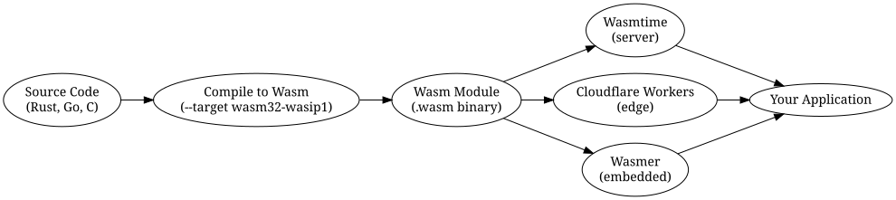

# WebAssembly Beyond the Browser: A Developer's Guide to Wasm on the Backend and Edge

*Reading time: 11 min · 2,092 words*

> WebAssembly has outgrown the browser. This guide explains how Wasm, WASI, and the component model are reshaping backend and edge computing, covers the major runtimes, and walks through a hands-on example so you can build and deploy your first Wasm service.

## Table of Contents
- [Why WebAssembly Beyond the Browser?](#why-webassembly-beyond-the-browser)
  - [The problems Wasm solves on the backend](#the-problems-wasm-solves-on-the-backend)
  - [Where Wasm is being used in 2025](#where-wasm-is-being-used-in-2025)
- [Core Concepts You Need to Know](#core-concepts-you-need-to-know)
  - [1. The Wasm binary format](#1-the-wasm-binary-format)
  - [2. WASI: The WebAssembly System Interface](#2-wasi-the-webassembly-system-interface)
  - [3. The component model](#3-the-component-model)
  - [4. Runtimes](#4-runtimes)
- [Getting Started: Your First Backend Wasm Service](#getting-started-your-first-backend-wasm-service)
  - [Prerequisites](#prerequisites)
  - [Write the module](#write-the-module)
  - [Compile to Wasm](#compile-to-wasm)
  - [Run it with Wasmtime](#run-it-with-wasmtime)
- [Real-World Use Cases](#real-world-use-cases)
  - [Edge functions and CDN compute](#edge-functions-and-cdn-compute)
  - [Plugin systems](#plugin-systems)
  - [Multi-tenant isolation](#multi-tenant-isolation)
- [Challenges and Pitfalls](#challenges-and-pitfalls)
  - [I/O and asynchronous programming](#io-and-asynchronous-programming)
  - [Toolchain maturity](#toolchain-maturity)
  - [Debugging and profiling](#debugging-and-profiling)
  - [Garbage collection and threading](#garbage-collection-and-threading)
- [A Real-World Example: Moving a Pricing Service to the Edge](#a-real-world-example-moving-a-pricing-service-to-the-edge)
- [Conclusion](#conclusion)
- [Key Takeaways](#key-takeaways)
- [Frequently Asked Questions](#frequently-asked-questions)

When most developers hear "WebAssembly," they picture the browser—high-performance games, video editors, and compute-heavy web apps. But in 2025, WebAssembly (Wasm) has quietly become one of the most important technologies for the backend and the edge. From Cloudflare Workers to plugin systems inside databases and API gateways, Wasm is reshaping how we build portable, secure, and fast services.

This guide explains what makes Wasm valuable outside the browser, introduces the core concepts—WASI, the component model, and the major runtimes—and walks through a hands-on example so you can start experimenting today.

## Why WebAssembly Beyond the Browser?

WebAssembly began as a browser technology: a low-level bytecode format that runs at near-native speed inside a sandbox. Its design, however, was never browser-specific. The execution model is a simple, stack-based virtual machine with no built-in assumptions about the host environment. This neutrality is exactly what makes Wasm attractive for other domains.

### The problems Wasm solves on the backend

| Problem | How Wasm helps |
| --- | --- |
| Slow cold starts | Wasm modules start in single-digit milliseconds, far faster than containers or VMs |
| Portability | One binary runs on any CPU and OS that has a Wasm runtime |
| Security | Sandboxed execution with fine-grained capability-based permissions |
| Multi-tenancy | Lightweight isolation makes it cheap to run many untrusted tenants side by side |
| Binary size | Modules are typically tens to hundreds of KB, not hundreds of MB |

### Where Wasm is being used in 2025

- **Edge functions:** Cloudflare Workers, Fastly Compute, and Deno Deploy all execute Wasm at the network edge.
- **Plugin systems:** Databases like PostgreSQL, and gateways like Envoy, support Wasm plugins for safe, dynamic extension.
- **Data processing:** Streaming pipelines and map-reduce-style workloads run Wasm for per-event transformations.
- **Multi-tenant SaaS:** Isolating customer code or user-defined functions in Wasm sandboxes.
- **Blockchain and decentralized compute:** Smart contract runtimes (e.g., on several L1 chains) execute Wasm.


> **Note:** Wasm is *not* a replacement for every containerized service. For long-running, I/O-heavy workloads with complex native dependencies, containers remain a better fit. Wasm shines where startup time, portability, and isolation matter most.

## Core Concepts You Need to Know

Before writing your first backend Wasm module, it helps to understand four pillars of the ecosystem.

### 1. The Wasm binary format

A Wasm module is a compact binary with sections for types, functions, memory, tables, and exports. It defines a single module with imported and exported functions, and it can grow its linear memory dynamically. Because the format is designed for streaming compilation, runtimes can begin executing before the full module is downloaded.

### 2. WASI: The WebAssembly System Interface

In the browser, Wasm cannot touch the filesystem, sockets, or environment variables directly. WASI provides a standardized set of system calls—file I/O, clocks, random numbers, sockets (via `wasi-sockets`)—that Wasm modules can import. WASI is the key that unlocks Wasm outside the browser.

WASI has evolved through several versions:

| Version | Status | Notes |
| --- | --- | --- |
| WASI Preview 1 (wasi_snapshot_preview1) | Stable, widely supported | The classic syscall-style interface |
| WASI Preview 2 | Stabilizing | Built on the component model; async, richer types |
| WASI 0.3 (planned) | In progress | Next-generation interface, tighter integration with the component model |

### 3. The component model

The component model is the next major evolution of Wasm. It adds a higher-level abstraction on top of the core Wasm format: components can define typed interfaces, import and export functions with rich value types (strings, records, variants, lists), and be composed together like building blocks. Components are the foundation of WASI Preview 2 and make it practical to share libraries across languages.

### 4. Runtimes

You don't need a browser to run Wasm. Several standalone runtimes are production-ready:

- **Wasmtime** (Bytecode Alliance) — the reference runtime; fast, embeddable, supports the component model and WASI.
- **Wasmer** — a popular runtime with a large ecosystem, supports multiple compilation backends.
- **WasmEdge** (CNCF) — lightweight, geared toward edge and serverless, supports JavaScript and Python embeddings.
- **WAMR** (WebAssembly Micro Runtime) — designed for embedded devices and small footprints.



## Getting Started: Your First Backend Wasm Service

Let's build a tiny service that reads text from stdin, transforms it, and writes the result to stdout. We'll use Rust, but you can follow along with Go, C, Zig, or AssemblyScript.

### Prerequisites

- Rust toolchain (`rustup`)
- The `wasm32-wasip1` target: `rustup target add wasm32-wasip1`
- The Wasmtime CLI: `curl https://wasmtime.dev/install.sh -sSf | bash`

### Write the module

Create a new crate:

```bash
cargo new wasm-text-tool
cd wasm-text-tool
```

Replace `src/main.rs`:

```rust
use std::io::{self, Read, Write};

fn main() {
    let mut input = String::new();
    io::stdin().read_to_string(&mut input).expect("failed to read stdin");

    let transformed = transform(&input);

    io::stdout().write_all(transformed.as_bytes()).expect("failed to write stdout");
}

fn transform(text: &str) -> String {
    // A deliberately simple transformation: reverse each line
    text.lines()
        .map(|line| line.chars().rev().collect::<String>())
        .collect::<Vec<_>>()
        .join("\n")
}
```

### Compile to Wasm

```bash
cargo build --target wasm32-wasip1 --release
```

This produces `target/wasm32-wasip1/release/wasm-text-tool.wasm`.

### Run it with Wasmtime

```bash
echo "hello world" | wasmtime run target/wasm32-wasip1/release/wasm-text-tool.wasm
# Output: dlrow olleh
```

That's it—a self-contained Wasm module running natively on your machine via WASI, with no browser in sight. The same `.wasm` file can be deployed to an edge function, embedded in a database, or executed in a serverless platform.


## Real-World Use Cases

### Edge functions and CDN compute

Cloudflare Workers and Fastly Compute let you run code at hundreds of locations worldwide. While both support JavaScript, their Wasm story matters for performance-critical paths: image processing, compression, encryption, and ML inference. A Wasm module compiled once can run on any edge node without recompilation, and cold starts are dramatically cheaper than spinning up a container.

### Plugin systems

Databases, message brokers, and API gateways increasingly use Wasm for plugins. Instead of loading native shared libraries (which can crash the host or require recompilation for each platform), hosts load Wasm modules and communicate through a stable ABI. Examples include:

- **Envoy** filters written in Wasm for traffic manipulation.
- **PostgreSQL** extensions compiled to Wasm for sandboxed user-defined functions.
- **Kubernetes** admission controllers and policy engines using Wasm policies (e.g., with OPA/Rego or custom runtimes).

### Multi-tenant isolation

If your SaaS lets customers upload code—think workflow automations, custom connectors, or data transformations—Wasm offers a much lighter isolation boundary than separate containers or VMs. Each tenant gets a fresh Wasm instance with its own memory and capabilities, and a misbehaving module can be killed without affecting neighbors.

## Challenges and Pitfalls

The ecosystem is maturing fast, but there are still sharp edges.

### I/O and asynchronous programming

WASI's socket support (via `wasi-sockets`) is newer and less mature than POSIX sockets. Writing highly concurrent, async network services in Wasm is possible but requires care. Many teams keep Wasm modules pure and stateless, and let the host handle I/O.

### Toolchain maturity

Rust and C/C++ have excellent Wasm support. Go's Wasm support has historically been limited (the `wasm32-wasi` target lacks goroutine preemption in some configurations). Zig and AssemblyScript are viable options, but the language ecosystem is uneven.

### Debugging and profiling

Debugging Wasm outside the browser is improving—Wasmtime supports the WASI debugger protocol and DWARF-based stack traces—but it's still not as polished as native debugging. Plan for extra time when diagnosing tricky issues.

### Garbage collection and threading

The Wasm GC proposal has shipped in major engines, enabling languages like Java, Kotlin, and C# to compile to Wasm. Threads are available but require shared memory and atomics; not all runtimes enable them by default.

> **Caution:** Don't assume a library you use in native Rust will compile to Wasm. Anything depending on platform-specific system calls, CUDA, or unsupported C libraries will need alternatives. Check the `wasm32-wasip1` target support before committing to a dependency.

## A Real-World Example: Moving a Pricing Service to the Edge

Consider a fictional e-commerce company, **Acme Retail**, that calculates dynamic prices based on inventory, demand signals, and competitor data. Originally, this logic lived in a Python microservice behind a load balancer. As traffic spiked during sales events, the service struggled with cold starts and scaling costs.

The team rewrote the core pricing algorithm in Rust and compiled it to Wasm. They deployed it as a Cloudflare Worker, keeping the Python service as a fallback. The results:

- **Cold start time dropped** from ~300 ms (container) to ~5 ms (Wasm).
- **Latency improved** because pricing decisions now happen at the edge, close to users.
- **Costs fell** because edge invocations were cheaper than running a fleet of always-on pods.
- **Security improved** because the Wasm module ran in a strict sandbox with no access to the internal network.

The migration wasn't trivial—the team had to replace Python's dynamic dispatch and third-party libraries with Rust equivalents—but the payoff was substantial. Today, Acme runs the same Wasm module in its CI pipeline for local testing, in its edge network for production, and even in a serverless function for batch jobs, all from a single binary.

## Conclusion

WebAssembly has outgrown the browser. With WASI providing a portable system interface, the component model enabling composition, and a growing family of production-grade runtimes, Wasm is now a credible choice for backend and edge workloads. It won't replace containers everywhere, but for edge functions, plugin systems, and multi-tenant isolation, it's often the best tool for the job.

Start small: compile a Rust function to Wasm, run it with Wasmtime, and experiment with deploying it to an edge platform. The skills you learn will pay off as Wasm continues to spread across the infrastructure stack.

## Key Takeaways

- **Wasm is not just for browsers.** WASI gives modules a portable system interface, unlocking backend and edge use cases.
- **Cold starts and portability are the killer features.** Single-digit-millisecond startup and one-binary-runs-anywhere make Wasm ideal for serverless and edge.
- **The component model is the future.** It enables typed interfaces and cross-language composition, making Wasm practical for large teams.
- **Choose your runtime carefully.** Wasmtime, Wasmer, WasmEdge, and WAMR have different strengths; match the runtime to your deployment target.
- **Mind the ecosystem gaps.** Not every library compiles to Wasm, and async networking is still maturing—plan for rewrites.
- **A single binary can serve many hosts.** The same module can run in CI, at the edge, and in batch jobs, simplifying deployment and testing.

## Frequently Asked Questions

**Q: Can I run WebAssembly on my existing Kubernetes cluster?**
A: Yes. You can run Wasm workloads on Kubernetes using runtimes like Wasmtime via containerd's `runwasi` shim, or use projects like Krustlet (though it's no longer actively maintained). Many teams prefer to use Wasm for specific tasks—function execution, policy evaluation, data transformation—rather than replacing all containers.

**Q: What languages compile best to WebAssembly for backend work?**
A: Rust and C/C++ have the most mature support. Zig and AssemblyScript are solid choices for new projects. Go's Wasm support exists but has limitations around goroutines and performance. Java, Kotlin, and C# are becoming viable thanks to the Wasm GC proposal.

**Q: How does Wasm compare to containers for security?**
A: Wasm provides a smaller attack surface: no OS kernel exposure, no shared libraries, and capability-based access to host resources. Containers rely on the host kernel and namespaces, which have a larger attack surface. However, Wasm runtimes themselves must be kept up to date, and the security model depends on the runtime's implementation.

**Q: Will WebAssembly replace Docker containers?**
A: Not in the foreseeable future. Containers remain better for long-running services with complex native dependencies, persistent storage, and rich orchestration. Wasm complements containers: it excels at short-lived, stateless, portable workloads where startup time and isolation matter.

**Q: How do I debug a Wasm module running outside the browser?**
A: Wasmtime supports the WASI debugger protocol and can generate DWARF-based stack traces if you compile with debug symbols. You can also use `wasmtime run --debug` with a debugger like GDB or LLDB. For logic errors, adding `println!`-style logging that goes to stderr works because WASI maps stderr to the host's stderr.

## Frequently Asked Questions

**Q: Can I run WebAssembly on my existing Kubernetes cluster?**

A: Yes. You can run Wasm workloads on Kubernetes using runtimes like Wasmtime via containerd's `runwasi` shim, or use projects like Krustlet (though it's no longer actively maintained). Many teams prefer to use Wasm for specific tasks—function execution, policy evaluation, data transformation—rather than replacing all containers.

**Q: What languages compile best to WebAssembly for backend work?**

A: Rust and C/C++ have the most mature support. Zig and AssemblyScript are solid choices for new projects. Go's Wasm support exists but has limitations around goroutines and performance. Java, Kotlin, and C# are becoming viable thanks to the Wasm GC proposal.

**Q: How does Wasm compare to containers for security?**

A: Wasm provides a smaller attack surface: no OS kernel exposure, no shared libraries, and capability-based access to host resources. Containers rely on the host kernel and namespaces, which have a larger attack surface. However, Wasm runtimes themselves must be kept up to date, and the security model depends on the runtime's implementation.

**Q: Will WebAssembly replace Docker containers?**

A: Not in the foreseeable future. Containers remain better for long-running services with complex native dependencies, persistent storage, and rich orchestration. Wasm complements containers: it excels at short-lived, stateless, portable workloads where startup time and isolation matter.

**Q: How do I debug a Wasm module running outside the browser?**

A: Wasmtime supports the WASI debugger protocol and can generate DWARF-based stack traces if you compile with debug symbols. You can also use `wasmtime run --debug` with a debugger like GDB or LLDB. For logic errors, adding `println!`-style logging that goes to stderr works because WASI maps stderr to the host's stderr.

## Key Takeaways

- Wasm is not just for browsers: WASI gives modules a portable system interface, unlocking backend and edge use cases.
- Cold starts and portability are the killer features: single-digit-millisecond startup and one-binary-runs-anywhere make Wasm ideal for serverless and edge.
- The component model is the future: it enables typed interfaces and cross-language composition, making Wasm practical for large teams.
- Choose your runtime carefully: Wasmtime, Wasmer, WasmEdge, and WAMR have different strengths; match the runtime to your deployment target.
- Mind the ecosystem gaps: not every library compiles to Wasm, and async networking is still maturing—plan for rewrites.
- A single binary can serve many hosts: the same module can run in CI, at the edge, and in batch jobs, simplifying deployment and testing.

## Related Articles

- WebAssembly Component Model deep dive
- Edge computing architecture patterns
- Rust for backend services
- Serverless functions and FaaS platforms

<!-- Cover image prompts (for editors):
  - A futuristic cloud-edge network diagram showing WebAssembly modules deployed across global edge nodes, with glowing blue server racks and latency graphs, dark theme, high-tech aesthetic
  - A developer workstation with a terminal compiling Rust code to WebAssembly, showing a .wasm binary file icon and a globe representing edge deployment, clean modern workspace, soft lighting
  - An abstract visualization of a sandboxed WebAssembly module running inside a secure container, with layered security boundaries and capability icons, minimalist tech illustration
  - A comparison infographic of cold start times between containers and WebAssembly edge functions, with bar charts and a fast clock icon, professional data-viz style
-->