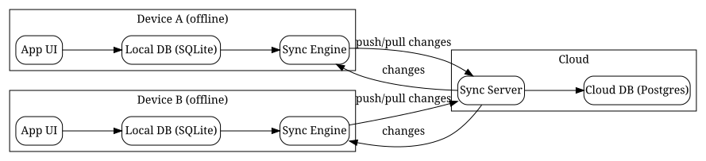

# Local-First Software Development: A Practical Guide to Offline-First Architectures

*Reading time: 12 min · 2,442 words*

> Learn how to build local-first applications that work offline, load instantly, and sync seamlessly across devices. This guide covers CRDTs, sync engines, architecture patterns, and real-world trade-offs.

## Table of Contents
- [Introduction](#introduction)
- [What Is Local-First Software?](#what-is-local-first-software)
  - [Local-First vs. Offline-First vs. Client-Server](#local-first-vs-offline-first-vs-client-server)
- [Core Concepts: CRDTs and Sync](#core-concepts-crdts-and-sync)
  - [Operational Transform (OT)](#operational-transform-ot)
  - [CRDTs](#crdts)
  - [CRDT Example: Last-Writer-Wins Register](#crdt-example-last-writer-wins-register)
- [Architecting a Local-First App](#architecting-a-local-first-app)
  - [The Sync Engine](#the-sync-engine)
  - [Local Database Choices](#local-database-choices)
  - [Sync Flow Diagram](#sync-flow-diagram)
  - [Handling Conflicts](#handling-conflicts)
- [Real-World Example: A Local-First Note-Taking App](#real-world-example-a-local-first-note-taking-app)
  - [Requirements](#requirements)
  - [Architecture Decisions](#architecture-decisions)
  - [Implementation Sketch](#implementation-sketch)
  - [What Happens When the User Goes Offline?](#what-happens-when-the-user-goes-offline)
- [Schema Evolution and Migrations](#schema-evolution-and-migrations)
- [Testing Local-First Apps](#testing-local-first-apps)
- [Trade-Offs and When NOT to Go Local-First](#trade-offs-and-when-not-to-go-local-first)
- [Tools and Ecosystem in 2025](#tools-and-ecosystem-in-2025)
- [Conclusion](#conclusion)
- [Key Takeaways](#key-takeaways)
- [Frequently Asked Questions](#frequently-asked-questions)

## Introduction

For decades, the dominant model for building applications has been client-server: the client renders a UI, and the server holds the source of truth. This model works well when connectivity is reliable, but it breaks down in the real world—on airplanes, in spotty cellular coverage, or in regions with poor infrastructure. Even when connected, round-trip latency makes apps feel sluggish, and every interaction depends on a server that might be slow, overloaded, or down.

Local-first software flips this paradigm. Instead of treating the server as the source of truth, local-first apps treat the user's device as the primary store. Data lives on the device, loads instantly, and works offline. Synchronization happens in the background, and conflicts are resolved automatically using techniques like CRDTs (Conflict-free Replicated Data Types).

In this guide, we'll explore what local-first means, why it matters, how to implement it, and the trade-offs involved. Whether you're building a mobile app, a desktop tool, or a web application, understanding local-first patterns will help you deliver a dramatically better user experience.

## What Is Local-First Software?

The term "local-first" was popularized by Ink & Switch, an industrial research lab, in their 2019 essay "Local-First Software: You Own Your Data, in spite of the Cloud." The essay identified seven ideals:

1. **Instant access** — Your data is available immediately, no network required.
2. **Multi-device** — Your data syncs across all your devices.
3. **Offline** — You can work without a connection.
4. **Collaboration** — Multiple people can work on the same data.
5. **Longevity** — Your data outlives any single app or vendor.
6. **Privacy** — You control who sees your data.
7. **User control** — You own your data, not the cloud provider.

Traditional web apps sacrifice most of these ideals for the convenience of centralized hosting. Local-first apps aim to get them back.

### Local-First vs. Offline-First vs. Client-Server

It's worth distinguishing these terms:

| Approach | Data location | Offline support | Sync | Complexity |
|----------|--------------|----------------|------|-----------|
| Client-server | Server | Limited/none | N/A (always online) | Low |
| Offline-first | Device, with server fallback | Yes | Manual or automatic | Medium |
| Local-first | Device (primary), cloud as sync layer | Yes | Automatic, background | High |

Offline-first is often a stepping stone: you cache data locally so the app degrades gracefully. Local-first goes further—the local copy *is* the source of truth, and the cloud is just a replication service.

> **Note:** Local-first doesn't mean "no server." It means the server's role changes from "source of truth" to "sync coordinator." You still need a backend to relay changes between devices and handle authentication.

## Core Concepts: CRDTs and Sync

The heart of local-first is synchronization. When two devices edit the same document offline, they'll diverge. When they reconnect, the system must merge their changes deterministically. Two main approaches exist: Operational Transform (OT) and Conflict-free Replicated Data Types (CRDTs).

### Operational Transform (OT)

OT is the older approach, used by Google Docs and collaborative editors like Etherpad. Each operation (insert, delete, format) is transformed against concurrent operations so that both clients converge to the same state. OT requires a central server to order operations and transform them, which makes it less suitable for peer-to-peer or multi-master scenarios.

### CRDTs

CRDTs are data structures designed for automatic conflict resolution. Each replica can apply updates locally without coordination, and when replicas exchange state, they converge to the same result regardless of order. There are two families:

- **State-based (CvRDTs):** Replicas exchange full state or deltas; merging uses a join operation (e.g., last-writer-wins, max, set union).
- **Operation-based (CmRDTs):** Replicas exchange operations; operations are designed to be commutative and idempotent.

Popular CRDT libraries include:

- **Yjs** — A high-performance CRDT framework for collaborative editing, used by many apps.
- **Automerge** — A CRDT library focused on JSON-like documents.
- **Loro** — A newer CRDT library with high performance.

### CRDT Example: Last-Writer-Wins Register

A simple CRDT is a register with last-writer-wins semantics:

```javascript
// Pseudo-code for an LWW register CRDT
class LWWRegister {
  constructor(id) {
    this.id = id;
    this.value = null;
    this.timestamp = 0;
  }

  set(value, timestamp) {
    if (timestamp > this.timestamp) {
      this.value = value;
      this.timestamp = timestamp;
    }
  }

  merge(other) {
    if (other.timestamp > this.timestamp) {
      this.value = other.value;
      this.timestamp = other.timestamp;
    }
  }
}
```

LWW registers are simple but lossy—if two users edit different fields of the same object, a naive LWW approach could lose one edit. That's why production CRDTs use more sophisticated structures like maps with per-field registers, counters, and sequence-aware lists.

## Architecting a Local-First App

Let's walk through a typical local-first architecture.

### The Sync Engine

The sync engine is the heart of a local-first app. It manages:

- Reading and writing to the local database
- Tracking changes (via timestamps, version vectors, or operation logs)
- Sending changes to the server
- Receiving changes from the server
- Applying remote changes to the local database

Common sync engines and services:

| Tool | Type | Notes |
|------|------|-------|
| **PowerSync** | Service + SDK | Syncs SQLite with PostgreSQL/MySQL; good for mobile |
| **ElectricSQL** | Open-source | Syncs SQLite with Postgres using logical replication |
| **Replicache** | Library | Client-side sync with custom backend |
| **Yjs** | Library | Best for collaborative documents and rich text |
| **Automerge** | Library | Good for structured JSON documents |

### Local Database Choices

Most local-first apps use an embedded database on the device:

- **SQLite** — The workhorse. Works on iOS, Android, desktop, and in browsers via WASM (sql.js, wa-sqlite).
- **Dexie.js** — A wrapper around IndexedDB for browser apps.
- **OPFS (Origin Private File System)** — For browser storage.

### Sync Flow Diagram

Here's a Graphviz diagram illustrating a typical local-first sync architecture:



// caption: A local-first sync architecture with two devices syncing through a cloud coordinator.

### Handling Conflicts

Even with CRDTs, you'll face business-level conflicts. For example, two users editing the same inventory item might set different quantities. Strategies include:

1. **Last-writer-wins** — Simple, but can silently lose data.
2. **Merge by field** — Different fields merge independently.
3. **Versioned conflict resolution** — Keep both versions and let the user resolve.
4. **Business rules** — Apply domain logic (e.g., "quantity cannot be negative") during merge.

> **Caution:** CRDTs guarantee convergence, not correctness. You still need to define what "correct" means for your domain. A CRDT will happily merge two conflicting edits into one state—it won't tell you that state is semantically wrong.

## Real-World Example: A Local-First Note-Taking App

Let's imagine you're building a note-taking app similar to Obsidian or Notion, but local-first.


### Requirements

- Users can create notes on their laptop, phone, and tablet.
- Notes must be available offline.
- Changes sync across devices within seconds of reconnecting.
- Multiple users can collaborate on shared notes.

### Architecture Decisions

1. **Local storage:** SQLite on mobile/desktop; IndexedDB in the browser.
2. **Sync:** Use PowerSync or ElectricSQL to sync SQLite with a Postgres backend.
3. **Conflict resolution:** Use CRDTs for note content (via Yjs) and LWW registers for metadata (title, tags).
4. **Auth:** The sync server handles authentication and authorization; the local DB stores only the user's accessible data.

### Implementation Sketch

```javascript
// Using Yjs for collaborative note content
import * as Y from 'yjs';
import { IndexeddbPersistence } from 'y-indexeddb';
import { WebsocketProvider } from 'y-websocket';

const doc = new Y.Doc();
const persistence = new IndexeddbPersistence('my-note', doc);
const provider = new WebsocketProvider('wss://sync.example.com', 'my-note', doc);

const ytext = doc.getText('content');
ytext.insert(0, 'Hello, local-first world!');

// Listen for remote changes
doc.on('update', (update) => {
  console.log('Document updated:', update.byteLength, 'bytes');
});
```

This gives you offline persistence (IndexedDB) plus real-time sync (WebSocket) with Yjs handling conflict resolution automatically.

### What Happens When the User Goes Offline?

1. The app continues to read/write from the local DB.
2. The sync engine queues outgoing changes.
3. When connectivity returns, the engine flushes the queue and pulls remote changes.
4. CRDTs merge everything deterministically.
5. The UI updates to reflect merged state.

## Schema Evolution and Migrations

One of the trickiest parts of local-first development is schema evolution. In a client-server app, you migrate the server database and deploy a new client version. In a local-first app, you have hundreds or thousands of copies of your schema on user devices, some of which may be offline for weeks.

Practical strategies:

- **Additive migrations only:** Never remove or rename columns without a compatibility window. Add new columns with defaults.
- **Versioned schemas:** Store a schema version number in the local DB and write migrations that run on app startup.
- **Backward-compatible reads:** Write queries that work with both old and new schemas during the transition period.
- **Server-side normalization:** If possible, have the sync server normalize data from old client versions.

A common pattern is to keep migrations small and idempotent:

```sql
-- Example: additive migration for a notes table
ALTER TABLE notes ADD COLUMN pinned INTEGER NOT NULL DEFAULT 0;
```

## Testing Local-First Apps

Testing local-first apps requires a different mindset than testing client-server apps. You need to verify:

- **Convergence:** Given the same initial state and a set of operations applied in different orders, do all replicas end up identical?
- **Idempotency:** Applying the same update twice produces the same result.
- **Offline behavior:** The app works correctly with no network.
- **Resume behavior:** After reconnecting, sync completes and merges correctly.

Tools and techniques:

- Use property-based testing (e.g., Hypothesis in Python, fast-check in JavaScript) to generate random operation sequences.
- Simulate network partitions in your test environment.
- Test with real devices and realistic network conditions (e.g., via Network Link Conditioner or similar tools).

## Trade-Offs and When NOT to Go Local-First

Local-first isn't a silver bullet. It adds significant complexity:

- **More moving parts:** Sync engines, conflict resolution, versioning, and migration handling.
- **Security surface:** Data is stored on many devices; you need encryption at rest and secure transport.
- **Consistency guarantees:** You give up strong consistency. If you need strict ordering (e.g., financial transactions), local-first is painful.
- **Debugging difficulty:** Bugs that only appear under specific sync interleavings are hard to reproduce.

When local-first makes sense:

- Collaborative documents (notes, whiteboards, spreadsheets)
- Productivity apps (task managers, calendars)
- Field work with intermittent connectivity (inspection apps, sales tools)
- Consumer apps where responsiveness is critical

When it doesn't:

- Banking/finance with strict transaction semantics
- Multiplayer games requiring authoritative state
- Apps where compliance mandates centralized audit trails

## Tools and Ecosystem in 2025

The local-first ecosystem has matured significantly. Notable projects:

- **ElectricSQL** — Now supports Postgres logical replication, making it production-ready for many apps.
- **PowerSync** — Acquired by MongoDB in 2024; integrates with MongoDB and Postgres.
- **Zero** — An open-source sync engine from Zero Technologies (formerly Rocicorp) that syncs a relational query layer to the client.
- **Triplit** — A full-stack local-first database with built-in sync.
- **Yjs** — Still the standard for collaborative editing.
- **Automerge 2.x** — Improved performance and smaller binaries.
- **Loro** — Gaining traction for high-performance CRDT needs.

Also notable: **Bun** and **Deno** have improved support for SQLite, and browsers' OPFS makes local storage more robust.


## Conclusion

Local-first software represents a fundamental shift in how we think about application architecture. By making the device the source of truth and treating the cloud as a sync layer, we can build apps that are faster, more resilient, and more respectful of user ownership.

The trade-off is complexity. CRDTs, sync engines, and conflict resolution are non-trivial. But the tooling has matured enough that a small team can ship a credible local-first app today.

If you're starting a new project where offline access matters—or where users would benefit from owning their data—seriously consider a local-first approach. Start small: pick one feature, prototype with a sync engine like ElectricSQL or PowerSync, and measure how it feels. You may never want to go back to the spinner.

## Key Takeaways

- Local-first apps treat the device as the source of truth; the cloud becomes a sync layer, not the authority.
- CRDTs enable automatic, deterministic conflict resolution; Yjs and Automerge are the leading libraries.
- Choose a sync engine based on your stack: PowerSync for SQLite+MongoDB/Postgres, ElectricSQL for Postgres, Replicache for custom backends.
- Schema evolution requires additive migrations and versioned schemas; never assume all devices are online.
- Local-first adds real complexity: security, versioning, conflict semantics, and debugging challenges.
- Don't use local-first where strong consistency is mandatory (finance, authoritative multiplayer).

## Frequently Asked Questions

**Q: What's the difference between offline-first and local-first?**
A: Offline-first typically means an app caches server data so it can degrade gracefully offline. Local-first means the device's data is authoritative and the cloud is just a replication service. Local-first is a stronger commitment: the app works fully on-device, and sync happens in the background.

**Q: Do I need CRDTs for a local-first app?**
A: Not necessarily. If your sync model is single-writer (one user edits at a time) or if you accept last-writer-wins semantics, simpler approaches work. CRDTs become essential when multiple writers can edit concurrently and you need automatic convergence.

**Q: Can I use local-first in a browser app?**
A: Yes. Browsers support IndexedDB, OPFS, and SQLite via WASM. Libraries like Yjs, Automerge, and PowerSync all have browser support. The main limitation is storage quotas, which vary by browser.

**Q: How do I handle authentication in a local-first app?**
A: Authentication still happens at the sync server. The client obtains a token (JWT or similar) and includes it in sync requests. The server enforces permissions and decides which data to replicate to each device.

**Q: Is local-first suitable for enterprise apps?**
A: It depends on the domain. For collaboration tools, field service apps, and productivity suites, yes. For applications with strict regulatory requirements around data residency and audit trails, you'll need to carefully evaluate whether decentralized storage meets compliance obligations.

## Frequently Asked Questions

**Q: What's the difference between offline-first and local-first?**

A: Offline-first typically means an app caches server data so it can degrade gracefully offline. Local-first means the device's data is authoritative and the cloud is just a replication service. Local-first is a stronger commitment: the app works fully on-device, and sync happens in the background.

**Q: Do I need CRDTs for a local-first app?**

A: Not necessarily. If your sync model is single-writer (one user edits at a time) or if you accept last-writer-wins semantics, simpler approaches work. CRDTs become essential when multiple writers can edit concurrently and you need automatic convergence.

**Q: Can I use local-first in a browser app?**

A: Yes. Browsers support IndexedDB, OPFS, and SQLite via WASM. Libraries like Yjs, Automerge, and PowerSync all have browser support. The main limitation is storage quotas, which vary by browser.

**Q: How do I handle authentication in a local-first app?**

A: Authentication still happens at the sync server. The client obtains a token (JWT or similar) and includes it in sync requests. The server enforces permissions and decides which data to replicate to each device.

**Q: Is local-first suitable for enterprise apps?**

A: It depends on the domain. For collaboration tools, field service apps, and productivity suites, yes. For applications with strict regulatory requirements around data residency and audit trails, you'll need to carefully evaluate whether decentralized storage meets compliance obligations.

## Key Takeaways

- Local-first apps treat the device as the source of truth; the cloud becomes a sync layer, not the authority.
- CRDTs enable automatic, deterministic conflict resolution; Yjs and Automerge are the leading libraries.
- Choose a sync engine based on your stack: PowerSync for SQLite+MongoDB/Postgres, ElectricSQL for Postgres, Replicache for custom backends.
- Schema evolution requires additive migrations and versioned schemas; never assume all devices are online.
- Local-first adds real complexity: security, versioning, conflict semantics, and debugging challenges.
- Don't use local-first where strong consistency is mandatory (finance, authoritative multiplayer).

## Related Articles

- Building Reliable AI Agents in Production
- Model Context Protocol (MCP): A Developer's Guide to Building AI Tool Servers
- Observability in 2025: A Practical Guide to OpenTelemetry and Unified Telemetry
- GitOps in 2025: A Practical Guide to Declarative Infrastructure and Continuous Delivery

<!-- Cover image prompts (for editors):
  - A clean flat illustration of three devices (laptop, tablet, smartphone) each showing a local database icon, connected by curved glowing sync lines to a small cloud icon at the top, representing local-first architecture with the cloud as a sync layer
  - An abstract visualization of a CRDT merge: two diverging tree branches made of colorful nodes converging into a single unified tree, symbolizing conflict-free merging of replicated data
  - A developer's desk scene with a laptop showing a code editor with SQLite and sync library imports, a coffee mug, soft natural lighting, shallow depth of field, photorealistic
-->