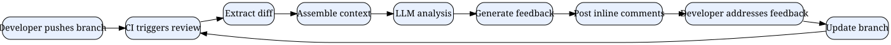

# AI Code Review in 2025: A Practical Guide to Automated Pull Request Feedback

*Reading time: 8 min · 1,675 words*

> A practical guide to AI-powered code review in 2025, covering how LLM-based tools analyze pull requests, where they excel, their limitations, and how to integrate them into your team's workflow without sacrificing human judgment.

## Table of Contents
- [Introduction](#introduction)
- [What Is AI Code Review?](#what-is-ai-code-review)
  - [How It Works](#how-it-works)
- [Types of AI Code Review Tools](#types-of-ai-code-review-tools)
- [Where AI Code Review Excels](#where-ai-code-review-excels)
  - [1. Catching Logic Errors Early](#1-catching-logic-errors-early)
  - [2. Enforcing Consistency](#2-enforcing-consistency)
  - [3. Speeding Up First Response](#3-speeding-up-first-response)
  - [4. Educating Junior Developers](#4-educating-junior-developers)
- [Where AI Code Review Falls Short](#where-ai-code-review-falls-short)
  - [1. Architectural Blind Spots](#1-architectural-blind-spots)
  - [2. False Positives](#2-false-positives)
  - [3. Security Overconfidence](#3-security-overconfidence)
- [How to Implement AI Code Review in Your Team](#how-to-implement-ai-code-review-in-your-team)
  - [Step 1: Choose Your Tool](#step-1-choose-your-tool)
  - [Step 2: Define Your Rules](#step-2-define-your-rules)
  - [Step 3: Set Up CI Integration](#step-3-set-up-ci-integration)
  - [Step 4: Integrate with Human Review](#step-4-integrate-with-human-review)
  - [Step 5: Measure and Iterate](#step-5-measure-and-iterate)
- [Real-World Example: Acme SaaS Team](#real-world-example-acme-saas-team)
- [Building Your Own AI Code Review Pipeline](#building-your-own-ai-code-review-pipeline)
- [Evaluating AI Code Review Quality](#evaluating-ai-code-review-quality)
- [Risks and Mitigations](#risks-and-mitigations)
- [Conclusion](#conclusion)
- [Key Takeaways](#key-takeaways)
- [Frequently Asked Questions](#frequently-asked-questions)

## Introduction

Code review is one of the most valuable practices in software engineering, yet it remains one of the most time-consuming. In 2025, AI-powered code review tools have moved from novelty to necessity. Tools like GitHub Copilot Code Review, CodeRabbit, Greptile, and open-source alternatives now analyze pull requests, flag bugs, suggest improvements, and even enforce style guides automatically.

This guide explores how AI code review works, where it excels, where it falls short, and how to integrate it into your team's workflow without sacrificing human judgment.


## What Is AI Code Review?

AI code review refers to the use of large language models (LLMs) and static analysis tools to automatically inspect code changes and provide feedback. Unlike traditional linters and static analyzers, which check for predefined rules, AI code review understands context, intent, and best practices.

### How It Works

Modern AI code review systems follow a pipeline:

1. **Diff extraction** — The system fetches the pull request diff from the version control system.
2. **Context assembly** — It gathers related files, repository history, issue trackers, and sometimes the entire codebase.
3. **Analysis** — An LLM processes the diff with prompts designed to find bugs, security issues, and style problems.
4. **Feedback generation** — The model produces inline comments, summaries, and suggestions.
5. **Action** — Some tools can auto-fix minor issues or block merges if critical problems are found.



// caption: The AI code review loop

## Types of AI Code Review Tools

| Type | Examples | Best For |
|------|----------|----------|
| Inline comment bots | CodeRabbit, Greptile, Bito | Detailed line-level feedback |
| IDE-integrated | GitHub Copilot, Cursor | Real-time suggestions while coding |
| CI-based | GitHub Actions + custom LLM | Automated gates before merge |
| Security-focused | Snyk, Semgrep + LLM | Vulnerability detection |
| Open-source | Aider, gpt-code-review | Self-hosted, customizable |

## Where AI Code Review Excels

### 1. Catching Logic Errors Early

LLMs are surprisingly good at spotting off-by-one errors, null pointer risks, and incorrect conditionals. A 2024 study by researchers at Microsoft found that AI code review tools caught around 30% of bugs that human reviewers missed, particularly in edge cases.

### 2. Enforcing Consistency

AI reviewers never get tired of checking naming conventions, import ordering, or documentation requirements. They can enforce a style guide across thousands of PRs without complaint.

### 3. Speeding Up First Response

Human reviewers often take hours or days to respond. AI tools respond in seconds, providing immediate feedback that keeps developers in flow state.

### 4. Educating Junior Developers

AI code review acts as a tireless mentor, explaining why a pattern is problematic and suggesting better alternatives.

## Where AI Code Review Falls Short

### 1. Architectural Blind Spots

AI models struggle with system-level concerns: coupling, cohesion, data flow across modules, and long-term maintainability. A model might suggest a micro-optimization that harms the overall design.

### 2. False Positives

AI reviewers can be overly aggressive. They might flag idiomatic code as "complex" or suggest refactors that introduce risk without benefit.

### 3. Security Overconfidence

While AI can identify common vulnerabilities like SQL injection or hardcoded secrets, it cannot guarantee security. It may miss context-specific threats or suggest fixes that are themselves insecure.

> **Important:** AI code review is a supplement, not a replacement. Never rely solely on AI for security-critical reviews. Always maintain human oversight for architectural decisions and security-sensitive changes.

## How to Implement AI Code Review in Your Team

### Step 1: Choose Your Tool

Consider your stack, budget, and privacy requirements. If you're on GitHub, start with GitHub Copilot Code Review or CodeRabbit. If you need self-hosting, consider open-source options like `gpt-code-review` or building your own pipeline.

### Step 2: Define Your Rules

Configure the AI to match your team's standards. Most tools allow custom instructions:

```
You are a senior reviewer for a Python web application.
Focus on: correctness, security, performance, readability.
Ignore: formatting (handled by black), type hints (handled by mypy).
Never suggest changes outside the scope of the diff.
```

### Step 3: Set Up CI Integration

Add the AI review step to your CI pipeline. Typically, this runs after tests pass but before human review.

```yaml
# GitHub Actions example
name: AI Code Review
on:
  pull_request:
    types: [opened, synchronize]
jobs:
  ai-review:
    runs-on: ubuntu-latest
    steps:
      - uses: actions/checkout@v4
      - name: Run AI review
        uses: your-org/ai-review-action@v1
        with:
          api_key: ${{ secrets.AI_API_KEY }}
          model: gpt-4o
          severity_threshold: warning
```

### Step 4: Integrate with Human Review

Create a workflow where AI handles the mechanical checks and humans focus on design:

1. AI comments on the PR within seconds.
2. Developer addresses clear issues immediately.
3. Human reviewer focuses on architecture, trade-offs, and non-obvious decisions.
4. AI summarizes the final state for the reviewer.

### Step 5: Measure and Iterate

Track metrics like:

- Time to first review
- Number of AI comments accepted vs rejected
- Bug escape rate
- Developer satisfaction

## Real-World Example: Acme SaaS Team

Acme, a mid-sized SaaS company, had a team of 12 engineers reviewing ~40 PRs per week. Reviews took an average of 22 hours to complete, creating bottlenecks.

They implemented CodeRabbit with custom rules tuned to their Django/Python stack. After three months:

| Metric | Before | After |
|--------|--------|-------|
| Median time to first review | 22 hours | 4 minutes |
| PRs merged per week | 40 | 58 |
| Bugs found in production | 14/month | 9/month |
| Developer satisfaction (1-5) | 3.1 | 4.2 |

The key insight: they didn't remove human review. Instead, they used AI to pre-filter trivial issues, freeing humans to focus on meaningful design discussions.

## Building Your Own AI Code Review Pipeline

If you want full control, you can build a simple pipeline:

```python
import os
from openai import OpenAI

client = OpenAI(api_key=os.environ["OPENAI_API_KEY"])

def review_diff(diff_text: str) -> str:
    prompt = f"""
    You are an expert code reviewer. Analyze this diff and provide:
    1. A list of bugs or potential issues (with line numbers)
    2. Security concerns
    3. Style or maintainability suggestions
    4. A brief overall summary
    
    Diff:
    {diff_text}
    """
    response = client.chat.completions.create(
        model="gpt-4o",
        messages=[{"role": "user", "content": prompt}],
        temperature=0.2,
    )
    return response.choices[0].message.content
```

This is a starting point. Production pipelines need chunking, deduplication, and integration with GitHub's API to post comments.

## Evaluating AI Code Review Quality

Before trusting any AI review tool, evaluate it against your own codebase:

1. **Run a retrospective test** — Feed it 50 past PRs and compare its findings with what human reviewers found.
2. **Measure precision and recall** — Track how many AI comments are valid vs noise.
3. **Check for harmful suggestions** — Ensure the AI doesn't suggest changes that break tests or introduce security issues.
4. **Monitor over time** — LLMs and tools change; re-evaluate quarterly.

## Risks and Mitigations

| Risk | Mitigation |
|------|-----------|
| Data leakage (code sent to third-party APIs) | Use self-hosted models or enterprise agreements |
| Over-reliance on AI | Require human sign-off on all merges |
| Prompt injection via code comments | Sanitize inputs; use robust system prompts |
| Bias toward popular patterns | Provide explicit context about your architecture |
| Cost | Cap tokens per PR; use smaller models for routine checks |

## Conclusion

AI code review is transforming how teams ship software. When implemented thoughtfully, it reduces review latency, catches real bugs, and lets humans focus on what they do best: making design decisions. But it's not magic. The best teams treat AI as a junior reviewer — helpful, fast, and occasionally wrong — and always keep a human in the loop.

The future will likely bring deeper integration: AI that understands your entire codebase, suggests architectural improvements, and even negotiates with other AI agents. For now, the practical win is clear: adopt AI code review, measure its impact, and iterate.

## Key Takeaways

- AI code review tools can reduce time-to-first-review from hours to minutes.
- They excel at catching logic errors, enforcing consistency, and educating developers.
- They struggle with architectural judgment, security nuance, and can produce false positives.
- Always combine AI review with human oversight, especially for security-critical changes.
- Evaluate any tool against your own codebase before full deployment.
- Start with a pilot on low-risk repositories, then expand based on measured results.

## Frequently Asked Questions

**Q: Will AI code review replace human code review?**
A: Not in the foreseeable future. AI excels at mechanical checks and common bug patterns, but humans are still needed for architectural decisions, product context, and nuanced trade-offs. Think of AI as an additional reviewer, not a replacement.

**Q: Are AI code review tools safe for proprietary codebases?**
A: It depends on the tool and your agreement. Some tools process code on third-party servers; others can be self-hosted. Always review the vendor's data handling policies and consider self-hosted models for sensitive code.

**Q: How much does AI code review cost?**
A: Pricing varies widely. Open-source tools are free but require setup. Commercial tools typically charge per user or per seat, ranging from $10 to $50 per developer per month, plus API costs if you build your own pipeline.

**Q: Can I use AI code review with any version control system?**
A: Most commercial tools support GitHub, GitLab, and Bitbucket. For self-hosted setups, you can build integrations with any system that exposes a webhook API.

**Q: How do I prevent AI from making harmful suggestions?**
A: Use strict system prompts, set a severity threshold, and always require human approval before applying AI-suggested changes. Also, run your test suite after any AI-generated modifications.

## Frequently Asked Questions

**Q: Will AI code review replace human code review?**

A: Not in the foreseeable future. AI excels at mechanical checks and common bug patterns, but humans are still needed for architectural decisions, product context, and nuanced trade-offs. Think of AI as an additional reviewer, not a replacement.

**Q: Are AI code review tools safe for proprietary codebases?**

A: It depends on the tool and your agreement. Some tools process code on third-party servers; others can be self-hosted. Always review the vendor's data handling policies and consider self-hosted models for sensitive code.

**Q: How much does AI code review cost?**

A: Pricing varies widely. Open-source tools are free but require setup. Commercial tools typically charge per user or per seat, ranging from $10 to $50 per developer per month, plus API costs if you build your own pipeline.

**Q: Can I use AI code review with any version control system?**

A: Most commercial tools support GitHub, GitLab, and Bitbucket. For self-hosted setups, you can build integrations with any system that exposes a webhook API.

**Q: How do I prevent AI from making harmful suggestions?**

A: Use strict system prompts, set a severity threshold, and always require human approval before applying AI-suggested changes. Also, run your test suite after any AI-generated modifications.

## Key Takeaways

- AI code review tools can reduce time-to-first-review from hours to minutes.
- They excel at catching logic errors, enforcing consistency, and educating developers.
- They struggle with architectural judgment, security nuance, and can produce false positives.
- Always combine AI review with human oversight, especially for security-critical changes.
- Evaluate any tool against your own codebase before full deployment.
- Start with a pilot on low-risk repositories, then expand based on measured results.

## Related Articles

- LLM Evals: Testing AI Applications in Production
- Building Reliable AI Agents in Production
- Model Context Protocol (MCP): Building AI Tool Servers
- Platform Engineering: Building Internal Developer Platforms

<!-- Cover image prompts (for editors):
  - A developer reviewing code on a large monitor with AI-generated inline comments highlighted in the pull request interface, modern office lighting, photorealistic style
  - A flowchart-style illustration showing the AI code review pipeline from pull request creation to automated feedback and human review, clean flat design with blue accents
  - A team of engineers collaborating around a screen displaying an AI code review summary dashboard with metrics like time-to-first-review and bug escape rate, warm office environment
  - A split-screen comparison showing a human reviewer's notes alongside AI-generated review comments on the same code diff, emphasizing collaboration between human and machine
-->