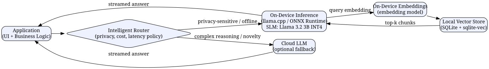

# On-Device AI in 2026: A Developer's Guide to Deploying Small Language Models

*Reading time: 11 min · 2,071 words*

> On-device AI is reshaping how developers build AI features in 2026. This guide covers small language models (SLMs), quantization, runtimes like llama.cpp and ONNX Runtime, hybrid on-device/cloud architecture, and a real-world privacy-first RAG example.

## Table of Contents
- [Why On-Device AI Is Having Its Moment](#why-on-device-ai-is-having-its-moment)
- [What Counts as a Small Language Model?](#what-counts-as-a-small-language-model)
- [The On-Device Inference Stack](#the-on-device-inference-stack)
  - [Model Formats](#model-formats)
  - [Runtimes and Tools](#runtimes-and-tools)
  - [Hardware Targets](#hardware-targets)
- [Key Techniques for Fitting Models on a Device](#key-techniques-for-fitting-models-on-a-device)
  - [Quantization](#quantization)
  - [Pruning and Distillation](#pruning-and-distillation)
  - [KV Cache Optimization](#kv-cache-optimization)
  - [Speculative Decoding](#speculative-decoding)
- [Designing a Hybrid Architecture: On-Device + Cloud](#designing-a-hybrid-architecture-on-device--cloud)
- [Real-World Example: A Privacy-First Local RAG Assistant](#real-world-example-a-privacy-first-local-rag-assistant)
- [Testing and Evaluating On-Device Models](#testing-and-evaluating-on-device-models)
- [Challenges and Pitfalls](#challenges-and-pitfalls)
- [The Road Ahead](#the-road-ahead)
- [Conclusion](#conclusion)
- [Key Takeaways](#key-takeaways)
- [Frequently Asked Questions](#frequently-asked-questions)

## Why On-Device AI Is Having Its Moment

For most of the last decade, "AI" meant sending your data to a distant data center and waiting for tokens to stream back. In 2026, that assumption is cracking. A wave of capable small language models (SLMs) — models under roughly 10 billion parameters — can now run directly on phones, laptops, tablets, and embedded devices. This shift is not a gimmick; it is reshaping how developers architect AI features.

Three forces are driving the move to on-device inference:

1. **Privacy and regulation.** Regulations like the EU AI Act and stricter data-protection laws make it expensive and risky to ship personal data to third-party APIs. Processing sensitive data locally sidesteps many compliance headaches entirely.
2. **Latency and reliability.** Round trips to the cloud add hundreds of milliseconds and fail whenever connectivity drops. On-device inference is instant and works on a plane, in a tunnel, or in a factory basement.
3. **Cost.** Token bills grow with usage. Running inference on hardware you already own turns a variable cost into a fixed one — often dramatically cheaper at scale.

Meanwhile, hardware has caught up. Modern smartphones ship with neural processing units (NPUs) capable of tens of trillions of operations per second (TOPS), and a growing class of "AI PCs" includes dedicated NPUs from Intel, AMD, and Qualcomm. The combination of better small models and ubiquitous accelerators has made local AI practical for mainstream products.

> Note: "On-device" does not mean "offline forever." Most production systems use a hybrid approach where a local model handles the common case and falls back to a larger cloud model when needed. We'll dig into that architecture below.

## What Counts as a Small Language Model?

There is no official size cutoff, but in 2026 the SLM category generally spans models from about 0.5B to 8B parameters. Popular examples include Llama 3.2 (1B and 3B), Phi-4 (14B, though smaller variants exist), Gemma 3, Qwen2.5 (0.5B–7B), SmolLM2, and IBM Granite. These models are often distilled or trained specifically to be compact while retaining strong reasoning for narrow tasks.

What can a 3B model actually do? Plenty — if you scope it well. It can summarize documents, classify intents, extract structured fields from forms, answer questions over a local knowledge base, and power assistant-style interactions with modest complexity. What it cannot reliably do is match a frontier model on open-ended creative writing, complex multi-step reasoning, or deep world knowledge. Knowing when to use a small model — and when to escalate — is the core skill.

## The On-Device Inference Stack

Deploying an SLM is not like deploying a web service. You need to choose a model format, a runtime, and a hardware target. Here is the landscape in 2026.

### Model Formats

- **GGUF** — the de facto open format for CPU/GPU inference via llama.cpp. Supports aggressive quantization and runs nearly anywhere.
- **ONNX Runtime** — Microsoft's cross-platform runtime; excellent when you need to share pipelines across devices and also target NPUs.
- **ExecuTorch** — PyTorch's edge runtime, popular for mobile and embedded deployments that stay inside the PyTorch ecosystem.
- **TFLite / MediaPipe LLM Inference** — Google's stack for Android and web.
- **Core ML** — Apple's format for iOS/macOS, often converted from PyTorch or ONNX.

### Runtimes and Tools

- **llama.cpp** — the workhorse. Pure C/C++, minimal dependencies, supports GGUF, and has bindings for Python, Node, Rust, and more.
- **ONNX Runtime GenAI** — adds generative-AI helpers on top of ONNX Runtime.
- **Ollama** — great for local development and prototyping; wraps llama.cpp with a friendly CLI and API.
- **ExecuTorch** — for production mobile/embedded PyTorch workloads.

### Hardware Targets

- **CPU** — AVX-512 on x86, NEON on ARM. Fine for <1B models; slower for larger ones.
- **GPU** — Apple Silicon unified memory, NVIDIA Jetson for robotics/edge, and integrated GPUs on laptops.
- **NPU** — Qualcomm Hexagon, Apple Neural Engine, Intel NPU, AMD XDNA. The fastest path for sustained low-power inference, but still uneven tooling support across vendors.

## Key Techniques for Fitting Models on a Device

A 3B model in FP16 needs about 6 GB of memory. That is too much for a phone's shared memory budget. Getting models onto devices relies on four main techniques.

### Quantization

Quantization reduces the precision of weights from 16-bit or 32-bit floats to 8-bit or 4-bit integers. An INT4 model uses roughly 4 bits per weight, cutting memory by ~4x versus FP16 and often speeding up inference on NPUs.

Common approaches include:

- **Post-training quantization (PTQ)** — convert a trained model directly; fast but can degrade quality.
- **GPTQ** — calibrates quantization on a small dataset to preserve accuracy.
- **AWQ** — protects the most important weight channels during quantization.
- **GGUF k-quants** — llama.cpp's family of mixed-precision quantizations (Q4_K_M, Q5_K_M, etc.) that balance size and quality.

### Pruning and Distillation

- **Knowledge distillation** trains a small "student" model to mimic a large "teacher." Many SLMs are born this way.
- **Structured pruning** removes entire neurons or attention heads, shrinking the model after training.

### KV Cache Optimization

During generation, the model caches key/value tensors for every token. Long contexts blow up memory. Sliding-window attention and paged attention keep the cache bounded, letting you serve longer conversations within a fixed memory budget.

### Speculative Decoding

A tiny "draft" model proposes several tokens, and the main model validates them in parallel. This can speed up generation substantially on multi-core CPUs and GPUs without changing output quality.

## Designing a Hybrid Architecture: On-Device + Cloud

Most production systems are not purely local or purely cloud — they are both. A router decides where each request goes based on policy:

| Trigger | Route |
| --- | --- |
| Sensitive personal data (health, finance) | On-device |
| Offline / poor connectivity | On-device |
| Simple extraction, classification, summarization | On-device |
| Complex reasoning, novel topics, creative writing | Cloud |
| High-confidence local answer required | On-device |

This hybrid pattern gives you the privacy and latency benefits of local inference without sacrificing the ceiling of a frontier model.

Here is the flow:



The router itself can be a small heuristic (check a privacy flag, check connectivity, estimate difficulty) or a lightweight classifier. You do not need another LLM to make the routing decision — keep it deterministic and testable.

## Real-World Example: A Privacy-First Local RAG Assistant

Imagine a clinic intake assistant running on a tablet used by nurses. It must capture patient symptoms, map them to standard codes, and suggest likely departments — all while keeping patient data on the device. Sending this data to a public API would violate policy.

**Architecture:**

- **Model:** Llama 3.2 3B Instruct, quantized to Q4_K_M (~2 GB).
- **Runtime:** llama.cpp via the `llama-cpp-python` bindings.
- **Embeddings:** a small on-device embedding model stored in the same GGUF/ONNX runtime.
- **Vector store:** SQLite with the `sqlite-vec` extension for local similarity search.
- **Fallback:** a cloud LLM is available only for non-clinical questions (e.g., explaining a billing form) and never receives patient identifiers.

Here is a simplified sketch:

```python
from llama_cpp import Llama

# Load the quantized 3B model (~2 GB in INT4)
llm = Llama(
    model_path="./models/llama-3.2-3b-instruct-q4_k_m.gguf",
    n_ctx=4096,
    n_threads=8,
)

def answer_local(question: str, context_chunks: list[str]) -> str:
    context = "\n".join(f"- {c}" for c in context_chunks)
    prompt = f"""You are a clinical intake assistant.
Use only the context below. Do not guess.

Context:
{context}

Question: {question}
Answer:"""
    out = llm(prompt, max_tokens=256, temperature=0.2)
    return out["choices"][0]["text"].strip()
```

In practice you would wrap this in a service with timeouts, token budgeting, and a fallback route. Measured on a mid-range 2026 tablet, this setup typically streams 20–40 tokens per second and stays under 500 MB of resident memory — comfortable for a kiosk-style app.

## Testing and Evaluating On-Device Models

Evaluating an on-device model is double duty: you must check output quality and device performance.

- **Quality evals:** reuse the same golden sets you use for cloud models — classification accuracy, extraction F1, answer faithfulness. Run them against the quantized model, not just the FP16 original, because quantization changes behavior.
- **Latency:** measure tokens per second on your real target hardware, not your dev machine.
- **Memory:** track peak RSS and steady-state memory; watch for leaks across long sessions.
- **Battery:** on battery-powered devices, measure energy per request. NPU paths often win here.
- **Regression across devices:** a model may be fast on Apple Silicon but slow on a given Android NPU. Build a device matrix in CI.

## Challenges and Pitfalls

- **Hardware fragmentation.** NPU toolchains vary wildly. Abstract with ONNX Runtime or ExecuTorch where possible, and keep a CPU fallback.
- **Model updates.** Shipping a new model version means an OTA download. Budget for it and consider delta updates.
- **Security.** On-device weights can be extracted. If your model encodes proprietary knowledge, treat it as a sensitive artifact and obfuscate or protect it.
- **Hallucination.** Small models hallucinate, and without a cloud guardrail you must add your own validation, constrained decoding, or retrieval grounding.
- **Cold start.** Loading a 2 GB model takes seconds on cold boot. Preload at startup or warm up lazily.

## The Road Ahead

Expect three trends to define the rest of 2026: first, continued progress in distillation and quantization pushing useful capability down to 1B parameters and below; second, better NPU standardization, with ONNX Runtime and ExecuTorch converging on common acceleration interfaces; and third, agentic on-device workflows, where a local model orchestrates local tools and sensors without phoning home.

Developers who learn the on-device stack now will be well positioned as hybrid AI becomes the default architecture for consumer and enterprise products alike.

## Conclusion

On-device AI is no longer a niche experiment. With capable SLMs, mature runtimes like llama.cpp and ONNX Runtime, and ubiquitous NPUs, local inference is a practical choice for privacy-sensitive, low-latency, and cost-conscious features. Start small: pick a narrow task, quantize a proven SLM, benchmark it on real hardware, and wrap it in a hybrid router. The skills you build — quantization, runtime integration, evaluation, and hybrid design — will pay off for years.

## Key Takeaways

- SLMs under ~8B parameters can handle many real tasks; pick narrow, well-scoped use cases.
- Quantization (INT4/INT8) is the single biggest lever for fitting models into device memory.
- Choose runtimes by ecosystem: llama.cpp/GGUF for portability, ONNX Runtime for cross-vendor NPU support, ExecuTorch for PyTorch-centric teams.
- Design hybrid routing: local for privacy/simple tasks, cloud for complex reasoning, with a deterministic router.
- Evaluate the quantized artifact on real target hardware — quality and latency both change after quantization.
- Plan for model updates, cold start, and on-device hallucination guardrails.

## Frequently Asked Questions

Q: What is the smallest model size that is actually useful?
A: In 2026, models around 1B–3B parameters are the sweet spot for narrow tasks like classification, extraction, and grounded Q&A. Below ~0.5B, quality drops quickly, though distilled sub-1B models are improving.

Q: Does on-device inference drain battery?
A: It depends on hardware. NPU-accelerated inference is far more efficient than CPU-only, but any sustained generation consumes power. Measure energy per request on your target device and prefer NPU paths for interactive workloads.

Q: Can I run a small model on a standard laptop without a GPU?
A: Yes. A 1B–3B INT4 model runs acceptably on modern CPUs (often 10–40 tokens/sec). For larger models or faster speeds, use a discrete GPU or NPU.

Q: How do I choose between GGUF and ONNX Runtime?
A: Use GGUF/llama.cpp for maximum portability and quick prototyping. Use ONNX Runtime when you need consistent NPU acceleration across multiple vendors or must integrate with an existing ONNX pipeline.

Q: Is on-device AI secure?
A: It improves privacy because raw data stays local, but model weights can be extracted. Treat the model as a sensitive asset, and add your own guardrails since you lose cloud-side content filtering.

## Frequently Asked Questions

**Q: What is the smallest model size that is actually useful?**

A: In 2026, models around 1B–3B parameters are the sweet spot for narrow tasks like classification, extraction, and grounded Q&A. Below ~0.5B, quality drops quickly, though distilled sub-1B models are improving.

**Q: Does on-device inference drain battery?**

A: It depends on hardware. NPU-accelerated inference is far more efficient than CPU-only, but any sustained generation consumes power. Measure energy per request on your target device and prefer NPU paths for interactive workloads.

**Q: Can I run a small model on a standard laptop without a GPU?**

A: Yes. A 1B–3B INT4 model runs acceptably on modern CPUs (often 10–40 tokens/sec). For larger models or faster speeds, use a discrete GPU or NPU.

**Q: How do I choose between GGUF and ONNX Runtime?**

A: Use GGUF/llama.cpp for maximum portability and quick prototyping. Use ONNX Runtime when you need consistent NPU acceleration across multiple vendors or must integrate with an existing ONNX pipeline.

**Q: Is on-device AI secure?**

A: It improves privacy because raw data stays local, but model weights can be extracted. Treat the model as a sensitive asset, and add your own guardrails since you lose cloud-side content filtering.

## Key Takeaways

- SLMs under ~8B parameters can handle many real tasks; pick narrow, well-scoped use cases.
- Quantization (INT4/INT8) is the single biggest lever for fitting models into device memory.
- Choose runtimes by ecosystem: llama.cpp/GGUF for portability, ONNX Runtime for cross-vendor NPU support, ExecuTorch for PyTorch-centric teams.
- Design hybrid routing: local for privacy/simple tasks, cloud for complex reasoning, with a deterministic router.
- Evaluate the quantized artifact on real target hardware — quality and latency both change after quantization.
- Plan for model updates, cold start, and on-device hallucination guardrails.

## Related Articles

- Local-First Software Development
- WebAssembly Beyond the Browser
- Building Reliable AI Agents in Production
- A Practical Guide to LLM Evals

<!-- Cover image prompts (for editors):
  - A modern smartphone and laptop displaying a small language model running locally, with a subtle neural network visualization overlaying the devices, clean tech illustration, blue and purple palette, 16:9.
  - Diagram-style illustration of a hybrid AI architecture showing a device routing requests between a local chip (NPU) and a cloud server, with arrows indicating privacy and latency decisions, flat vector style, white background.
  - A close-up of a circuit board with a glowing NPU chip labeled 'SLM', surrounded by floating token streams, futuristic but clean, teal accents, 16:9.
-->