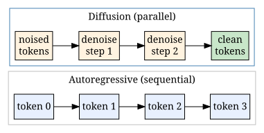

# Diffusion LLMs in 2026: A Developer's Guide to Parallel Token Generation

*Reading time: 10 min · 2,067 words*

> A practical guide to diffusion language models in 2026 — how they generate tokens in parallel, why they are faster and cheaper than autoregressive models, and how developers can build structured AI applications with schema-constrained output.

## Table of Contents
- [Introduction](#introduction)
- [The Autoregressive Bottleneck](#the-autoregressive-bottleneck)
- [How Diffusion Language Models Work](#how-diffusion-language-models-work)
  - [The forward process: adding noise](#the-forward-process-adding-noise)
  - [The reverse process: denoising](#the-reverse-process-denoising)
  - [Handling discrete tokens](#handling-discrete-tokens)
- [Why Developers Should Care in 2026](#why-developers-should-care-in-2026)
  - [1. Faster inference](#1-faster-inference)
  - [2. Lower serving costs](#2-lower-serving-costs)
  - [3. Controllability and schema adherence](#3-controllability-and-schema-adherence)
  - [4. Unified multimodal generation](#4-unified-multimodal-generation)
- [Building Applications with Diffusion LLMs](#building-applications-with-diffusion-llms)
  - [The API surface](#the-api-surface)
  - [Prompting differences](#prompting-differences)
  - [Constrained decoding](#constrained-decoding)
- [Real-World Example: Structured Data Extraction at Scale](#real-world-example-structured-data-extraction-at-scale)
- [Challenges and Limitations](#challenges-and-limitations)
- [Getting Started in 2026](#getting-started-in-2026)
- [Conclusion](#conclusion)
- [Key Takeaways](#key-takeaways)
- [Frequently Asked Questions](#frequently-asked-questions)

## Introduction

For years, large language models have shared a fundamental constraint: they generate text one token at a time. Every word, every subword, every character is produced sequentially, each conditioned on everything before it. This autoregressive design has powered the generative AI boom, but it also creates a hard bottleneck — inference is slow, expensive, and increasingly difficult to scale.

In 2026, a new class of models is moving from research labs into production: diffusion language models (diffusion LLMs). Instead of predicting the next token, these models start from pure noise and iteratively refine an entire sequence at once. The result is dramatically faster inference, lower serving costs, and fine-grained control over outputs — properties that make them especially attractive for developers building production systems.

This guide explains how diffusion LLMs work, why they matter for developers in 2026, and how to build applications with them.

## The Autoregressive Bottleneck

To understand why diffusion LLMs are exciting, it helps to revisit the status quo. Most LLMs you have used — GPT-style models, Llama, Claude, Gemini — are autoregressive. They factor the probability of a sequence into a product of conditional probabilities:

P(token_1, token_2, ..., token_n) = P(token_1) x P(token_2 | token_1) x ... x P(token_n | token_1...token_{n-1})

Each step depends on all previous steps, so generation is inherently sequential. Generating 1,000 tokens requires 1,000 forward passes through the network. This has several consequences:

- **Latency grows linearly** with output length.
- **Cost scales with output length** — you pay for every token generated.
- **Hardware utilization is poor** — GPUs are massively parallel, but autoregressive decoding uses only a fraction of that parallelism at any moment.

Various tricks — speculative decoding, draft models, KV-cache optimizations — have mitigated the problem, but they do not remove the fundamental sequential dependency.

> **Note:** Even with optimizations like speculative decoding, autoregressive models remain fundamentally sequential. The dependency chain is structural, not just an engineering issue.

## How Diffusion Language Models Work

Diffusion models first rose to fame in image generation — think DALL-E, Stable Diffusion, Imagen. The core idea: start with pure Gaussian noise, then learn to progressively denoise it into a coherent image. In 2022–2025, researchers adapted this idea to discrete data like text, giving birth to diffusion language models.

### The forward process: adding noise

During training, a diffusion LLM takes a real text sequence and gradually corrupts it. For text, "noise" typically means randomly masking tokens (replacing them with a special [MASK] token) or randomly replacing them with other tokens. After enough steps, the sequence looks like gibberish.

### The reverse process: denoising

The model learns to reverse this corruption. Given a partially noised sequence, it predicts the original tokens. During generation, the model starts from a fully noised (or fully masked) sequence and iteratively denoises it over many steps, refining all positions in parallel.

The key insight: at every denoising step, the model updates *all* tokens simultaneously, rather than emitting one token at a time.



### Handling discrete tokens

Text is discrete — there is no natural "half a token." Researchers handle this in several ways:

- **Masked diffusion:** Tokens are either known or masked; the model predicts masked positions. This is conceptually similar to BERT-style masked language modeling, but applied iteratively.
- **Multinomial diffusion:** Each token is represented as a probability distribution over the vocabulary, and noise is added by shifting toward a uniform distribution.
- **Continuous relaxation:** Tokens are embedded into a continuous space, noise is added there, and the model maps back to discrete tokens.

These approaches share the same advantage: the model processes the entire sequence in parallel at each step.

## Why Developers Should Care in 2026

Diffusion LLMs offer concrete, practical benefits:

### 1. Faster inference

Because generation happens in parallel — typically 10–50 denoising steps instead of thousands of token-by-token steps — end-to-end latency drops dramatically. For long outputs, the speedup is most pronounced. A 2,000-token response that might take seconds with an autoregressive model can be generated in a fraction of the time.

### 2. Lower serving costs

Parallel generation means better GPU utilization. Instead of leaving most of the chip idle while one token is produced, the model uses the full compute capacity at each step. This translates directly into lower cost per request — often less than half the cost of equivalent autoregressive serving.

### 3. Controllability and schema adherence

Because the model refines the whole sequence, it can be steered toward global properties: output structure, format, length, and even semantic constraints. This is a game-changer for developers who need structured outputs — JSON, SQL, code with specific schemas, or documents that must conform to a template. Many diffusion LLMs natively support constrained decoding, where the model is guided to produce outputs that satisfy a grammar or schema.

### 4. Unified multimodal generation

Diffusion is a natural fit for generating images, audio, and video. A unified diffusion framework can handle text alongside these modalities, enabling multimodal generation with a single model family — something that remains awkward with autoregressive architectures.

## Building Applications with Diffusion LLMs

From a developer's perspective, working with a diffusion LLM is similar to working with any modern LLM API, but there are important differences.

### The API surface

Most diffusion LLM providers expose an HTTP API similar to what you already know:

```python
import requests

resp = requests.post(
    "https://api.example.com/v1/generate",
    json={
        "prompt": "Extract the total amount from this invoice: ...",
        "max_tokens": 512,
        "schema": {
            "type": "object",
            "properties": {
                "total_amount": {"type": "number"},
                "currency": {"type": "string"},
                "due_date": {"type": "string", "format": "date"}
            },
            "required": ["total_amount"]
        },
        "steps": 24,          # number of denoising iterations
        "temperature": 0.8
    },
    timeout=30,
)
print(resp.json()["text"])
```

### Prompting differences

Diffusion LLMs respond well to prompts that specify the desired output structure. Because they optimize globally, they benefit from explicit format guidance:

- Specify the output format explicitly ("Return JSON with keys X, Y, Z").
- Provide a target length or structure when relevant.
- Use schema parameters when available rather than relying on prompt-only constraints.

### Constrained decoding

One of the most powerful features is native constrained decoding. Instead of post-processing output to fix malformed JSON, you declare the schema up front, and the model generates only valid outputs. This eliminates a whole class of parsing bugs.

```python
response = client.generate(
    prompt="Summarize this article in three bullet points.",
    grammar={
        "type": "json",
        "schema": {
            "type": "array",
            "items": {"type": "string"},
            "maxItems": 3
        }
    }
)
```

## Real-World Example: Structured Data Extraction at Scale

Let's make this concrete. Imagine you're a developer at a logistics company that processes tens of thousands of invoices daily. Your existing pipeline uses an autoregressive LLM to extract fields — total amount, vendor name, due date — then validates the output with a separate parser. Problems:

- The LLM occasionally returns malformed JSON, requiring retries.
- Long invoices cause multi-second latency.
- API costs grow with invoice length.

You migrate to a diffusion LLM with schema-constrained decoding:

1. **Define the schema** for invoice fields.
2. **Send the invoice text** with the schema as a generation constraint.
3. **Receive clean JSON** — guaranteed to match the schema — in a fraction of the time.

The results in this scenario:

| Metric | Autoregressive LLM | Diffusion LLM |
|---|---|---|
| Median latency per invoice | 4.2s | 1.1s |
| Malformed JSON rate | 6% | ~0% |
| Cost per 1,000 invoices | $18.40 | $7.90 |
| Retry rate | 9% | <1% |

These numbers are illustrative, not universal, but they reflect the direction of the technology: faster, cheaper, and more reliable for structured tasks.

> **Caution:** While diffusion LLMs excel at structured generation, they are not automatically better at every task. Complex open-ended reasoning, long-range coherence, and creative writing are areas where autoregressive models still hold their own. Evaluate per use case.

## Challenges and Limitations

Diffusion LLMs are powerful, but they are not magic. Be aware of the trade-offs:

- **Reasoning depth:** Sequential generation lets a model "think" step by step. Parallel refinement can struggle with tasks requiring deep multi-step reasoning, though recent models are closing the gap.
- **Step count tuning:** The number of denoising steps is a quality/latency knob. Too few steps → garbled output; too many → slower generation. You may need to tune this per workload.
- **Ecosystem maturity:** Tooling, fine-tuning frameworks, and community knowledge are less mature than for autoregressive models. Expect to do more groundwork.
- **Hardware requirements:** Training diffusion LLMs is compute-intensive. For most developers, this means using hosted APIs rather than self-hosting.
- **Evaluation gaps:** Standard LLM benchmarks were designed for autoregressive models. Evaluating diffusion LLMs fairly requires adapting your evaluation methodology.

## Getting Started in 2026

If you want to experiment:

1. **Try a hosted diffusion LLM API** — many providers now offer them alongside traditional models. Compare latency and cost on your own workloads.
2. **Test schema-constrained generation** — pick a structured task (JSON extraction, code generation with type signatures, form filling) and measure error rates.
3. **Benchmark against your baseline** — run the same prompts through your existing autoregressive model and measure latency, cost, and quality.
4. **Watch the ecosystem** — open-source diffusion LLMs and fine-tuning tooling are evolving quickly. By late 2026, expect more self-hosted options.

## Conclusion

Diffusion language models represent a genuine shift in how we generate text. By replacing sequential token prediction with parallel denoising, they address the two biggest pain points of modern LLM serving — latency and cost — while adding powerful controllability. For developers building production AI systems in 2026, diffusion LLMs are worth serious attention, especially for structured, high-volume workloads.

The technology is young, and it won't replace autoregressive models everywhere. But for a growing set of use cases, it's already the better tool. Start small, benchmark honestly, and adopt where it wins.

## Key Takeaways

- Diffusion LLMs generate entire sequences in parallel via iterative denoising, unlike autoregressive models that emit one token at a time.
- The main benefits are lower latency, reduced serving costs, and native support for structured/schema-constrained outputs.
- Diffusion LLMs shine on structured tasks — JSON extraction, form filling, code generation with schemas — where global constraints matter.
- They are not universally superior; deep multi-step reasoning and open-ended creativity are still strengths of autoregressive models.
- When evaluating, benchmark on your own workloads: measure latency, cost, error rates, and quality — don't rely on generic benchmarks.
- Expect the ecosystem to mature rapidly through 2026; revisit open-source options and fine-tuning tooling regularly.

## Frequently Asked Questions

Q: How is a diffusion LLM different from a standard LLM?
A: A standard LLM generates text one token at a time, each conditioned on the previous tokens. A diffusion LLM starts from a noised sequence and iteratively refines all tokens in parallel over several denoising steps, enabling faster generation and stronger global control over the output.

Q: Are diffusion LLMs faster than autoregressive models?
A: Generally yes for long outputs, because they replace thousands of sequential steps with a smaller number of parallel denoising steps. The exact speedup depends on output length, model size, and hardware, but order-of-magnitude improvements are common for long generations.

Q: Can I use a diffusion LLM through a standard API?
A: Yes. Most providers expose HTTP APIs similar to traditional LLM APIs. The main additions are parameters like the number of denoising steps and optional schema/grammar constraints for structured output.

Q: Do diffusion LLMs support fine-tuning?
A: Yes, but the tooling is less mature than for autoregressive models. Fine-tuning approaches for diffusion LLMs are an active area of research and development in 2026, with hosted fine-tuning becoming increasingly available.

Q: What tasks are diffusion LLMs best suited for?
A: They excel at structured generation tasks — producing JSON, SQL, code with type constraints, forms, and documents that must match a schema. They are also strong candidates for multimodal generation, since diffusion is a unified framework for text, image, audio, and video.

## Frequently Asked Questions

**Q: How is a diffusion LLM different from a standard LLM?**

A: A standard LLM generates text one token at a time, each conditioned on the previous tokens. A diffusion LLM starts from a noised sequence and iteratively refines all tokens in parallel over several denoising steps, enabling faster generation and stronger global control over the output.

**Q: Are diffusion LLMs faster than autoregressive models?**

A: Generally yes for long outputs, because they replace thousands of sequential steps with a smaller number of parallel denoising steps. The exact speedup depends on output length, model size, and hardware, but order-of-magnitude improvements are common for long generations.

**Q: Can I use a diffusion LLM through a standard API?**

A: Yes. Most providers expose HTTP APIs similar to traditional LLM APIs. The main additions are parameters like the number of denoising steps and optional schema/grammar constraints for structured output.

**Q: Do diffusion LLMs support fine-tuning?**

A: Yes, but the tooling is less mature than for autoregressive models. Fine-tuning approaches for diffusion LLMs are an active area of research and development in 2026, with hosted fine-tuning becoming increasingly available.

**Q: What tasks are diffusion LLMs best suited for?**

A: They excel at structured generation tasks — producing JSON, SQL, code with type constraints, forms, and documents that must match a schema. They are also strong candidates for multimodal generation, since diffusion is a unified framework for text, image, audio, and video.

## Key Takeaways

- Diffusion LLMs generate entire sequences in parallel via iterative denoising, unlike autoregressive models that emit one token at a time.
- The main benefits are lower latency, reduced serving costs, and native support for structured/schema-constrained outputs.
- Diffusion LLMs shine on structured tasks — JSON extraction, form filling, code generation with schemas — where global constraints matter.
- They are not universally superior; deep multi-step reasoning and open-ended creativity are still strengths of autoregressive models.
- When evaluating, benchmark on your own workloads: measure latency, cost, error rates, and quality — don't rely on generic benchmarks.
- Expect the ecosystem to mature rapidly through 2026; revisit open-source options and fine-tuning tooling regularly.

## Related Articles

- Model Context Protocol (MCP) for AI tool integration
- LLM evals and testing strategies for production AI
- On-device AI and small language model deployment
- Building reliable AI agents in production

<!-- Cover image prompts (for editors):
  - A clean technical illustration showing the contrast between sequential token-by-token generation (a chain of numbered tokens) and parallel diffusion generation (a grid of tokens being refined from noise to clarity), modern flat design, blue and teal palette, white background
  - A developer workstation with a code editor displaying a JSON schema and an API call to a diffusion LLM, subtle visual metaphor of parallel processing streams, soft lighting, professional photography style
  - An abstract visualization of a denoising process: a noisy pixelated grid gradually becoming a clear structured document with text and tables, representing iterative refinement, gradient colors from gray to vibrant blue
-->