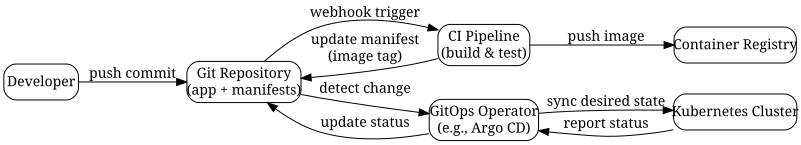

# GitOps in 2025: A Practical Guide to Declarative Infrastructure and Continuous Delivery

*Reading time: 12 min · 2,377 words*

> GitOps is a modern operating model that treats Git as the single source of truth for both application code and infrastructure configuration. This guide explains its core principles, tooling, adoption strategies, and a real-world example, plus common pitfalls and best practices.

## Table of Contents
- [What Is GitOps?](#what-is-gitops)
- [Core Principles of GitOps](#core-principles-of-gitops)
- [GitOps vs. Traditional CI/CD](#gitops-vs-traditional-cicd)
- [The GitOps Workflow](#the-gitops-workflow)
- [Tooling: Argo CD and Flux](#tooling-argo-cd-and-flux)
  - [Argo CD](#argo-cd)
  - [Flux](#flux)
  - [Which One Should You Choose?](#which-one-should-you-choose)
- [Implementing GitOps: A Step-by-Step Guide](#implementing-gitops-a-step-by-step-guide)
  - [Step 1: Set Up the Git Repository](#step-1-set-up-the-git-repository)
  - [Step 2: Install Argo CD](#step-2-install-argo-cd)
  - [Step 3: Connect Your Git Repository](#step-3-connect-your-git-repository)
  - [Step 4: Create an Application](#step-4-create-an-application)
  - [Step 5: Define Your CI Pipeline](#step-5-define-your-ci-pipeline)
  - [Step 6: Monitor and Operate](#step-6-monitor-and-operate)
- [Real-World Example: Scaling Multi-Cluster Deployments](#real-world-example-scaling-multi-cluster-deployments)
- [Challenges and Best Practices](#challenges-and-best-practices)
  - [Secret Management](#secret-management)
  - [Handling Drift](#handling-drift)
  - [Large Repositories](#large-repositories)
  - [Multi-Tenancy](#multi-tenancy)
  - [Testing and Validation](#testing-and-validation)
- [Conclusion](#conclusion)
- [Key Takeaways](#key-takeaways)
- [Frequently Asked Questions](#frequently-asked-questions)

GitOps has moved from a buzzword to a mainstream operational model for teams running cloud-native applications. At its core, GitOps is about using Git as the single source of truth for both application code and the desired state of your infrastructure. In this guide, we'll unpack what GitOps really means, why it matters in 2025, how to implement it with popular tools like Argo CD and Flux, and what pitfalls to avoid.

## What Is GitOps?

GitOps is an operational framework that applies DevOps best practices—such as version control, code review, and automated pipelines—to infrastructure management. The idea is simple: everything that describes your system (configurations, deployment manifests, infrastructure definitions) lives in a Git repository. A software agent (often called a GitOps operator) continuously monitors that repository and reconciles the actual state of your environment with the desired state defined in Git.

The term was coined by Weaveworks in 2017, and it has since become a foundational practice for Kubernetes-native development. While GitOps is often associated with Kubernetes, the principles apply to any infrastructure that can be managed declaratively, including cloud resources, databases, and even edge devices.

## Core Principles of GitOps

GitOps is built on five key principles, as defined by the Open GitOps working group:

1. **Declarative configuration** – The desired state of the system is expressed as code, not as imperative commands. You describe what you want, not how to get there.
2. **Versioned and immutable** – All configuration is stored in Git, and changes are made via commits. This gives you a complete audit trail and the ability to roll back instantly.
3. **Pulled automatically** – Software agents automatically pull the desired state from Git and apply it to the environment. No manual kubectl apply or terraform apply commands.
4. **Continuously reconciled** – The system constantly compares the actual state to the desired state and takes action to correct any drift. This is often called the reconciliation loop.
5. **Software agents** – The automation is performed by dedicated agents (like Argo CD or Flux) that run inside the cluster or alongside it.

These principles shift your mindset from “push” to “pull.” Instead of pushing changes from your laptop or a CI server, you let the system pull from Git. This makes the deployment process more secure, auditable, and reliable.

## GitOps vs. Traditional CI/CD

Traditional CI/CD pipelines are push-based. A developer commits code, the CI server builds and tests it, and then it pushes the artifact to a registry. A separate CD tool (like Jenkins or Spinnaker) then pushes the artifact to the target environment. This model works, but it has several drawbacks:

- **Drift**: The environment can drift from the intended configuration because manual changes or ad-hoc fixes are not captured in Git.
- **Security**: Push-based pipelines often require credentials stored in the CI system, which becomes a high-value target.
- **Auditability**: It's hard to know exactly what changed in production, especially when multiple tools are involved.

GitOps flips this model. The CI pipeline still builds and tests the application, but instead of deploying directly, it updates the Git repository with a new image tag or configuration change. The GitOps operator then detects the change and syncs the cluster. This pull-based approach eliminates the need for cluster credentials in your CI system and ensures that Git is always the source of truth.

Here's a simple comparison:

| Aspect | Traditional CI/CD | GitOps |
|--------|------------------|--------|
| Deployment trigger | Push from CI server | Pull from Git repository |
| Source of truth | CI/CD tool's state | Git repository |
| Rollback | Manual or scripted | Git revert or checkout |
| Access control | CI credentials | Git permissions + agent |
| Drift detection | Often manual | Automatic reconciliation |

## The GitOps Workflow

To visualize how GitOps works in practice, consider the following sequence diagram. It shows a typical GitOps loop for a Kubernetes application.



This diagram illustrates the key benefit: the operator is the only component that talks directly to the cluster. The developer and CI system only interact with Git, which reduces the attack surface and simplifies access control.

## Tooling: Argo CD and Flux

The two most popular GitOps tools for Kubernetes are Argo CD and Flux. Both are CNCF projects and offer similar functionality, but they have different strengths.

### Argo CD

Argo CD is a declarative, GitOps continuous delivery tool for Kubernetes. It provides a rich web UI, a CLI, and a REST API. Key features include:

- **Application CRD**: Define applications as Kubernetes custom resources.
- **Sync strategies**: Automatic or manual sync, with the ability to prune resources.
- **Health assessment**: Built-in health checks for common Kubernetes resources.
- **Multi-cluster support**: Manage multiple clusters from a single Argo CD instance.
- **SSO integration**: Supports OIDC, LDAP, and other authentication providers.

Argo CD is often chosen for its user-friendly interface and enterprise features.

### Flux

Flux is a family of Kubernetes controllers that automate the deployment of applications and infrastructure. It is more modular and has a smaller footprint than Argo CD. Key components include:

- **source-controller**: Fetches and caches Git repositories, Helm charts, and OCI artifacts.
- **kustomize-controller**: Applies Kustomize overlays.
- **helm-controller**: Manages Helm releases.
- **notification-controller**: Sends notifications to Slack, webhooks, etc.

Flux is known for its simplicity and its tight integration with the Kubernetes ecosystem. It also supports multi-tenancy and progressive delivery (canary, blue-green) through extensions like Flagger.

### Which One Should You Choose?

Both tools are mature and widely adopted. Your choice may depend on your team's familiarity and specific requirements. As a rule of thumb:

- Choose **Argo CD** if you want a centralized control plane, a rich UI, and multi-cluster management out of the box.
- Choose **Flux** if you prefer a lightweight, controller-based approach, and you plan to use GitOps for both apps and infrastructure (e.g., with Terraform via the tf-controller).

Many organizations start with one and later adopt the other based on evolving needs. The good news is that both follow the same GitOps principles, so the concepts you learn are transferable.

## Implementing GitOps: A Step-by-Step Guide

Let's walk through a practical implementation using Argo CD. We'll assume you have a Kubernetes cluster and a Git repository with your application code.

### Step 1: Set Up the Git Repository

Create a repository that contains your application manifests. A common structure looks like this:

```
my-app/
├── base/
│   ├── deployment.yaml
│   ├── service.yaml
│   └── ingress.yaml
├── overlays/
│   ├── staging/
│   │   └── kustomization.yaml
│   └── production/
│       └── kustomization.yaml
└── kustomization.yaml
```

Using Kustomize or Helm helps you manage environment-specific variations without duplicating files.

### Step 2: Install Argo CD

Install Argo CD in your cluster using the official manifests or Helm chart:

```bash
kubectl create namespace argocd
kubectl apply -n argocd -f https://raw.githubusercontent.com/argoproj/argo-cd/stable/manifests/install.yaml
```

Expose the Argo CD server (e.g., via port-forward or ingress) and log in with the default admin user. The initial password is stored in a secret.

### Step 3: Connect Your Git Repository

Add your Git repository as a source in Argo CD. You can do this via the UI or the CLI. For private repositories, you'll need to provide credentials (e.g., SSH key or username/password).

### Step 4: Create an Application

Define an Argo CD Application that points to your repository and target cluster. For example, a YAML manifest:

```yaml
apiVersion: argoproj.io/v1alpha1
kind: Application
metadata:
  name: my-app
  namespace: argocd
spec:
  project: default
  source:
    repoURL: https://github.com/myorg/my-app.git
    targetRevision: main
    path: overlays/production
  destination:
    server: https://kubernetes.default.svc
    namespace: production
  syncPolicy:
    automated:
      prune: true
      selfHeal: true
```

This application tells Argo CD to sync the `overlays/production` directory from the `main` branch to the `production` namespace. The `automated.syncPolicy` enables automatic sync and self-healing.

### Step 5: Define Your CI Pipeline

Your CI pipeline (e.g., GitHub Actions, GitLab CI) should build the container image, push it to a registry, and then update the image tag in your Git repository. For example, a GitHub Actions step might look like:

```yaml
- name: Update image tag
  run: |
    sed -i "s|image: myapp:.*|image: myapp:${{ github.sha }}|" overlays/production/deployment.yaml
    git config user.name "github-actions"
    git config user.email "actions@github.com"
    git add .
    git commit -m "Update image tag to ${{ github.sha }}"
    git push
```

This commit triggers Argo CD to detect the change and deploy the new image.

### Step 6: Monitor and Operate

Use the Argo CD UI to monitor sync status, view resource health, and access logs. You can also set up notifications for sync failures or health changes.

## Real-World Example: Scaling Multi-Cluster Deployments

Consider a fintech startup that runs a microservices architecture across three Kubernetes clusters: staging, production-us, and production-eu. Before adopting GitOps, the platform team used a mix of Jenkins pipelines and manual kubectl commands. Deployments were error-prone, and the team often discovered configuration drift weeks after it happened.

They adopted Argo CD as their GitOps control plane. Each environment is represented as a separate Argo CD Application, pointing to the same Git repository but different overlays. A single GitHub repository holds all manifests, and the CI pipeline builds images and updates tags. Argo CD automatically syncs each cluster when a change is pushed to the relevant branch.

The results were dramatic:

- **Deployment time** dropped from 30 minutes to under 5 minutes (mostly waiting for image pulls).
- **Rollbacks** became a simple `git revert` or a branch switch, taking seconds.
- **Audit compliance** improved because every change is traceable to a commit.
- **Access control** simplified: only the Argo CD service account has cluster credentials, and developers only need Git access.

This example shows how GitOps can transform an organization's delivery velocity and reliability.

## Challenges and Best Practices

While GitOps is powerful, it's not a silver bullet. Here are common challenges and how to address them:

### Secret Management

Storing secrets in Git is a security risk. Use tools like Sealed Secrets, External Secrets Operator, or Vault to encrypt secrets in the repository. The GitOps operator can decrypt them at runtime using the cluster's key.

### Handling Drift

Even with self-healing, drift can occur if someone manually changes resources in the cluster. Enable `selfHeal` in your sync policy, and consider adding admission controllers to prevent out-of-band changes.

### Large Repositories

If your repository grows large, performance can suffer. Use multiple repositories or monorepo strategies with path-based filtering. Argo CD and Flux both support selective sync.

### Multi-Tenancy

In a multi-team environment, you need to isolate permissions. Use Argo CD projects or Flux's multi-tenancy features to control which teams can modify which applications.

### Testing and Validation

GitOps doesn't eliminate the need for testing. Use pre-sync hooks or CI checks to validate manifests before they are applied. Tools like kubeconform or kustomize build can catch syntax errors early.

> **Caution**: GitOps is a powerful pattern, but it requires discipline. If your team is not ready to treat Git as the single source of truth, you may end up with a more complex system than before. Start small, automate incrementally, and ensure your team understands the mental model.

## Conclusion

GitOps is more than a tooling trend; it's a fundamental shift in how we manage infrastructure and deployments. By making Git the source of truth, you gain auditability, security, and reliability. In 2025, GitOps is the default choice for Kubernetes-native teams, and its principles are extending to other platforms like serverless and edge computing.

Whether you choose Argo CD, Flux, or another tool, the core concepts remain the same. Start by defining your desired state declaratively, then let an operator reconcile it. The payoff is a deployment pipeline that is fast, reproducible, and easy to operate.

## Key Takeaways

- GitOps uses Git as the single source of truth for both application code and infrastructure configuration.
- The pull-based model eliminates the need for cluster credentials in CI systems and reduces security risks.
- Argo CD and Flux are the two leading GitOps tools, each with distinct strengths.
- Automate sync and self-healing to prevent configuration drift and ensure desired state is always applied.
- Manage secrets carefully and use encryption tools to avoid storing plaintext secrets in Git.
- Start with a small, non-critical application to build confidence before rolling out GitOps across your entire organization.

## Frequently Asked Questions

**Q: Is GitOps only for Kubernetes?**
A: No, GitOps principles can be applied to any infrastructure that can be managed declaratively, such as AWS resources via Terraform, databases, and even edge devices. However, Kubernetes is the most common target due to its declarative nature and strong ecosystem support.

**Q: What is the difference between GitOps and Infrastructure as Code (IaC)?**
A: IaC is about defining infrastructure in code (e.g., Terraform, CloudFormation). GitOps extends this by adding a continuous reconciliation loop that automatically applies the code and keeps the environment in sync. GitOps is a superset of IaC, focusing on the operational workflow.

**Q: How do I handle rollbacks in GitOps?**
A: Rollbacks are straightforward: you revert the commit in Git, or you switch the target branch to a previous revision. The GitOps operator will then sync the cluster to the previous state. This is much faster than traditional rollback procedures.

**Q: Can GitOps work with Helm charts?**
A: Yes, both Argo CD and Flux support Helm. You can store Helm charts in Git, or use Helm repositories as sources. The operator will render and apply the charts, and you can use Helm values files for environment-specific customization.

**Q: What are the common security concerns with GitOps?**
A: The main concerns are secret management, access control to the Git repository, and the security of the GitOps operator itself. Use encrypted secrets, implement branch protection and code reviews, and run the operator with the least privilege necessary.

## Frequently Asked Questions

**Q: Is GitOps only for Kubernetes?**

A: No, GitOps principles can be applied to any infrastructure that can be managed declaratively, such as AWS resources via Terraform, databases, and even edge devices. However, Kubernetes is the most common target due to its declarative nature and strong ecosystem support.

**Q: What is the difference between GitOps and Infrastructure as Code (IaC)?**

A: IaC is about defining infrastructure in code (e.g., Terraform, CloudFormation). GitOps extends this by adding a continuous reconciliation loop that automatically applies the code and keeps the environment in sync. GitOps is a superset of IaC, focusing on the operational workflow.

**Q: How do I handle rollbacks in GitOps?**

A: Rollbacks are straightforward: you revert the commit in Git, or you switch the target branch to a previous revision. The GitOps operator will then sync the cluster to the previous state. This is much faster than traditional rollback procedures.

**Q: Can GitOps work with Helm charts?**

A: Yes, both Argo CD and Flux support Helm. You can store Helm charts in Git, or use Helm repositories as sources. The operator will render and apply the charts, and you can use Helm values files for environment-specific customization.

**Q: What are the common security concerns with GitOps?**

A: The main concerns are secret management, access control to the Git repository, and the security of the GitOps operator itself. Use encrypted secrets, implement branch protection and code reviews, and run the operator with the least privilege necessary.

## Key Takeaways

- GitOps uses Git as the single source of truth for both application code and infrastructure configuration.
- The pull-based model eliminates the need for cluster credentials in CI systems and reduces security risks.
- Argo CD and Flux are the two leading GitOps tools, each with distinct strengths.
- Automate sync and self-healing to prevent configuration drift and ensure desired state is always applied.
- Manage secrets carefully and use encryption tools to avoid storing plaintext secrets in Git.
- Start with a small, non-critical application to build confidence before rolling out GitOps across your entire organization.

## Related Articles

- Kubernetes Deployment Strategies: Blue-Green, Canary, and Rolling Updates
- Infrastructure as Code with Terraform: Best Practices for Production
- Observability for Cloud-Native Applications: Metrics, Logs, and Traces
- Platform Engineering: Building Internal Developer Platforms

<!-- Cover image prompts (for editors):
  - A clean diagram showing the GitOps workflow: developer commits to Git, CI pipeline builds image, GitOps operator syncs cluster, with arrows indicating the pull-based flow.
  - A screenshot-style mockup of the Argo CD web UI showing application sync status, health indicators, and a sync history table.
  - An abstract illustration of a Git repository as a central hub connecting to multiple Kubernetes clusters, representing multi-cluster GitOps management.
  - A comparison infographic of traditional push-based CI/CD vs. GitOps pull-based model, with icons for security and auditability.
-->