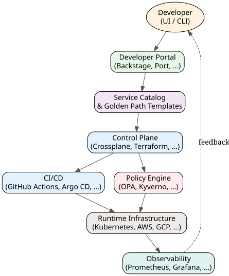

# Platform Engineering in 2025: A Practical Guide to Building Internal Developer Platforms

*Reading time: 11 min · 2,278 words*

> Platform engineering has become the defining discipline of modern DevOps, transforming infrastructure and tooling into a self-service product for developers. This guide explains what an internal developer platform (IDP) is, how golden paths reduce cognitive load, and how to build one incrementally without boiling the ocean. It includes a real-world fintech example, practical metrics, and common pitfalls to avoid.

## Table of Contents
- [What Is Platform Engineering?](#what-is-platform-engineering)
- [Why Platform Engineering Now?](#why-platform-engineering-now)
- [Core Concepts: Golden Paths, Paved Roads, and Cognitive Load](#core-concepts-golden-paths-paved-roads-and-cognitive-load)
  - [Golden Paths](#golden-paths)
  - [Cognitive Load](#cognitive-load)
  - [Self-Service](#self-service)
- [Anatomy of an Internal Developer Platform](#anatomy-of-an-internal-developer-platform)
- [Platform Engineering vs. GitOps vs. DevOps](#platform-engineering-vs-gitops-vs-devops)
- [Building Your First IDP: A Step-by-Step Approach](#building-your-first-idp-a-step-by-step-approach)
  - [Step 1: Identify Pain Points](#step-1-identify-pain-points)
  - [Step 2: Start with a Single Golden Path](#step-2-start-with-a-single-golden-path)
  - [Step 3: Productize the Platform](#step-3-productize-the-platform)
  - [Step 4: Measure and Iterate](#step-4-measure-and-iterate)
- [Real-World Example: A Fintech Company's Journey](#real-world-example-a-fintech-companys-journey)
- [Common Pitfalls and How to Avoid Them](#common-pitfalls-and-how-to-avoid-them)
- [The Future of Platform Engineering](#the-future-of-platform-engineering)
- [Key Takeaways](#key-takeaways)
- [Frequently Asked Questions](#frequently-asked-questions)

Platform engineering has quickly become one of the most talked-about disciplines in the DevOps world — and for good reason. As organizations scale their cloud-native architectures, the gap between "developers want to ship" and "operations keeps the lights on" has widened into a chasm. Platform engineering is the answer: it treats the infrastructure and tooling layer as a product, with the development team as its customer.

In this guide, you'll learn what platform engineering really means, how it differs from traditional DevOps, what an internal developer platform (IDP) actually contains, and how to start building one without boiling the ocean.


## What Is Platform Engineering?

Platform engineering is the discipline of designing, building, and operating **internal developer platforms (IDPs)** — a set of shared tools, services, and workflows that enable development teams to deliver software quickly, safely, and with minimal operational overhead.

Think of an IDP as a "productized" version of your infrastructure. Instead of giving every team a pile of raw cloud credentials, Kubernetes manifests, and CI/CD pipelines to assemble themselves, you provide a curated, self-service layer that encodes your organization's best practices.

| Traditional DevOps | Platform Engineering |
|---|---|
| Focus on automation and collaboration | Focus on productizing internal tooling |
| Teams build their own pipelines | Teams consume standardized golden paths |
| Ops is a support function | Platform is a product with users |
| Metrics: uptime, deployment frequency | Metrics: developer satisfaction, time-to-first-deploy |

The key shift is mental: **the platform team treats developers as customers**, not as internal stakeholders to be "handled."

## Why Platform Engineering Now?

Platform engineering didn't emerge from a vacuum. Several forces converged to make it necessary:

- **Cognitive load explosion.** Modern microservices, Kubernetes, service meshes, observability stacks, and compliance requirements place enormous cognitive demands on developers. Industry surveys consistently show developers spending a significant portion of their time on infrastructure-related tasks rather than writing business logic.
- **The "You build it, you run it" paradox.** DevOps promised that teams owning their services end-to-end would improve quality. In practice, many organizations discovered that asking every team to master Kubernetes, Terraform, and cloud networking leads to duplicated effort, inconsistent patterns, and burnout.
- **Cloud complexity.** Multi-cloud and hybrid setups multiply the number of decisions a developer must make just to deploy a simple service.
- **The rise of AI-assisted coding.** As AI accelerates code generation, the bottleneck shifts further toward deployment and operations — making a smooth, self-service path to production even more valuable.

> **Note:** Platform engineering does not replace DevOps. It operationalizes DevOps at scale. If DevOps is a culture and set of practices, platform engineering is the product that embodies those practices so developers can benefit from them without becoming infrastructure experts.

## Core Concepts: Golden Paths, Paved Roads, and Cognitive Load

### Golden Paths

A **golden path** is a well-defined, supported route from code commit to production that follows your organization's best practices. It's the "happy path" that handles 80% of use cases out of the box. For example, a golden path might be:

1. Developer creates a new service via a template.
2. The template provisions a repo, CI pipeline, staging environment, and monitoring.
3. The developer writes code, pushes, and the pipeline handles tests, builds, and deployment.
4. Rollback, secrets management, and alerting are pre-configured.

Teams can deviate from the golden path, but doing so requires explicit justification and incurs additional responsibility.

### Cognitive Load

Cognitive load theory distinguishes three types:

- **Intrinsic load:** inherent complexity of the task (writing business logic).
- **Extraneous load:** unnecessary complexity imposed by poor tooling.
- **Germane load:** productive effort spent learning and improving.

Platform engineering aims to minimize extraneous load by abstracting away infrastructure complexity, freeing cognitive capacity for germane work.

### Self-Service

Self-service is the cornerstone of an IDP. Developers interact with the platform through a portal, CLI, or API — never through tickets or tribal knowledge. The platform enforces policies (security, cost, compliance) automatically.

## Anatomy of an Internal Developer Platform

A mature IDP typically includes:

| Component | Purpose | Examples |
|---|---|---|
| Developer portal | Front door for discovery and self-service | Backstage, Port, Cortex |
| Service catalog | Registry of all services, APIs, and resources | Backstage catalog, OpsLevel |
| Templates & scaffolding | Generate new services with best practices baked in | Cookiecutter, Backstage templates |
| Control plane / orchestrator | Coordinate provisioning and deployment | Crossplane, Kratix, Terraform |
| CI/CD engine | Build, test, and deploy pipelines | GitHub Actions, GitLab CI, Argo CD |
| Observability & feedback | Metrics, logs, traces, and developer feedback | Prometheus, Grafana, OpenTelemetry |
| Policy engine | Enforce security and compliance rules | OPA, Kyverno, Conftest |

Here's a simplified view of how these pieces fit together:



The key architectural principle: **developers interact with the portal, not with the raw infrastructure.** All the gnarly bits are hidden behind the control plane.

## Platform Engineering vs. GitOps vs. DevOps

It's easy to confuse these terms. Here's a quick clarification:

- **DevOps** is a cultural and technical movement emphasizing collaboration, automation, and shared ownership between development and operations.
- **GitOps** is a specific operational pattern: Git is the single source of truth for declarative infrastructure and application state, and automated agents reconcile the live environment to match the desired state. GitOps is often *part of* a platform's delivery mechanism.
- **Platform Engineering** is the broader discipline of building the internal product (the IDP) that makes DevOps practices — including GitOps — accessible and consistent across teams.

In short: DevOps is the *why*, GitOps is the *how* (for delivery), and platform engineering is the *what* — the concrete product that ties it together.

## Building Your First IDP: A Step-by-Step Approach

You don't need to build a massive platform overnight. Here's a pragmatic path.

### Step 1: Identify Pain Points

Talk to your developers. What do they struggle with most? Common answers:

- "I don't know how to set up a new service consistently."
- "Deploying takes too long and involves too many manual steps."
- "I have no idea what environments exist or what's running where."
- "Security reviews happen at the end and block my release."

Pick the single biggest pain point to address first.

### Step 2: Start with a Single Golden Path

Choose one common workflow — say, "deploy a new REST API service to staging" — and build a template that automates the entire journey. Use existing tools where possible; don't reinvent the wheel.

Example using Backstage template scaffolding:

```yaml
apiVersion: scaffolder.backstage.io/v1beta3
kind: Template
metadata:
  name: rest-api-service
  title: REST API Service
spec:
  parameters:
    - title: Provide details
      properties:
        serviceName:
          type: string
          title: Service name
        owner:
          type: string
          title: Owner team
  steps:
    - id: fetch-template
      action: fetch:template
      input:
        url: ./skeleton
        values:
          serviceName: ${{ parameters.serviceName }}
          owner: ${{ parameters.owner }}
    - id: publish
      action: publish:github
      input:
        repoUrl: github.com?owner=${{ parameters.owner }}&repo=${{ parameters.serviceName }}
```

This is a simplified snippet, but it illustrates the pattern: templated scaffolding that produces a repo with CI, Dockerfile, Helm chart, and monitoring pre-configured.

### Step 3: Productize the Platform

Treat the platform like a product:

- Appoint a product manager (even part-time) for the platform.
- Collect feedback via surveys, Slack channels, and usage analytics.
- Maintain a roadmap and communicate releases.
- Set up an SLA for platform availability.

### Step 4: Measure and Iterate

Track metrics that matter to developers:

| Metric | Description |
|---|---|
| Time-to-first-deploy | Time from repo creation to first production deploy |
| Deployment frequency | Releases per week per service |
| Change failure rate | % of deployments causing incidents |
| Developer satisfaction | NPS or CSAT surveys |
| Ticket volume | Number of infrastructure requests handled manually |

Improve the golden path based on feedback, and expand to new paths (e.g., background jobs, frontend apps, data pipelines) as the platform matures.

## Real-World Example: A Fintech Company's Journey

Consider **AcmePay** (a composite example), a fintech company with 40 engineering teams and over 200 microservices. Their pain points were classic:

- Each team had its own way of deploying, leading to inconsistent security and compliance posture.
- Auditors demanded evidence of who deployed what, when — which was scattered across tools.
- New hires took weeks to become productive because there was no standard onboarding path.


**What they did:**

1. **Chose Backstage** as the developer portal (open-source, extensible).
2. **Built a "payment service" golden path** first — the most common service type in their org. The template included PCI-DSS-compliant defaults, secrets handling, and audit logging.
3. **Adopted Crossplane** as the control plane to provision AWS resources declaratively, with GitOps-style reconciliation.
4. **Integrated OPA** for policy enforcement — e.g., blocking deployments to production without required approvals or missing encryption.
5. **Rolled out gradually**: first to 5 teams as beta, then to all 40 after refining based on feedback.

**Results (illustrative):**

- Time-to-first-deploy dropped from 3 weeks to under 2 days.
- Onboarding time for new engineers fell from ~4 weeks to ~1 week.
- Security review time was cut by 70% because compliance was encoded in the golden path.
- Developer satisfaction scores rose from 3.2/5 to 4.1/5.

The key lesson: they started small, focused on one path, and iterated with real user feedback.

## Common Pitfalls and How to Avoid Them

| Pitfall | Mitigation |
|---|---|
| Building a "platform" nobody uses | Start with a real pain point; involve developers early |
| Over-engineering the platform | Use off-the-shelf tools; customize only where needed |
| Treating the platform as an ops project | Staff it with product-minded engineers, not just SREs |
| Ignoring documentation and UX | Invest in docs, demos, and a clean portal UI |
| Mandating the platform from above | Let teams opt in; win them with a better experience |
| Forgetting maintenance | A platform is a product; it needs ongoing investment |

> **Caution:** The biggest risk in platform engineering is building a "platform theater" — a sophisticated system that looks impressive in architecture reviews but doesn't reduce friction for real developers. Always measure adoption and time-to-value, not just feature counts.

## The Future of Platform Engineering

Several trends will shape platform engineering in the coming years:

- **AI-augmented platforms.** Generative AI will help generate scaffolding, troubleshoot failures, and even auto-remediate incidents. Expect IDPs to embed AI assistants that guide developers through the golden path.
- **Internal developer platforms as a service.** Vendors (Humanitec, Port, Qovery, etc.) are offering managed IDPs, reducing the need to build everything in-house.
- **Standardization around Backstage.** Backstage (originally from Spotify, now a CNCF project) is becoming the de facto open-source foundation for developer portals.
- **FinOps integration.** Platforms will increasingly bake cost awareness into golden paths — e.g., showing estimated costs before provisioning resources.
- **Policy-as-code everywhere.** Expect tighter coupling between platforms and policy engines as regulatory pressure grows.

## Key Takeaways

- Platform engineering productizes internal tooling, treating developers as customers and reducing their cognitive load.
- An internal developer platform (IDP) provides self-service golden paths that encode best practices for security, compliance, and delivery.
- Platform engineering complements — it doesn't replace — DevOps and GitOps; GitOps is often the delivery mechanism inside a platform.
- Start small: identify one painful workflow, build a golden path for it, and iterate based on developer feedback.
- Measure what matters: time-to-first-deploy, deployment frequency, change failure rate, and developer satisfaction.
- Avoid "platform theater" by focusing on adoption and real friction reduction, not just features.

## Frequently Asked Questions

**Q: What is the difference between DevOps and platform engineering?**
A: DevOps is a culture and set of practices for collaboration between development and operations. Platform engineering is the discipline of building an internal developer platform — a product that operationalizes DevOps practices so developers can ship faster with less operational burden.

**Q: Do I need Kubernetes to adopt platform engineering?**
A: No. Platform engineering principles apply to any infrastructure, from VMs to serverless to Kubernetes. Kubernetes is common because it's where much of the complexity lives, but the core idea — self-service golden paths — is infrastructure-agnostic.

**Q: What is a golden path?**
A: A golden path is a well-supported, opinionated route from code to production that encodes your organization's best practices. It handles the majority of use cases automatically, and developers can deviate from it only with justification.

**Q: How long does it take to build an internal developer platform?**
A: A useful MVP can be built in a few weeks to a few months if you start with one golden path and leverage existing tools like Backstage, Terraform/Crossplane, and your current CI/CD. A mature platform evolves over quarters, not months.

**Q: Is Backstage the only option for a developer portal?**
A: No. Popular alternatives include Port, Cortex, OpsLevel, and Humanitec's Orchestrator. Backstage is attractive because it's open-source, extensible, and backed by a large community (CNCF).

## Frequently Asked Questions

**Q: What is the difference between DevOps and platform engineering?**

A: DevOps is a culture and set of practices for collaboration between development and operations. Platform engineering is the discipline of building an internal developer platform — a product that operationalizes DevOps practices so developers can ship faster with less operational burden.

**Q: Do I need Kubernetes to adopt platform engineering?**

A: No. Platform engineering principles apply to any infrastructure, from VMs to serverless to Kubernetes. Kubernetes is common because it's where much of the complexity lives, but the core idea — self-service golden paths — is infrastructure-agnostic.

**Q: What is a golden path?**

A: A golden path is a well-supported, opinionated route from code to production that encodes your organization's best practices. It handles the majority of use cases automatically, and developers can deviate from it only with justification.

**Q: How long does it take to build an internal developer platform?**

A: A useful MVP can be built in a few weeks to a few months if you start with one golden path and leverage existing tools like Backstage, Terraform/Crossplane, and your current CI/CD. A mature platform evolves over quarters, not months.

**Q: Is Backstage the only option for a developer portal?**

A: No. Popular alternatives include Port, Cortex, OpsLevel, and Humanitec's Orchestrator. Backstage is attractive because it's open-source, extensible, and backed by a large community (CNCF).

## Key Takeaways

- Platform engineering productizes internal tooling, treating developers as customers and reducing their cognitive load.
- An internal developer platform (IDP) provides self-service golden paths that encode best practices for security, compliance, and delivery.
- Platform engineering complements — it doesn't replace — DevOps and GitOps; GitOps is often the delivery mechanism inside a platform.
- Start small: identify one painful workflow, build a golden path for it, and iterate based on developer feedback.
- Measure what matters: time-to-first-deploy, deployment frequency, change failure rate, and developer satisfaction.
- Avoid 'platform theater' by focusing on adoption and real friction reduction, not just features.

## Related Articles

- GitOps and declarative continuous delivery
- Kubernetes operators and custom controllers
- Backstage and developer portal customization
- Policy as code with Open Policy Agent (OPA)

<!-- Cover image prompts (for editors):
  - A clean, modern illustration of an internal developer platform architecture showing a developer portal, service catalog, control plane, and Kubernetes infrastructure connected by arrows, with a friendly blue and green color palette.
  - A photo-realistic image of a small engineering team collaborating around a whiteboard filled with platform architecture diagrams and sticky notes, warm office lighting, shallow depth of field.
  - A stylized 3D render of a golden path winding through a cloud landscape, with icons for CI/CD, containers, and monitoring floating alongside, representing the developer journey from code to production.
-->