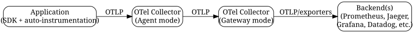

# Observability in 2025: A Practical Guide to OpenTelemetry and Unified Telemetry

*Reading time: 7 min · 1,373 words*

> Observability has become the core constraint on reliability in distributed systems, and OpenTelemetry is now the de facto standard for unifying logs, metrics, and traces. This guide explains the three pillars, how to design a telemetry pipeline, and how to diagnose real production incidents faster.

## Table of Contents
- [Introduction](#introduction)
- [What Is Observability?](#what-is-observability)
  - [The Three Pillars (and a Fourth)](#the-three-pillars-and-a-fourth)
  - [Why Logs Alone Aren't Enough](#why-logs-alone-arent-enough)
- [OpenTelemetry: The Unifying Standard](#opentelemetry-the-unifying-standard)
  - [How It Fits Together](#how-it-fits-together)
  - [Automatic vs. Manual Instrumentation](#automatic-vs-manual-instrumentation)
- [Designing Your Telemetry Pipeline](#designing-your-telemetry-pipeline)
  - [Stage 1: Generation](#stage-1-generation)
  - [Stage 2: Collection](#stage-2-collection)
  - [Stage 3: Export](#stage-3-export)
  - [Sampling Strategies](#sampling-strategies)
- [The Real-World Example: Diagnosing a Checkout Latency Spike](#the-real-world-example-diagnosing-a-checkout-latency-spike)
- [Best Practices and Pitfalls](#best-practices-and-pitfalls)
  - [Do](#do)
  - [Don't](#dont)
- [Building an Observability Culture](#building-an-observability-culture)
- [Conclusion](#conclusion)
- [Key Takeaways](#key-takeaways)
- [Frequently Asked Questions](#frequently-asked-questions)

## Introduction

In modern distributed systems, failure is not a question of if, but when. As applications have moved from monolithic servers to microservices, serverless functions, and multi-cloud deployments, the ability to understand system behavior has become the core constraint on reliability. This is where observability comes in — not just monitoring, but the capacity to ask arbitrary questions about your system's internal state based on its external outputs.

By 2025, observability has matured from a buzzword into an engineering discipline with a de facto standard: OpenTelemetry (OTel). This guide explains what observability actually means, why the three pillars matter, how OpenTelemetry unifies them, and how to implement it pragmatically.


## What Is Observability?

Observability is a property of a system: the degree to which you can infer internal states from external outputs. In practice, it means being able to answer questions you didn't anticipate — like "why did checkout latency spike at 2:14 PM?" — without deploying new code.

Monitoring answers known questions with predefined dashboards. Observability lets you explore unknown unknowns. The distinction matters because distributed systems generate failures that are emergent and unpredictable.

### The Three Pillars (and a Fourth)

| Pillar | What it captures | Typical questions |
|--------|------------------|-------------------|
| Logs | Discrete, timestamped events | What happened at this moment? |
| Metrics | Aggregated numeric measurements | Is this a trend or a blip? |
| Traces | End-to-end request paths | Which service caused the delay? |
| Profiles | CPU/memory samples tied to code | Where is the CPU being spent? |

### Why Logs Alone Aren't Enough

Logs tell you what happened on one service at one time. They don't tell you the causal chain across services. A trace connects the dots; metrics tell you whether this is a trend or a blip.

## OpenTelemetry: The Unifying Standard

OpenTelemetry is an open-source project (a CNCF project) that provides APIs, SDKs, and tooling to generate, collect, and export telemetry data. It was formed by merging OpenTracing and OpenCensus.

Key components:

- **APIs and SDKs** for many languages (Go, Java, Python, Node.js, .NET, Rust, and more)
- **Instrumentation libraries** — automatic instrumentation for common frameworks (HTTP servers, DB clients, message queues)
- **Collector** — a vendor-neutral proxy that receives, processes, and exports telemetry
- **Semantic Conventions** — standardized attribute names so data is consistent across tools
- **OTLP** — the OpenTelemetry Protocol for transporting telemetry

### How It Fits Together



// caption: OpenTelemetry data flow from application to backend

### Automatic vs. Manual Instrumentation

Automatic instrumentation gives you roughly 80% of the value with 20% of the effort. You attach an agent or import a library, and your HTTP framework, database client, and message queue are traced. Manual instrumentation is needed for business-critical spans: custom logic, background jobs, or async flows.

## Designing Your Telemetry Pipeline

A typical production pipeline has three stages: generation, collection, and export.

### Stage 1: Generation

Instrument your services. Start with automatic instrumentation everywhere, then add manual spans for critical paths.

```python
from opentelemetry import trace

tracer = trace.get_tracer("checkout")
with tracer.start_as_current_span("apply_discount") as span:
    span.set_attribute("discount.code", promo_code)
    result = apply_discount(cart, promo_code)
```

### Stage 2: Collection

Run the OpenTelemetry Collector as a sidecar (agent mode) or as a central gateway. The Collector can batch, filter, redact, and transform data before exporting. This keeps vendor-specific logic out of your application code.

### Stage 3: Export

Export to one or more backends. Common choices:

- Prometheus + Grafana (metrics)
- Jaeger or Tempo (traces)
- Loki (logs)
- Commercial platforms: Datadog, New Relic, Honeycomb, Grafana Cloud

### Sampling Strategies

Traces are high-volume. Always use tail-based sampling to keep the interesting traces (errors, slow requests, rare paths) and drop the noise. Head-based sampling is simpler but less targeted.

> **Important:** Sampling is not optional in production. Without it, your trace storage costs will explode. Start with head-based sampling at 10%, then graduate to tail-based sampling once your pipeline stabilizes.

## The Real-World Example: Diagnosing a Checkout Latency Spike

Scenario: An e-commerce platform runs a microservice architecture. Customers report that checkout takes 30+ seconds during peak hours. Dashboards show CPU is fine; error rates are normal.

**Step 1 — Look at the trace waterfall.** A trace for a slow checkout shows a 28-second gap between the `payment-service` span and the `inventory-service` span. No error is recorded — just a long wait.

**Step 2 — Drill into the spans.** The `inventory-service` span shows a child span `db.query.reserve_stock` with duration 27.9s. The database query is the bottleneck.

**Step 3 — Correlate with metrics.** The `db.query.duration` histogram shows a bimodal distribution: most queries complete in under 100ms, but a subset takes over 25s. This matches the connection pool exhaustion pattern.

**Step 4 — Check logs.** The database log shows "connection wait timeout" warnings. The pool size was 10, and peak concurrency exceeded it. The fix: increase pool size, add a read replica, and add a circuit breaker.

Without traces, this diagnosis would have taken hours. With unified telemetry, it took minutes.


## Best Practices and Pitfalls

### Do

- **Standardize on semantic conventions.** Use OTel naming for HTTP, DB, and messaging attributes so your queries are consistent.
- **Add context propagation.** Ensure W3C Trace Context is enabled across all services, including message queues.
- **Redact sensitive data.** The Collector can filter attributes; never export PII or secrets in spans.
- **Define SLOs linked to telemetry.** Alert on burn rate, not just static thresholds.
- **Use exemplars.** Attach a trace ID to metric samples so you can jump from a dashboard to the exact trace.

### Don't

- **Don't send everything everywhere.** Filter noisy logs at the source or in the Collector.
- **Don't ignore cardinality.** High-cardinality attributes (for example, user IDs in metric labels) will blow up Prometheus memory.
- **Don't treat observability as a post-hoc add-on.** Instrument from day one; retrofitting is painful.
- **Don't rely solely on dashboards.** Dashboards are for known questions; traces and structured logs are for exploration.

## Building an Observability Culture

Tooling alone doesn't make a system observable. You need:

- **On-call runbooks** that reference traces and metrics
- **Blameless postmortems** that use telemetry data
- **Regular game days** where engineers practice debugging with telemetry
- **Developer experience**: make it easy to add spans and view them locally

## Conclusion

Observability is the foundation of modern DevOps. OpenTelemetry has made it possible to standardize telemetry across every service, language, and cloud. The path forward is clear: instrument automatically, collect centrally, sample intelligently, and build a culture that treats telemetry as a first-class product.

## Key Takeaways

- Observability goes beyond monitoring: it lets you answer unanticipated questions about system behavior.
- OpenTelemetry is the industry-standard API/SDK/Collector stack for unified logs, metrics, and traces.
- Start with automatic instrumentation, then add manual spans for business-critical paths.
- Run the OTel Collector in agent and gateway modes to decouple applications from backends.
- Always sample traces; prefer tail-based sampling for targeted retention.
- Define SLOs and alert on burn rate to turn telemetry into actionable reliability.

## Frequently Asked Questions

**Q: What is the difference between monitoring and observability?**

A: Monitoring tells you whether a known metric is within bounds; observability lets you discover unknown failure modes by exploring rich telemetry.

**Q: Is OpenTelemetry tied to a specific vendor?**

A: No. It is a CNCF project with a vendor-neutral specification. You can export to any OTLP-compatible backend, or use the Collector to translate to vendor formats.

**Q: Do I need to instrument every microservice manually?**

A: No. Use automatic instrumentation libraries for frameworks and libraries; add manual spans only for custom business logic.

**Q: How do I control telemetry costs?**

A: Sample traces, filter noisy logs in the Collector, set retention policies per data type, and watch metric cardinality.

**Q: Can I use OpenTelemetry with legacy systems?**

A: Yes. The Collector can ingest data from legacy agents and exporters, and you can instrument incrementally service by service.

## Frequently Asked Questions

**Q: What is the difference between monitoring and observability?**

A: Monitoring tells you whether a known metric is within bounds; observability lets you discover unknown failure modes by exploring rich telemetry.

**Q: Is OpenTelemetry tied to a specific vendor?**

A: No. It is a CNCF project with a vendor-neutral specification. You can export to any OTLP-compatible backend, or use the Collector to translate to vendor formats.

**Q: Do I need to instrument every microservice manually?**

A: No. Use automatic instrumentation libraries for frameworks and libraries; add manual spans only for custom business logic.

**Q: How do I control telemetry costs?**

A: Sample traces, filter noisy logs in the Collector, set retention policies per data type, and watch metric cardinality.

**Q: Can I use OpenTelemetry with legacy systems?**

A: Yes. The Collector can ingest data from legacy agents and exporters, and you can instrument incrementally service by service.

## Key Takeaways

- Observability goes beyond monitoring: it lets you answer unanticipated questions about system behavior.
- OpenTelemetry is the industry-standard API/SDK/Collector stack for unified logs, metrics, and traces.
- Start with automatic instrumentation, then add manual spans for business-critical paths.
- Run the OTel Collector in agent and gateway modes to decouple applications from backends.
- Always sample traces; prefer tail-based sampling for targeted retention.
- Define SLOs and alert on burn rate to turn telemetry into actionable reliability.

## Related Articles

- sre
- gitops
- platform-engineering
- incident-management

<!-- Cover image prompts (for editors):
  - A modern observability dashboard showing logs, metrics, and distributed traces in a unified UI, dark theme with colorful graphs and a waterfall trace view, professional SaaS product screenshot style.
  - An illustration of the OpenTelemetry architecture: an application sending OTLP data to a collector gateway, which fans out to Prometheus, Jaeger, and Grafana backends, clean flat vector style with labeled boxes and arrows.
  - A developer debugging a microservice latency spike using a distributed tracing waterfall chart, with a terminal window showing trace spans and database query durations, realistic modern workspace setting.
-->