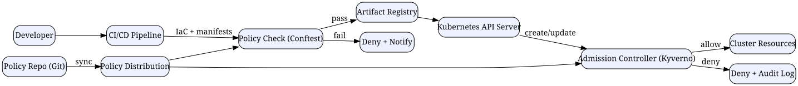

# Policy as Code in 2025: Automating Guardrails, Governance, and Compliance

*Reading time: 10 min · 1,973 words*

> Policy as Code (PaC) expresses security and compliance rules as versioned, testable code evaluated automatically across the delivery lifecycle. This guide covers the core concepts, leading tools like OPA and Kyverno, a reference architecture, and a real-world adoption story.

## Table of Contents
- [Introduction](#introduction)
- [Why Policy as Code Matters in 2025](#why-policy-as-code-matters-in-2025)
- [Core Concepts: What Is a Policy?](#core-concepts-what-is-a-policy)
  - [Policy Evaluation Points](#policy-evaluation-points)
- [The Policy as Code Ecosystem](#the-policy-as-code-ecosystem)
- [How Policy as Code Works: A Reference Architecture](#how-policy-as-code-works-a-reference-architecture)
- [A Real-World Example: From Tagging Chaos to Automated Guardrails](#a-real-world-example-from-tagging-chaos-to-automated-guardrails)
  - [Layer 1: CI-time checks with Conftest](#layer-1-ci-time-checks-with-conftest)
  - [Layer 2: Admission control with Kyverno](#layer-2-admission-control-with-kyverno)
  - [Layer 3: Continuous audit](#layer-3-continuous-audit)
- [Best Practices for Adopting Policy as Code](#best-practices-for-adopting-policy-as-code)
- [Common Pitfalls and How to Avoid Them](#common-pitfalls-and-how-to-avoid-them)
- [Policy as Code Meets AI Agents](#policy-as-code-meets-ai-agents)
- [Conclusion](#conclusion)
- [Key Takeaways](#key-takeaways)
- [Frequently Asked Questions](#frequently-asked-questions)

## Introduction

In 2025, software delivery is faster than ever—and so are the consequences of misconfiguration. A single misconfigured storage bucket, an overly permissive IAM role, or a deployment that bypasses an approval gate can lead to a breach, a fine, or a multi-hour incident. Traditional approaches to governance—PDFs, spreadsheets, quarterly audits, and human approvals—simply cannot keep pace.

Policy as Code (PaC) is the practice of expressing security, compliance, and operational rules as versioned, testable code that is evaluated automatically throughout the software delivery lifecycle. Instead of asking engineers to read a 40-page compliance handbook, you encode the rules themselves and enforce them at machine speed.

This guide explains what policy as code is, why it has become a cornerstone of modern DevOps, how the major tools work, and how to adopt it pragmatically in your organization.

## Why Policy as Code Matters in 2025

Several forces have pushed policy as code from a niche technique to a mainstream practice:

- **Regulatory pressure.** Frameworks like SOC 2, FedRAMP, NIS2, and the EU AI Act demand continuous, demonstrable control over systems. Auditors increasingly expect automated evidence, not screenshots.
- **Delivery speed.** When teams deploy dozens or hundreds of times per day, human gatekeeping is impossible. Automated policy gates are the only scalable way to maintain guardrails.
- **Platform engineering.** Internal developer platforms (IDPs) are built on "golden paths"—blessed ways to build and deploy. Policy as code is how those golden paths are enforced without slowing developers down.
- **Agentic AI.** As AI agents and MCP-based tool servers take on operational tasks, they need the same guardrails as humans—expressed as code.

> **Note:** Policy as code is not a replacement for human judgment or security expertise. It is a force multiplier that lets experts encode their knowledge once and apply it everywhere.


## Core Concepts: What Is a Policy?

A **policy** is a rule that determines whether an action is permitted. Policies typically answer questions like:

- Does this resource have the required labels and tags?
- Is this image from an approved registry and pinned to a digest?
- Is this network path encrypted with TLS 1.2 or higher?
- Does this Terraform plan create any publicly accessible storage?
- Is this role scoped to the principle of least privilege?

Policies can be expressed in two styles:

| Style | Description | Example |
| --- | --- | --- |
| Declarative | Describe the desired end state; the engine decides | "No storage buckets may be public" |
| Imperative | Describe the exact steps to check | "If bucket.acl == 'public-read', fail" |

Most modern policy engines favor **declarative** rules because they are easier to reason about, test, and audit.

### Policy Evaluation Points

Policies can be enforced at different points in the delivery lifecycle:

1. **Pre-commit / pre-merge** — linting and scanning IaC in the developer's editor or in CI.
2. **CI/CD pipeline gates** — evaluating manifests, plans, and artifacts before promotion.
3. **Admission control** — intercepting requests to the Kubernetes API server.
4. **Runtime enforcement** — service mesh and proxy policies (e.g., mTLS, egress rules).
5. **Continuous audit** — periodically scanning live infrastructure for drift and violations.

## The Policy as Code Ecosystem

The landscape has matured significantly. Here are the tools you are most likely to encounter:

| Tool | Language | Primary Use Case |
| --- | --- | --- |
| **OPA (Open Policy Agent)** | Rego | General-purpose policy engine; admission control, CI gates, API authorization |
| **Kyverno** | YAML | Kubernetes-native policy management; mutate, validate, generate |
| **HashiCorp Sentinel** | Sentinel | Enterprise policies for Terraform, Vault, Consul |
| **AWS CloudFormation Guard** | Guard DSL | Validate CloudFormation/Terraform JSON/YAML against rules |
| **Conftest** | Rego | Test configuration files against OPA policies in CI |
| **Checkov / Terrascan** | Python/HCL | Static scanning of IaC for misconfigurations |

## How Policy as Code Works: A Reference Architecture

Here is a typical architecture showing where policy evaluation happens in a Kubernetes-centric delivery pipeline:



In this flow:

- Developers commit code and infrastructure definitions to Git.
- CI runs **Conftest** (or OPA) against the IaC to catch violations early.
- If policies pass, artifacts are built and pushed to a registry.
- When Kubernetes receives a create/update request, an **admission controller** evaluates it against cluster policies.
- Violations are denied and logged; allowed resources are created.
- A **policy distribution** mechanism keeps CI and cluster policies in sync from a single Git repo.

## A Real-World Example: From Tagging Chaos to Automated Guardrails

**The scenario.** Acme SaaS runs 40 microservices on Amazon EKS. Last quarter, an engineer created an S3 bucket without a cost-center tag, and the finance team spent three weeks tracing the bill. Worse, a deployment pulled an image from Docker Hub instead of the internal registry, introducing an unvetted dependency.

**The fix.** Acme adopted a three-layer policy strategy:

### Layer 1: CI-time checks with Conftest

They added a Conftest gate to their pipeline that validates Terraform plans:

```bash
conftest test --policy ./policy terraform_plan.json
```

With a Rego policy requiring a cost-center tag:

```rego
package main

deny[msg] {
  input.resource_changes[_].change.after.tags["cost-center"] == ""
  msg := "Resource must include a cost-center tag"
}
```

### Layer 2: Admission control with Kyverno

They deployed Kyverno to the cluster and wrote a policy that denies any workload whose image does not come from their internal registry and is not pinned to a digest:

```yaml
apiVersion: kyverno.io/v1
kind: ClusterPolicy
metadata:
  name: require-internal-image
spec:
  validationFailureAction: Enforce
  rules:
    - name: check-image-registry
      match:
        any:
          - resources:
              kinds:
                - Pod
      validate:
        message: "Images must come from registry.acme.internal and be pinned to a digest."
        pattern:
          spec:
            containers:
              - image: "registry.acme.internal/*@sha256:*"
```

### Layer 3: Continuous audit

Finally, they scheduled a nightly scan using OPA against live AWS resources to detect drift—resources created outside the pipeline that violate tagging or encryption rules. Results feed a Slack channel and a monthly compliance report.

**The outcome.** Within a month, tagging compliance went from 71% to 99.4%. No unvetted image has reached production since enforcement began. The finance team now gets clean cost allocation data automatically.


## Best Practices for Adopting Policy as Code

- **Start small and high-value.** Pick 5–10 rules that prevent your worst recent incidents. Don't try to codify every control at once.
- **Treat policies as software.** Store them in Git, require pull requests, write unit tests for them, and review changes like code.
- **Use audit/dry-run mode first.** Run policies in non-blocking mode, measure violations, and socialize the results before flipping to enforcement.
- **Write excellent denial messages.** A developer who sees "image must match registry.acme.internal/*@sha256:*" understands what to do. A terse "denied" does not help anyone.
- **Provide an exception and break-glass path.** There will always be legitimate edge cases. Make exceptions explicit, time-boxed, and logged.
- **Measure coverage and outcomes.** Track how many resources are covered, how many violations are caught, and how often policies block deployments.
- **Keep policies close to the teams that own them.** Centralized policy teams can become bottlenecks. Encourage platform teams to own policies for their domains.

## Common Pitfalls and How to Avoid Them

- **The Rego learning curve.** OPA's Rego language is powerful but unfamiliar. Invest in training, or start with Kyverno's YAML-based policies if Kubernetes is your focus.
- **Policy sprawl.** Hundreds of overlapping rules become hard to maintain. Review and prune policies quarterly; consolidate duplicates.
- **Blocking everything.** Overly strict policies cause developers to find workarounds or abandon the platform. Prefer "shift-left" soft checks over hard blocks where possible.
- **Stale policies.** Infrastructure evolves; policies must evolve with it. Tie policy reviews to your infrastructure change cadence.
- **Performance bottlenecks.** Admission controllers add latency to every API request. Keep policies efficient and avoid expensive external calls inside hot paths.

## Policy as Code Meets AI Agents

One of the most interesting developments in 2025 is applying policy as code to AI agents. When an agent is granted access to tools via the Model Context Protocol (MCP), you can wrap each tool call in a policy check: *Is this agent allowed to call this tool? Can it access this dataset? Is this action reversible?* The same engines that guard your Kubernetes cluster can guard your agents.

This convergence means the skills you build implementing policy as code today will directly transfer to governing tomorrow's autonomous systems.

## Conclusion

Policy as Code transforms governance from a sluggish, manual afterthought into a continuous, automated capability. It gives security and compliance teams a way to encode expertise once and enforce it everywhere, while giving developers fast, clear feedback instead of bureaucratic delays.

The organizations winning in 2025 are not the ones with the thickest compliance binders. They are the ones whose guardrails are written in code, tested in CI, and enforced at the point of action—whether that action is a Kubernetes deployment or an AI agent's tool call.

## Key Takeaways

- Policy as code expresses security and compliance rules as versioned, testable code evaluated automatically across the delivery lifecycle.
- The main evaluation points are pre-merge, CI gates, admission control, runtime enforcement, and continuous audit.
- OPA/Rego, Kyverno, Sentinel, CloudFormation Guard, and Conftest are the tools you will most likely encounter.
- Start with a small set of high-value rules, run in audit mode first, and treat policies with the same rigor as application code.
- Clear denial messages, explicit exception paths, and regular policy pruning are essential to keeping developers productive.
- The same policy engines are increasingly used to govern AI agents, making PaC a future-proof skill.

## Frequently Asked Questions

**Q: What is the difference between policy as code and infrastructure as code?**

A: Infrastructure as Code (IaC) defines *what* infrastructure should exist (e.g., Terraform, CloudFormation). Policy as Code defines *what is allowed*—the rules and guardrails that constrain how infrastructure and applications are built, deployed, and operated. IaC describes the desired state; PaC constrains it.

**Q: Should I use OPA or Kyverno?**

A: It depends on your context. Kyverno is Kubernetes-native, uses YAML, and is easier to learn if you are primarily securing Kubernetes workloads. OPA is a general-purpose engine that works across Kubernetes, CI/CD, APIs, and even AI agents—but it requires learning Rego. Many organizations use both.

**Q: How do I test policies?**

A: Most engines support unit testing. OPA has `opa test`, and Conftest can run policies against fixture files. Treat policy tests like application tests: cover the happy path, edge cases, and denial cases, and run them in CI.

**Q: Will policy as code slow down our developers?**

A: Done well, it speeds them up. Automated checks give immediate feedback at the point of writing code, instead of a security review weeks later. The key is to start with sensible, well-documented rules and to provide clear, actionable messages when a policy fails.

**Q: Can policy as code replace our annual security audit?**

A: Not entirely. Audits verify overall control effectiveness and often require human judgment and evidence beyond automated checks. However, policy as code provides continuous, auditable evidence that dramatically reduces the effort and cost of audits, and it catches issues long before an auditor would.

## Frequently Asked Questions

**Q: What is the difference between policy as code and infrastructure as code?**

A: Infrastructure as Code (IaC) defines *what* infrastructure should exist (e.g., Terraform, CloudFormation). Policy as Code defines *what is allowed*—the rules and guardrails that constrain how infrastructure and applications are built, deployed, and operated. IaC describes the desired state; PaC constrains it.

**Q: Should I use OPA or Kyverno?**

A: It depends on your context. Kyverno is Kubernetes-native, uses YAML, and is easier to learn if you are primarily securing Kubernetes workloads. OPA is a general-purpose engine that works across Kubernetes, CI/CD, APIs, and even AI agents—but it requires learning Rego. Many organizations use both.

**Q: How do I test policies?**

A: Most engines support unit testing. OPA has `opa test`, and Conftest can run policies against fixture files. Treat policy tests like application tests: cover the happy path, edge cases, and denial cases, and run them in CI.

**Q: Will policy as code slow down our developers?**

A: Done well, it speeds them up. Automated checks give immediate feedback at the point of writing code, instead of a security review weeks later. The key is to start with sensible, well-documented rules and to provide clear, actionable messages when a policy fails.

**Q: Can policy as code replace our annual security audit?**

A: Not entirely. Audits verify overall control effectiveness and often require human judgment and evidence beyond automated checks. However, policy as code provides continuous, auditable evidence that dramatically reduces the effort and cost of audits, and it catches issues long before an auditor would.

## Key Takeaways

- Policy as code expresses security and compliance rules as versioned, testable code evaluated automatically across the delivery lifecycle.
- The main evaluation points are pre-merge, CI gates, admission control, runtime enforcement, and continuous audit.
- OPA/Rego, Kyverno, Sentinel, CloudFormation Guard, and Conftest are the tools you will most likely encounter.
- Start with a small set of high-value rules, run in audit mode first, and treat policies with the same rigor as application code.
- Clear denial messages, explicit exception paths, and regular policy pruning are essential to keeping developers productive.
- The same policy engines are increasingly used to govern AI agents, making PaC a future-proof skill.

## Related Articles

- gitops
- platform-engineering
- observability
- devsecops

<!-- Cover image prompts (for editors):
  - A clean vector-style illustration of a DevOps pipeline with policy gates shown as traffic lights, code flowing from a developer laptop through CI/CD into a Kubernetes cluster, with a shield icon representing policy enforcement, muted blue and green palette.
  - A professional flat-design diagram of a policy-as-code architecture showing a Git repository, CI pipeline, admission controller, and audit logs connected by arrows, with a compliance checklist overlay.
  - An abstract 3D render of a glowing shield formed from lines of code hovering above a cloud infrastructure grid, symbolizing automated governance and guardrails, dark background with cyan accents.
-->