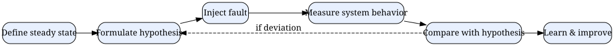

# Chaos Engineering in 2025: A Practical Guide to Building Resilient Systems

*Reading time: 5 min · 970 words*

> A practical guide to chaos engineering in 2025, covering core concepts, popular tools, implementation strategies, and real-world examples to help teams build more resilient distributed systems.

## Table of Contents
- [What Is Chaos Engineering?](#what-is-chaos-engineering)
- [Core Principles of Chaos Engineering](#core-principles-of-chaos-engineering)
- [Popular Chaos Engineering Tools](#popular-chaos-engineering-tools)
- [Implementing Chaos Engineering: A Step-by-Step Approach](#implementing-chaos-engineering-a-step-by-step-approach)
  - [1. Start Small and Safe](#1-start-small-and-safe)
  - [2. Define Metrics and Alerts](#2-define-metrics-and-alerts)
  - [3. Design Experiments](#3-design-experiments)
  - [4. Execute and Observe](#4-execute-and-observe)
  - [5. Iterate and Improve](#5-iterate-and-improve)
- [Real-World Example: Netflix](#real-world-example-netflix)
- [Best Practices for Chaos Engineering](#best-practices-for-chaos-engineering)
- [Challenges and Considerations](#challenges-and-considerations)
- [Diagram: Chaos Experiment Workflow](#diagram-chaos-experiment-workflow)
- [Conclusion](#conclusion)
- [Key Takeaways](#key-takeaways)
- [Frequently Asked Questions](#frequently-asked-questions)

In today's distributed systems landscape, failures are inevitable. Whether it's a network partition, a server crash, or a misconfigured service, outages can have significant business impact. Chaos engineering is the discipline of experimenting on a system to build confidence in its capability to withstand turbulent conditions in production. This guide explores the fundamentals, tools, and practical steps to adopt chaos engineering in your organization.

## What Is Chaos Engineering?

Chaos engineering is the practice of intentionally introducing faults into a system to identify weaknesses before they cause user-facing incidents. It's not about breaking things randomly; it's about conducting controlled experiments to learn how a system behaves under stress.

> "Chaos engineering is the discipline of experimenting on a distributed system to build confidence in the system's capability to withstand turbulent conditions in production." — Principles of Chaos Engineering

The goal is to uncover hidden failures, improve resilience, and validate that the system can recover gracefully from unexpected events.

## Core Principles of Chaos Engineering

1. **Define steady state** – Establish a baseline of normal behavior, such as response time, error rate, or throughput.
2. **Hypothesize** – Predict what will happen when a specific fault is injected.
3. **Introduce faults** – Run controlled experiments with real-world conditions like latency, crashes, or resource exhaustion.
4. **Measure and learn** – Compare the results against the hypothesis, identify deviations, and address them.
5. **Automate** – Integrate chaos experiments into CI/CD pipelines for continuous validation.

## Popular Chaos Engineering Tools

Several open-source and commercial tools help implement chaos engineering:

| Tool | Description | Type |
|------|-------------|------|
| Chaos Monkey | Originally developed by Netflix to randomly terminate instances in production | Open source |
| Litmus | Kubernetes-native chaos engineering framework with a web UI | Open source |
| Chaos Mesh | A cloud-native chaos platform for Kubernetes, offering various fault injection types | Open source |
| Gremlin | Commercial platform with a wide range of attack methods and integrations | Commercial |
| AWS Fault Injection Simulator | Managed service for running fault injection experiments on AWS | Commercial |

Each tool has its strengths. For Kubernetes environments, Litmus and Chaos Mesh are popular choices. For broader infrastructure, Gremlin offers a user-friendly interface.

## Implementing Chaos Engineering: A Step-by-Step Approach

### 1. Start Small and Safe
Begin with non-critical services or staging environments. Choose low-risk experiments that won't affect customers.

### 2. Define Metrics and Alerts
Monitor key performance indicators (KPIs) like error rates, latency, and CPU usage. Establish thresholds to detect anomalies.

### 3. Design Experiments
Use the principles above to design experiments. For example, inject a 500ms latency into a microservice to see if timeouts are handled correctly.

### 4. Execute and Observe
Run the experiment, collect data, and analyze the outcomes. Document findings.

### 5. Iterate and Improve
Use insights to fix issues and refine the system. Repeat experiments regularly.

## Real-World Example: Netflix

Netflix pioneered chaos engineering with Chaos Monkey, which randomly terminates virtual machine instances in production. Over time, they expanded to full chaos experiments using tools like Chaos Kong (for AWS region failures) and the Simian Army suite. This approach helped Netflix build one of the most resilient streaming platforms, ensuring availability during peak traffic and regional outages.

## Best Practices for Chaos Engineering

- **Start with a hypothesis** – Always predict the outcome before injecting a fault.
- **Use blast radius control** – Limit the scope to avoid cascading failures.
- **Automate continuously** – Integrate chaos tests into your CI/CD pipeline.
- **Collaborate across teams** – Involve developers, SREs, and operations.
- **Document everything** – Track experiments, results, and action items.

## Challenges and Considerations

Chaos engineering requires a cultural shift. Teams must embrace failure as a learning opportunity. Additionally, compliance and regulatory constraints may limit experimentation in certain industries. Always ensure experiments are safe and reversible.

## Diagram: Chaos Experiment Workflow

Below is a visual representation of a typical chaos experiment process:

This workflow ensures that each experiment is structured and measurable.

## Conclusion

Chaos engineering is not about causing outages; it's about preventing them. By proactively testing your system's resilience, you can discover issues before they impact users. With the right tools and practices, any organization can adopt chaos engineering to build more reliable software.

## Key Takeaways

- Chaos engineering helps identify weaknesses before they become incidents.
- Start small, define steady state, and always have a hypothesis.
- Use tools like Litmus, Chaos Mesh, or Gremlin to automate experiments.
- Integrate chaos testing into your CI/CD pipeline for continuous validation.
- Learn from every experiment and iterate on improvements.

## Frequently Asked Questions

**Q: Is chaos engineering safe for production environments?**
A: When done correctly with proper controls, yes. Start with low-risk scenarios, use blast radius limits, and have rollback plans.

**Q: What is the difference between chaos engineering and fault injection?**
A: Fault injection is a technique used within chaos engineering. Chaos engineering encompasses the entire experimental process, including hypothesis, measurement, and learning.

**Q: Do I need specialized tools to start?**
A: Not necessarily. You can begin with simple scripts, but tools like Litmus or Gremlin provide better control and observability.

**Q: How often should I run chaos experiments?**
A: It depends on your system's complexity and change frequency. Many teams run them continuously in CI/CD or on a regular schedule.

**Q: What skills are needed for chaos engineering?**
A: A solid understanding of distributed systems, monitoring, and incident response. Collaboration and communication are also crucial.

## Frequently Asked Questions

**Q: Is chaos engineering safe for production environments?**

A: When done correctly with proper controls, yes. Start with low-risk scenarios, use blast radius limits, and have rollback plans.

**Q: What is the difference between chaos engineering and fault injection?**

A: Fault injection is a technique used within chaos engineering. Chaos engineering encompasses the entire experimental process, including hypothesis, measurement, and learning.

**Q: Do I need specialized tools to start?**

A: Not necessarily. You can begin with simple scripts, but tools like Litmus or Gremlin provide better control and observability.

**Q: How often should I run chaos experiments?**

A: It depends on your system's complexity and change frequency. Many teams run them continuously in CI/CD or on a regular schedule.

**Q: What skills are needed for chaos engineering?**

A: A solid understanding of distributed systems, monitoring, and incident response. Collaboration and communication are also crucial.

## Key Takeaways

- Chaos engineering helps identify weaknesses before they become incidents.
- Start small, define steady state, and always have a hypothesis.
- Use tools like Litmus, Chaos Mesh, or Gremlin to automate experiments.
- Integrate chaos testing into your CI/CD pipeline for continuous validation.
- Learn from every experiment and iterate on improvements.

## Related Articles

- Site Reliability Engineering
- Distributed Systems
- Fault Tolerance
- Load Testing

<!-- Cover image prompts (for editors):
  - A chaotic yet controlled environment with servers being disrupted by a lightning bolt, symbolizing chaos engineering, dark background with glowing network lines.
  - A team of engineers observing a dashboard with graphs and alerts while a robot arm injects a fault into a server rack, illustrating controlled experimentation.
  - A visual representation of a chaos experiment workflow, showing steps from steady state to learning, with arrows and icons.
-->