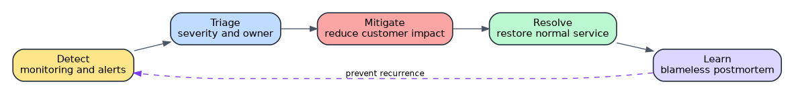

# Incident Management and Blameless Postmortems - An SRE Playbook for On-Call, Severity Levels and Learning from Failure

It is 02:14 on a Saturday. A payment service is failing in one region, and three engineers are typing in different channels without a shared understanding of what is broken. What happens next depends less on heroics than on the incident management system the team built before the pager went off.

Incident management is the discipline of coordinating people, communication, and technical work when a system behaves badly. Blameless postmortems convert that experience into durable improvements. Together they form a feedback loop: detect, stabilize, learn, and prevent. This guide covers severity levels, on-call design, incident roles, communication, mitigation, postmortem structure, and the metrics that keep the process honest.

## Table of Contents

- [What Incident Management Actually Optimizes For](#what-incident-management-actually-optimizes-for)
- [The Incident Lifecycle](#the-incident-lifecycle)
- [Severity Levels That Drive Action](#severity-levels-that-drive-action)
- [Designing an On-Call Rotation That Lasts](#designing-an-on-call-rotation-that-lasts)
- [Running the Incident: Roles and Communication](#running-the-incident-roles-and-communication)
- [Mitigation Before Root Cause](#mitigation-before-root-cause)
- [The Blameless Postmortem](#the-blameless-postmortem)
- [Turning Postmortems into Prevention](#turning-postmortems-into-prevention)
- [A Real-World Example: The Checkout Outage](#a-real-world-example-the-checkout-outage)
- [Measuring What Matters Without Gaming It](#measuring-what-matters-without-gaming-it)
- [Common Anti-Patterns](#common-anti-patterns)
- [Conclusion](#conclusion)
- [Key Takeaways](#key-takeaways)
- [Frequently Asked Questions](#frequently-asked-questions)

## What Incident Management Actually Optimizes For

Incident management is not the same as debugging. Debugging is an individual technical activity; incident management is a team coordination activity. Most painful outages are prolonged not by a single mysterious bug, but by unclear ownership, missing information, and well-meaning people working on different theories at the same time.

A good incident process optimizes for three outcomes:

1. **Time to mitigate** — how quickly customer impact is reduced, even if the cause is still unknown.
2. **Coordination cost** — how much human effort is spent figuring out who does what, rather than doing it.
3. **Learning quality** — how reliably the organization converts one incident into systemic improvement.

"Find the root cause" is not first on the list. During an active incident, restoring service usually matters more than completing a perfect diagnosis. Root-cause work belongs in the postmortem, where it can be done carefully without customer pressure.

> **Important:** Mitigation is not diagnosis. Restarting a healthy instance, rolling back a deployment, or disabling a feature can stop the bleeding before anyone understands why it started. Treat those actions as legitimate engineering work, not shortcuts.

It also depends on reliability foundations: SLOs define "healthy enough," and observability provides evidence to detect and localize problems.

## The Incident Lifecycle

Every incident follows a broadly similar arc. The goal is not a rigid checklist, but explicit transitions so nothing gets skipped under pressure.



The lifecycle is a loop, not a line. Detection improves when postmortems identify missing signals; triage improves when severity definitions are tested against real events; mitigation improves when runbooks and rollback paths are exercised.

A common failure mode is treating the lifecycle as finished at resolution. Service is restored, the channel goes quiet, and everyone returns to feature work. The incident has ended operationally but not organizationally — and learning is where the return on all that stress is collected.

## Severity Levels That Drive Action

Severity levels exist to answer one question quickly: how much coordination does this event deserve? A severity scale that nobody can apply consistently is worse than no scale at all, because it creates debate during the moments when debate is most expensive.

The exact definitions should be local, but a four-level model is a useful starting point:

| Severity | Typical impact | Response expectation | Communication |
|---|---|---|---|
| SEV1 | Major customer-facing outage, data loss risk, or safety issue | Page immediately; assemble incident team | Status page, executive update, frequent internal updates |
| SEV2 | Significant degradation or a key workflow unavailable | Page on-call; formal incident process | Status page if customers are affected |
| SEV3 | Limited impact, workaround available, or single-tenant issue | Handle during business hours or next on-call window | Internal ticket and team channel |
| SEV4 | Minor bug or cosmetic issue with no meaningful service impact | Normal backlog | Standard issue tracking |

Two rules make severity useful in practice:

- **Severity can change.** Start where the evidence points and adjust as understanding improves. A SEV3 can become SEV1 when a second region fails.
- **Severity is about impact, not effort.** A difficult bug affecting one internal tool is not SEV1. A simple configuration mistake that blocks all checkouts is.

Publish examples and review the definitions after major incidents. If engineers routinely disagree about severity, the definitions are too vague or the escalation incentives are wrong.

## Designing an On-Call Rotation That Lasts

On-call is the human interface of incident management. A rotation that looks efficient on a spreadsheet can quietly destroy the team's ability to respond well. Sustainable on-call design balances coverage, alert quality, and recovery time.

### Start with alert quality

Every page should be actionable, urgent, and owned. If the correct response is "ignore it" or "wait and see," the alert belongs in a ticket or dashboard, not a pager. Alert fatigue is a design failure, not a personality flaw. Track how often pages lead to action, and tune or remove the rest.

### Define clear ownership

Each service needs a named owning team, an escalation path, and documentation for the first fifteen minutes of an incident. "Someone will figure it out" is not an ownership model. Ownership also means authority to change the service, not just the duty to be paged about it.

### Protect recovery time

A rotation should account for the fact that humans need sleep, focus time, and a break after a bad night. Common practices include:

- Follow-the-sun coverage where the organization is large enough.
- A secondary on-call when the primary is overwhelmed.
- Explicit compensation or time off after out-of-hours incidents.
- A documented handoff at rotation boundaries and a limit on consecutive pages.

New engineers should shadow incidents before carrying the pager alone, with runbooks, service maps, and access ready before the first shift. On-call is a skill built through practice with backup.


## Running the Incident: Roles and Communication

During a significant incident, explicit role assignment is the most valuable coordination tool. Without it, the loudest person becomes the de facto leader, and the quietest expert may never be asked the question that solves the problem.

| Role | Responsibility |
|---|---|
| Incident Commander (IC) | Owns the process, sets priorities, makes or delegates decisions, and keeps the response moving. Does not usually debug. |
| Operations Lead | Coordinates the technical work and assigns investigation tasks. |
| Communications Lead | Handles internal updates, status page updates, and stakeholder communication. |
| Scribe | Maintains a timestamped timeline of hypotheses, actions, and results. |
| Subject Matter Experts | Investigate specific systems and report findings back to the operations lead. |

Small teams often combine roles. One person may be IC and communications lead; another may be operations lead and scribe. That is fine if the responsibilities are acknowledged. The dangerous pattern is silent role collapse: everyone assumes someone else is watching the status page or tracking the timeline.

### Establish a communication cadence

Silence feels like progress to the people working and like chaos to everyone else. A predictable rhythm prevents repeated interruptions. A common default is:

- An initial declaration with severity, impact, and current owner.
- Updates every 15 to 30 minutes for SEV1, less often for lower severities.
- A clear statement when the incident is mitigated, and another when it is resolved.
- One canonical channel for technical coordination, with stakeholder discussion elsewhere.

Good updates answer four questions: what is affected, what changed, what is being tried now, and when the next update will come.

> **Caution:** Avoid using the incident channel for speculative debate that does not change the next action. Move deep technical investigation into a focused huddle or a separate thread, then report conclusions back to the canonical channel.


## Mitigation Before Root Cause

The fastest path out of an incident is often not the most intellectually satisfying one. A rollback, feature flag disablement, traffic shift, cache purge, or capacity increase can restore service while the team preserves evidence for later analysis.

Build mitigation options before you need them:

- **Rollback paths** for every deployable service, tested regularly.
- **Feature flags** that disable risky functionality without a deployment.
- **Traffic controls** for draining a region, shifting versions, or shedding load.
- **Runbooks** for common failure modes, with recently verified commands.
- **A bias toward reversible actions** when diagnosis is uncertain.

There is a tradeoff: repeated blind restarts can hide systemic problems and destroy diagnostic evidence. The right balance is to mitigate decisively, record what was done and when, and then investigate with the timeline in hand.

## The Blameless Postmortem

A *blameless* postmortem assumes that people acted reasonably given the information, incentives, and constraints available at the time. It focuses on system conditions — confusing interfaces, missing safeguards, unclear ownership, unrealistic deadlines — rather than individual character.

Blamelessness is not softness. It does not mean pretending mistakes did not happen or skipping accountability for follow-through. It means separating *understanding* from *punishment*. If people fear that honesty will damage their career, they will write defensive narratives, hide near-misses, and omit the details that matter most.

### A practical postmortem structure

```markdown
# Incident Postmortem: <short title>

## Summary
What happened, and who was affected.

## Impact
- Duration:
- Customers and regions affected:
- Revenue or compliance impact (if known):
- SLO/error budget consumed:

## Timeline
| Time (UTC) | Event |
|---|---|
| 02:14 | Alert fired for elevated checkout errors |
| 02:19 | Incident declared, IC assigned |
| 02:27 | Rollback of release 2026.11.14 started |
| 02:41 | Error rate returned to baseline |
| 03:05 | Incident resolved |

## Contributing factors
Technical, organizational, and process conditions that made the
incident more likely or more severe. Avoid single-cause language.

## What went well / what was difficult
Detection, coordination, tooling, observability, access, or documentation.

## Action items
| Action | Owner | Priority | Due date | Tracking link |
|---|---|---|---|---|
| Add checkout error-rate alert per region | | | | |
| Automate rollback for the pricing service | | | | |
| Clarify feature-flag ownership | | | | |

## Supporting evidence
Dashboards, logs, deploy records, and related incident links.
```

The timeline is often the most valuable section. It turns a fuzzy memory into a shared record of what was known and when, often revealing that the first hypothesis was reasonable but a missing signal delayed the correction.

### Run the review well

Schedule the review within a few days, while memory is fresh but responders are rested. Appoint a facilitator who is not the incident commander. Walk the timeline before discussing causes, and separate observations from interpretations.

Ask questions that widen the lens:

- What made the failure possible, detectable, or hard to mitigate?
- Where did the system depend on someone remembering something?
- What near-misses happened that we should learn from?

Avoid "why did you" questions. Prefer "what did the system show you at that moment?" and "what would have made the correct action obvious?"

## Turning Postmortems into Prevention

A postmortem without follow-through is a ceremony. Value comes from action items that change systems, not documents that describe intent.

### Make actions small, owned, and visible

Each action needs a clear owner, a definition of done, and a place in the normal work queue. Vague actions like "improve monitoring" rarely survive a busy sprint. Better examples:

- Add a per-region error-rate alert with a documented runbook.
- Automate rollback for the three highest-risk services.
- Remove the shared credential that let one change affect two environments.
- Add a schema compatibility check to the deployment pipeline.

Limit the list. A postmortem with thirty action items usually produces zero completed ones. Pick the three to five changes with the highest expected risk reduction, finish them, and revisit the rest deliberately.

Treat overdue actions like any other reliability risk. Review them in engineering planning, surface them on a dashboard, and escalate when they repeatedly slip. This is where blameless learning meets operational accountability: no blame for the past, but real commitment to the future.

## A Real-World Example: The Checkout Outage

The following is an illustrative composite based on common failure patterns, not a report about a specific company.

An e-commerce team ships a pricing change behind a feature flag. It works in staging, but in production it interacts badly with a cache warmer that precomputes totals. Checkout requests for one region begin failing. The alert uses an aggregate error-rate threshold, so a healthy second region keeps the global average below the page threshold for several minutes.

| Time | What happens | What the process provides |
|---|---|---|
| 02:14 | First customer errors appear | Per-region dashboard shows the spike |
| 02:22 | Aggregate alert finally pages | On-call acknowledges and opens the incident channel |
| 02:26 | Severity set to SEV1 | IC, operations lead, and communications lead assigned |
| 02:31 | Status page updated | Support stops sending duplicate inquiries to engineers |
| 02:34 | Cache warmer identified as differentiator | Operations lead assigns a focused check |
| 02:38 | Feature flag disabled | Mitigation begins without waiting for full diagnosis |
| 02:46 | Error rate returns to baseline | Incident marked mitigated |
| 03:10 | Evidence collected and incident resolved | Postmortem scheduled for the next business day |

The postmortem finds three contributing factors: an aggregate-only alert that masked regional impact, a feature flag owned by a team excluded from the rollout review, and a cache warmer with no documented dependency on pricing logic. The actions: add per-region alerting, require flag ownership metadata, and add a cache-warming compatibility test to the release checklist.

None of this requires blaming the engineer who enabled the flag. They followed the documented process; the process was underdesigned for the blast radius of the change.

## Measuring What Matters Without Gaming It

Metrics help teams improve response, but they are easy to misread. Use a small set and pair every speed metric with a quality metric.

| Metric | What it measures | Watch out for |
|---|---|---|
| MTTD | Time from impact start to detection | Better alerting can reveal previously invisible problems, making the number look worse |
| MTTR | Time from impact start to recovery | Teams may declare recovery early to improve the number |
| Change failure rate | Share of changes that cause degradation | Requires consistent definitions and honest recording |
| Incident recurrence | Repeat incidents with similar contributing factors | Often exposes weak action-item follow-through |

> **Caution:** Any metric used as a target will be optimized, sometimes in ways that harm the underlying goal. Do not reward individuals for low MTTR or punish teams for reporting incidents. Measure the system and treat anomalies as questions, not verdicts.

Review a handful of incidents monthly for patterns rather than judging each in isolation. Are alerts consistently late? Are rollbacks consistently slow? Are the same services involved? Those patterns point to investments that improve many future incidents at once.

## Common Anti-Patterns

- **Hero culture.** One senior engineer saves every outage, so the organization never builds shared ownership. Heroes burn out, and the system stays fragile.
- **Blame disguised as analysis.** "Human error" as a root cause explains nothing. Ask what made the error easy or hard to catch.
- **Severity inflation.** If everything is SEV1, nothing is. Teams either ignore the process or exhaust themselves.
- **Alert sprawl and communication vacuums.** Low-value pages train responders to dismiss the pager, while silent debugging lets support and leadership invent their own explanations.

## Conclusion

Incident management is both a reliability practice and a human-systems practice. Good observability, safe rollback paths, and understood failure modes make response faster. Clear severity, explicit roles, predictable communication, and a culture of honest reporting make it coordinated.

Blameless postmortems close the loop. They turn an expensive, stressful outage into specific changes to alerts, tooling, ownership, and process. The goal is not to pretend failures disappear, but to make the next failure smaller, shorter, and more understandable — and to make the responding organization a little more capable than it was last time.

## Key Takeaways

- Incident management coordinates people and communication; it is not the same as debugging.
- Optimize for time to mitigate first, then investigate root cause with the timeline preserved.
- Severity levels should be based on customer impact, documented with examples, and allowed to change.
- Sustainable on-call depends on actionable alerts, clear ownership, and protected recovery time.
- Blameless does not mean accountability-free; it means understanding systems before judging people.
- Postmortem value comes from a small number of owned, tracked actions that actually change the system.

## Frequently Asked Questions

### Is a blameless postmortem the same as having no accountability?

No. Blamelessness removes punishment for honest disclosure; it does not remove responsibility for follow-through. Teams still own their services, action items still have owners and due dates, and repeated failure to complete reliability work is a legitimate management concern.

### Do small teams need a dedicated incident commander?

A dedicated IC is valuable for significant incidents, but small teams can combine roles. The important part is that someone explicitly owns coordination and communication rather than trying to debug and manage stakeholders simultaneously.

### What is a good MTTR?

There is no universal target. A good MTTR depends on the service, its customers, and the team's SLOs. More useful than chasing an industry number is tracking your own trend, separating detection time from recovery time, and asking whether the largest contributors are being addressed.

### How soon should a postmortem happen?

Soon enough to preserve accurate memory, but late enough that responders are rested. A few business days is a common range for significant incidents. For severe incidents, capture a raw timeline immediately and hold the facilitated review later.

### Should every incident get a postmortem?

Not every minor event needs a full document. Use a lightweight review for small incidents and reserve the full process for events that consumed meaningful error budget, affected customers, or revealed a novel failure mode.


