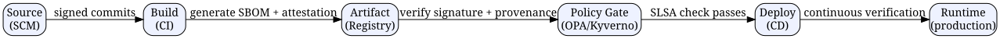

# Software Supply Chain Security in 2026: A Practical Guide to SLSA, SBOM, and Attestation

*Reading time: 10 min · 2,010 words*

> A practical DevOps guide to securing the software supply chain in 2026, covering SBOMs, SLSA levels, signing with Sigstore, attestation, and policy enforcement, with a real-world case study of the xz Utils backdoor.

## Table of Contents
- [Why Supply Chain Security Is the Defining DevOps Challenge of 2026](#why-supply-chain-security-is-the-defining-devops-challenge-of-2026)
- [The Threat Landscape: What Are We Protecting Against?](#the-threat-landscape-what-are-we-protecting-against)
  - [Dependency Confusion and Typosquatting](#dependency-confusion-and-typosquatting)
  - [Build Environment Compromise](#build-environment-compromise)
  - [Compromised Open-Source Maintainers](#compromised-open-source-maintainers)
  - [Malicious Dependencies and Transitive Risk](#malicious-dependencies-and-transitive-risk)
- [The Building Blocks of a Secure Supply Chain](#the-building-blocks-of-a-secure-supply-chain)
  - [SBOM: Know What Is Inside Your Artifacts](#sbom-know-what-is-inside-your-artifacts)
  - [SLSA: A Security Level System for Artifacts](#slsa-a-security-level-system-for-artifacts)
  - [Signing and Attestation](#signing-and-attestation)
  - [Policy Enforcement](#policy-enforcement)
- [Where to Add Controls: A Reference Pipeline](#where-to-add-controls-a-reference-pipeline)
- [Real-World Example: The xz Utils Backdoor](#real-world-example-the-xz-utils-backdoor)
- [A Practical Roadmap for 2026](#a-practical-roadmap-for-2026)
- [Conclusion](#conclusion)
- [Key Takeaways](#key-takeaways)
- [Frequently Asked Questions](#frequently-asked-questions)

In 2026, your software is only as secure as the weakest link in its supply chain. Attackers know this. Over the past few years, we have watched sophisticated adversaries shift their focus from attacking applications directly to attacking the pipelines that produce them — and the results have been devastating. A single compromised dependency, a hijacked build runner, or a poisoned open-source package can ripple through thousands of organizations in hours.

This article is a practical field guide for DevOps teams that want to defend the software supply chain in 2026. We will cover the core building blocks — SBOMs, SLSA levels, signing, and attestation — show you exactly where to add controls in your pipeline, and walk through a real-world attack to make the concepts concrete.

## Why Supply Chain Security Is the Defining DevOps Challenge of 2026

Software supply chain security is not a new idea, but 2026 is the year it becomes non-negotiable. Several forces are converging:

- Regulatory pressure: The EU Cyber Resilience Act (CRA) and similar legislation now require manufacturers to maintain SBOMs and address vulnerabilities in their software components. In the US, Executive Order 14028 and CISA guidance push federal agencies and their suppliers toward stricter provenance requirements.
- Attack economics: Launching a supply chain attack is often cheaper and more impactful than exploiting a single vulnerability. One successful compromise can yield access to hundreds of downstream customers.
- AI-amplified threats: Attackers now use AI to craft convincing fake packages, automate typosquatting, and even generate malicious code that passes basic static analysis. This raises the bar for automated defenses.
- Toolchain maturity: The ecosystem has finally matured. Tools like Sigstore, SLSA, and standard SBOM formats are production-ready, which means there is no longer a good excuse to delay adoption.

## The Threat Landscape: What Are We Protecting Against?

Before adding controls, it helps to understand the attacks we are defending against. Here are the most common vectors in 2026:

### Dependency Confusion and Typosquatting

Attackers publish packages with names that collide with private packages or closely resemble popular ones. When a build system resolves a dependency, it may pull the malicious public package instead of the intended internal one. Automated scanners now catch many of these, but novel variants appear constantly.

### Build Environment Compromise

If an attacker gains control of a CI runner or build server, they can inject malicious code into every artifact built there. This is one of the most dangerous scenarios because the compromise happens after source code review, making it invisible to traditional checks.

### Compromised Open-Source Maintainers

Social engineering remains highly effective. Attackers befriend maintainers, submit innocent-looking contributions, and eventually gain commit access. They may then introduce a subtle backdoor over months or years.

### Malicious Dependencies and Transitive Risk

Even if your direct dependencies are clean, transitive dependencies can hide malicious or vulnerable code. Without an SBOM, you simply cannot see what is actually inside your artifacts.

## The Building Blocks of a Secure Supply Chain

Four technologies form the foundation of modern supply chain security. They work together, and each addresses a different gap.

### SBOM: Know What Is Inside Your Artifacts

A Software Bill of Materials (SBOM) is a machine-readable inventory of all components in a piece of software. Think of it as the ingredients label on a food package. The two dominant formats are SPDX and CycloneDX; both are mature and widely supported in 2026.

SBOMs matter for three reasons:
- Visibility: You can see every component, version, and license in your artifacts.
- Vulnerability management: When a CVE is disclosed, you can instantly identify which of your products are affected.
- Compliance: Regulators increasingly require SBOMs as part of procurement and certification.

Generate the SBOM at build time, not afterward, and store it alongside the artifact. Treat it as a first-class deliverable.

### SLSA: A Security Level System for Artifacts

SLSA (Supply-chain Levels for Software Artifacts) is a framework that defines increasing levels of security assurance. It answers a simple question: how much can you trust that an artifact was built from the source you think it was, without tampering?

| SLSA Level | Core guarantee | Typical requirements |
| --- | --- | --- |
| 0 | No guarantees | No formal requirements |
| 1 | Documentation | Provenance (metadata about how the artifact was built) is recorded |
| 2 | Tamper resistance | Provenance is signed; builds run on a hosted platform |
| 3 | Hardened builds | Builds are isolated and reproducible; provenance is strongly verified |
| 4 | Highest assurance | Two-person review, hermetic builds, and full auditability |

Most teams should aim for Level 2 or 3. Level 4 is rarely necessary outside extremely sensitive environments such as critical infrastructure or cryptographic libraries.

### Signing and Attestation

Signing proves that an artifact came from a specific identity, and attestation provides verifiable claims about how it was produced. In 2026, the de facto tooling is Sigstore, which enables keyless signing using short-lived certificates tied to your identity provider. The in-toto framework provides attestation formats that capture metadata such as the build command, source repository, and builder ID.

A typical flow looks like this:
1. The build runs and produces an artifact.
2. The build tool generates an in-toto attestation describing the build.
3. Sigstore signs the attestation with a short-lived certificate.
4. The signed attestation is stored in the artifact registry or a transparency log.
5. At deployment time, a policy engine verifies the signature and checks the attestation against your requirements.

### Policy Enforcement

Signing and attestation only help if something actually checks them. This is where policy-as-code enters the picture. Tools like Open Policy Agent (OPA) and Kyverno can gate your deployment pipeline: if an artifact lacks a valid signature, a required SBOM, or an approved provenance, the deployment is blocked automatically. This closes the loop between security controls and everyday operations.

## Where to Add Controls: A Reference Pipeline

The diagram below shows a reference pipeline with security checkpoints highlighted. Each stage has a specific responsibility.

Let us walk through each checkpoint:

1. Source control: Require signed commits and enforce branch protection. This prevents an attacker from injecting code directly into your repository.
2. Build: Run builds on isolated, ephemeral runners with least-privilege credentials. Generate the SBOM and attestation here, and sign them immediately.
3. Artifact registry: Store artifacts, SBOMs, and attestations together. Enable integrity verification and audit logging.
4. Policy gate: Before anything reaches production, verify the signature, validate the attestation, and confirm the SBOM is present and complete.
5. Runtime: Continuously monitor deployed software against known vulnerabilities and re-verify artifacts when new CVEs are disclosed.

## Real-World Example: The xz Utils Backdoor

The most instructive supply chain attack of recent years is the xz Utils backdoor, disclosed in March 2024 as CVE-2024-3094. An attacker spent roughly two years contributing to the open-source xz project, gradually earning the trust of the maintainer. Eventually, they introduced a malicious build script that injected a backdoor into the liblzma library. The backdoor was designed to compromise SSH authentication on affected systems, and it was only discovered by accident when a developer noticed unusual performance issues.

Why did this succeed? Because the traditional controls — code review, testing, and release engineering — were all bypassed. The malicious code was hidden in the build process, not in the source files that reviewers examined. The project had no SBOM, no signed provenance, and no automated policy enforcement.

What would have helped:
- An SBOM would have made the unexpected extra build steps visible and auditable.
- SLSA-style provenance would have documented exactly what commands ran during the build, making the hidden script much easier to spot.
- Signed attestations and a policy gate would have flagged that the build behavior deviated from the expected, trusted pattern.

The xz incident is a powerful reminder that supply chain security is not about trusting people; it is about verifying artifacts mechanically at every step.

## A Practical Roadmap for 2026

Here is a pragmatic sequence for teams that want to improve their supply chain posture without boiling the ocean:

1. Inventory your artifacts. List every application, service, and container image you produce and deploy.
2. Automate SBOM generation. Add SBOM generation to your build pipeline for every artifact. Start with CycloneDX or SPDX.
3. Adopt signing via Sigstore. Integrate cosign into your build and release process. Keyless signing removes the burden of managing long-lived keys.
4. Enforce policy at deploy time. Add a policy gate that requires valid signatures and SBOMs before any deployment proceeds.
5. Monitor and respond. Subscribe to vulnerability feeds, scan your SBOMs continuously, and establish a process for rapidly patching affected artifacts.
6. Extend to third parties. Ask your vendors for SBOMs and signed attestations, and make them a condition of procurement.

## Conclusion

Supply chain security in 2026 is a team sport that spans developers, security engineers, and platform teams. The good news is that the tooling has matured to the point where the core practices — generating SBOMs, signing artifacts, and enforcing policy — are within reach of any organization. The bad news is that attackers are also getting better, and the cost of inaction is rising.

Start small, automate aggressively, and treat supply chain security as a continuous discipline rather than a one-time project.

> Caution: An SBOM is a starting point, not a silver bullet. It tells you what is inside your software, but it does not tell you whether that content is trustworthy. Pair SBOMs with signing, attestation, and policy enforcement to get real protection.

## Key Takeaways

- Generate SBOMs at build time for every artifact, using SPDX or CycloneDX, and store them alongside the artifact.
- Use SLSA levels to define your assurance target; most teams should aim for Level 2 or 3.
- Adopt Sigstore for keyless signing and in-toto for attestations to prove where and how artifacts were built.
- Enforce policy with OPA or Kyverno so that unverified artifacts are blocked before deployment.
- Learn from incidents like the xz Utils backdoor: hidden build-time code is invisible to source review alone.
- Make supply chain security a continuous practice: monitor SBOMs, respond to CVEs, and demand SBOMs from vendors.

## Frequently Asked Questions

Q: What is the difference between an SBOM and SLSA?
A: An SBOM is an inventory of the components inside your software. SLSA is a framework of security levels that describe how much you can trust the build and provenance of an artifact. They complement each other: the SBOM answers 'what is inside?', while SLSA answers 'can I trust how it was made?'

Q: Do I need to reach SLSA Level 4?
A: Probably not. Level 4 is designed for extremely sensitive projects such as cryptographic libraries or critical infrastructure. Most organizations get meaningful protection at Level 2 or 3, which require signed provenance and hardened build environments.

Q: What tools should I use in 2026?
A: The most common stack is CycloneDX or SPDX for SBOMs, Sigstore (cosign) for signing, in-toto for attestations, and OPA or Kyverno for policy enforcement. Many CI/CD platforms now offer built-in integrations for these tools.

Q: How does supply chain security relate to policy-as-code?
A: Policy-as-code is the enforcement layer. Once you have SBOMs, signatures, and attestations, you need automated checks that verify them before deployment. Policy engines like OPA and Kyverno make those checks declarative and repeatable.

Q: Is keyless signing safe?
A: Yes, when implemented correctly. Sigstore's keyless model uses short-lived certificates tied to your identity provider, which reduces the risk of long-lived key compromise. The certificates are recorded in a transparency log, providing a public audit trail.

## Frequently Asked Questions

**Q: What is the difference between an SBOM and SLSA?**

A: An SBOM is an inventory of the components inside your software. SLSA is a framework of security levels that describe how much you can trust the build and provenance of an artifact. They complement each other: the SBOM answers 'what is inside?', while SLSA answers 'can I trust how it was made?'

**Q: Do I need to reach SLSA Level 4?**

A: Probably not. Level 4 is designed for extremely sensitive projects such as cryptographic libraries or critical infrastructure. Most organizations get meaningful protection at Level 2 or 3, which require signed provenance and hardened build environments.

**Q: What tools should I use in 2026?**

A: The most common stack is CycloneDX or SPDX for SBOMs, Sigstore (cosign) for signing, in-toto for attestations, and OPA or Kyverno for policy enforcement. Many CI/CD platforms now offer built-in integrations for these tools.

**Q: How does supply chain security relate to policy-as-code?**

A: Policy-as-code is the enforcement layer. Once you have SBOMs, signatures, and attestations, you need automated checks that verify them before deployment. Policy engines like OPA and Kyverno make those checks declarative and repeatable.

**Q: Is keyless signing safe?**

A: Yes, when implemented correctly. Sigstore's keyless model uses short-lived certificates tied to your identity provider, which reduces the risk of long-lived key compromise. The certificates are recorded in a transparency log, providing a public audit trail.

## Key Takeaways

- Generate SBOMs at build time for every artifact, using SPDX or CycloneDX, and store them alongside the artifact.
- Use SLSA levels to define your assurance target; most teams should aim for Level 2 or 3.
- Adopt Sigstore for keyless signing and in-toto for attestations to prove where and how artifacts were built.
- Enforce policy with OPA or Kyverno so that unverified artifacts are blocked before deployment.
- Learn from incidents like the xz Utils backdoor: hidden build-time code is invisible to source review alone.
- Make supply chain security a continuous practice: monitor SBOMs, respond to CVEs, and demand SBOMs from vendors.

## Related Articles

- Policy as Code with OPA and Kyverno
- GitOps and Declarative Delivery
- Observability with OpenTelemetry
- Platform Engineering and Internal Developer Platforms

<!-- Cover image prompts (for editors):
  - A futuristic DevOps pipeline diagram showing a software build flowing through stages labeled source, build, sign, verify, and deploy, with glowing security shields at each checkpoint, dark blue tech aesthetic, high detail.
  - An abstract illustration of a software supply chain as a series of connected shipping containers and code blocks, with a large padlock and fingerprint overlay symbolizing trust and verification, modern flat design.
  - A stylized timeline infographic depicting the xz Utils backdoor attack, showing a hidden malicious script being inserted during the build phase, with warning icons and red highlights.
  - A team of engineers reviewing a large screen displaying SBOM and SLSA dashboards, with charts showing artifact signatures and policy compliance, warm office lighting.
-->