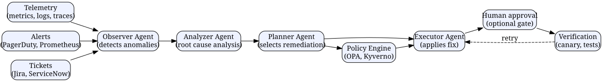

# AI Agents for DevOps in 2026: Automating Incident Response and Self-Healing Infrastructure

*Reading time: 9 min · 1,721 words*

> Explore how AI agents are transforming DevOps in 2026: autonomous incident response, self-healing infrastructure, and the guardrails needed to deploy them safely. A practical guide to architecture, best practices, and real-world outcomes.

## Table of Contents
- [Introduction: The Rise of Agentic DevOps](#introduction-the-rise-of-agentic-devops)
- [What Is Agentic DevOps?](#what-is-agentic-devops)
  - [From Automation to Autonomy](#from-automation-to-autonomy)
- [The Anatomy of a DevOps AI Agent](#the-anatomy-of-a-devops-ai-agent)
  - [Observer Agents](#observer-agents)
  - [Analyzer Agents](#analyzer-agents)
  - [Planner Agents](#planner-agents)
  - [Executor Agents](#executor-agents)
- [Where AI Agents Add the Most Value in 2026](#where-ai-agents-add-the-most-value-in-2026)
  - [Autonomous Incident Triage](#autonomous-incident-triage)
  - [Self-Healing Infrastructure](#self-healing-infrastructure)
  - [Capacity Planning and Cost Optimization](#capacity-planning-and-cost-optimization)
  - [Compliance and Policy Enforcement](#compliance-and-policy-enforcement)
- [Architecture: Putting It All Together](#architecture-putting-it-all-together)
- [The Safety Imperative: Guardrails and Human Oversight](#the-safety-imperative-guardrails-and-human-oversight)
  - [The Principle of Least Privilege](#the-principle-of-least-privilege)
  - [Approval Gates for High-Risk Actions](#approval-gates-for-high-risk-actions)
  - [Audit Trails and Explainability](#audit-trails-and-explainability)
- [Real-World Example: A Nightly Batch Failure](#real-world-example-a-nightly-batch-failure)
- [Tooling and Ecosystem in 2026](#tooling-and-ecosystem-in-2026)
- [Best Practices for Adopting AI Agents in DevOps](#best-practices-for-adopting-ai-agents-in-devops)
- [Conclusion](#conclusion)
- [Key Takeaways](#key-takeaways)
- [Frequently Asked Questions](#frequently-asked-questions)

## Introduction: The Rise of Agentic DevOps

In 2026, the conversation around DevOps has shifted from "automate everything" to "make automation intelligent." The first wave of DevOps tooling gave us pipelines that run fast and repeatably. The second wave gave us declarative infrastructure and GitOps. Now a third wave is arriving: **agentic DevOps**, where AI agents actively observe production systems, diagnose problems, and — within carefully defined guardrails — take corrective action on their own.

This isn't about replacing engineers. It's about giving engineers superpowers: offloading the tedious, repetitive parts of on-call work so humans can focus on the novel, high-judgment problems that only people can solve.

By 2026, major cloud providers and open-source communities have converged on a common pattern: a small fleet of specialized agents — observers, analyzers, planners, and executors — working together under a policy engine. This article explains how that pattern works, where it delivers the most value, and how to adopt it safely.

## What Is Agentic DevOps?

Agentic DevOps is the application of autonomous AI agents to operational tasks: monitoring, incident response, remediation, capacity management, and compliance. Unlike traditional automation, which follows fixed scripts, agents can reason about unfamiliar situations, adapt their plans, and learn from outcomes.

### From Automation to Autonomy

Traditional automation is deterministic: if X happens, do Y. That works well for known failure modes, but production systems fail in surprising ways. An agent can:

- Correlate signals across metrics, logs, and traces.
- Generate hypotheses about root causes.
- Propose and execute remediation steps.
- Verify that the fix worked.

The key distinction is **agency**: the ability to act on the environment based on reasoning, not just pre-programmed triggers.

## The Anatomy of a DevOps AI Agent

Most agentic DevOps stacks in 2026 follow a four-layer architecture. Each layer is a separate agent or agent team.

### Observer Agents

Observers continuously ingest telemetry: metrics, logs, traces, and event streams. They detect anomalies — often using ML models trained on historical baselines — and emit structured findings rather than raw alerts.

### Analyzer Agents

Analyzers take findings and perform root cause analysis. They may query distributed tracing data, correlate recent deployments, check configuration drift, and produce a ranked list of likely causes with confidence scores.

### Planner Agents

Planners decide what to do. Given a diagnosis, they select from a catalog of remediation playbooks, or generate a novel plan if none fits. Crucially, they must check every proposed action against policy before anything executes.

### Executor Agents

Executors carry out approved actions through existing infrastructure APIs: scaling a deployment, rolling back a release, restarting a service, or adjusting autoscaling thresholds. They report results back to the observer layer, closing the loop.

## Where AI Agents Add the Most Value in 2026

### Autonomous Incident Triage

On-call engineers spend a huge share of their time just figuring out what's wrong. Agents can compress that from minutes to seconds by automatically correlating alerts, checking recent changes, and presenting a concise summary with recommended next steps.

### Self-Healing Infrastructure

For well-understood failure modes, agents can remediate automatically: restarting crashed pods, draining unhealthy nodes, or reverting a bad deployment. The goal isn't to eliminate humans — it's to handle the routine 80% so humans only see the interesting 20%.

### Capacity Planning and Cost Optimization

Agents can analyze usage patterns and recommend right-sizing, spot instance usage, or autoscaling policy changes. In 2026, with cloud costs still a top concern, this is one of the fastest-ROI use cases.

### Compliance and Policy Enforcement

Policy-as-code is already mainstream. Agents extend it by detecting drift in real time and either correcting it or flagging it for human review — continuously, not just at audit time.

## Architecture: Putting It All Together

Here's a typical architecture for an agentic incident response system:

The critical feature is the **policy gate** between planning and execution. No action reaches the executor without passing policy checks.

## The Safety Imperative: Guardrails and Human Oversight

> **Caution:** An autonomous agent with broad permissions and no oversight is a liability, not an asset. The safest agent is one that is empowered to act but constrained by explicit, auditable rules.

### The Principle of Least Privilege

Give each agent only the permissions it needs. An observer shouldn't be able to delete resources; an executor shouldn't be able to modify IAM policies. Use short-lived credentials and scoped service accounts.

### Approval Gates for High-Risk Actions

Classify actions by risk. Low-risk actions (restarting a stateless pod) can be fully automatic. High-risk actions (changing database schema, modifying network policies) should require human approval. Many teams use a "human-in-the-loop" gate for anything that touches data or security boundaries.

### Audit Trails and Explainability

Every agent decision should be logged: what it observed, what it concluded, what it did, and why. In 2026, regulators and auditors increasingly expect this level of transparency. If an agent makes a mistake, you need to be able to reconstruct exactly what happened.

## Real-World Example: A Nightly Batch Failure

Consider a fintech company that runs a nightly reconciliation batch. One night, the batch fails at 2:00 AM. Here's how an agentic stack handles it:

1. **Observer** detects the failed job and an unusual spike in database connection errors.
2. **Analyzer** correlates the spike with a deployment of a new API version earlier that evening, and identifies a connection pool misconfiguration as the likely cause.
3. **Planner** selects a remediation: roll back the API deployment and restore the previous connection pool settings. It checks the policy engine: rollback is classified as medium-risk, so it's approved for automatic execution.
4. **Executor** performs the rollback via the CI/CD platform and restarts the affected pods.
5. **Verification** re-runs the batch; it succeeds. The observer confirms metrics return to baseline.
6. The entire sequence is recorded in the audit log, and a summary is posted to the on-call Slack channel — so when the engineer wakes up, they see exactly what happened and why.

Without agents, this would have meant paging an engineer at 2:00 AM, 45 minutes of investigation, and a manual rollback. With agents, it was resolved in under five minutes, with full documentation.

## Tooling and Ecosystem in 2026

The agentic DevOps ecosystem is maturing quickly. As of 2026, the landscape includes:

- **Agent orchestration frameworks** that let you define agent roles, tools, and handoffs.
- **Policy engines** (OPA, Kyverno) integrated directly into agent decision loops.
- **Observability platforms** exposing machine-readable APIs that agents can query.
- **Incident management platforms** adding native AI triage and auto-remediation features.
- **CI/CD systems** offering agent-friendly APIs for rollbacks, canary deployments, and approvals.

The good news: you don't need to build everything from scratch. Most teams start by connecting existing tools with a thin agent layer.

## Best Practices for Adopting AI Agents in DevOps

1. **Start narrow.** Pick one well-understood workflow — like incident triage — and automate just that before expanding.
2. **Instrument everything.** Agents are only as good as the telemetry they consume. If you don't have good logs and traces, fix that first.
3. **Write policies before you write agents.** Define what agents are allowed to do before you give them any power.
4. **Keep a human in the loop for risky actions.** Start with full human approval, then relax controls as you gain confidence.
5. **Measure what matters.** Track time-to-detection, time-to-resolution, and the percentage of incidents handled without human intervention.
6. **Run red-team exercises.** Deliberately inject failures to test whether your agents respond correctly — and whether your guardrails hold.

## Conclusion

Agentic DevOps is not science fiction in 2026; it's a practical, rapidly maturing discipline. The teams that adopt it thoughtfully — with strong guardrails, good telemetry, and a clear understanding of where autonomy helps — will see faster resolution times, fewer late-night pages, and more time for engineers to focus on creative work.

The key is balance. Automate the routine, but keep humans accountable for the exceptional. Build agents that are powerful but constrained, fast but explainable. Do that, and you'll have a DevOps practice that's ready for whatever 2026 throws at it.

## Key Takeaways

- Agentic DevOps uses AI agents to observe, analyze, plan, and execute operational tasks.
- The highest-value use cases are incident triage, self-healing infrastructure, capacity optimization, and continuous compliance.
- Always place a policy gate between agent planning and agent execution.
- Grant agents least privilege and require human approval for high-risk actions.
- Start with a narrow workflow, instrument thoroughly, and measure time-to-resolution improvements.
- Keep full audit trails so every agent decision is explainable and reviewable.

## Frequently Asked Questions

**Q: Will AI agents replace DevOps engineers?**
A: No. Agents handle routine operational work, but humans remain essential for setting strategy, designing systems, and making high-judgment decisions. The role shifts from firefighting to oversight and improvement.

**Q: How do I prevent an AI agent from making things worse?**
A: Use least-privilege permissions, a policy engine that gates every action, approval workflows for high-risk changes, and thorough audit logging. Start with read-only agents and expand gradually.

**Q: What's the difference between traditional automation and an AI agent?**
A: Traditional automation follows fixed, pre-programmed rules. An agent can reason about novel situations, generate plans, and adapt based on outcomes — but it requires guardrails to stay safe.

**Q: Do I need a large AI team to adopt agentic DevOps?**
A: No. Most teams start by enabling agent features in existing observability and incident management tools, then add a thin orchestration layer for custom workflows.

**Q: How do I measure the success of an agentic DevOps rollout?**
A: Track mean time to detection (MTTD), mean time to resolution (MTTR), the percentage of incidents resolved without human intervention, and the number of false-positive remediations.

## Frequently Asked Questions

**Q: Will AI agents replace DevOps engineers?**

A: No. Agents handle routine operational work, but humans remain essential for setting strategy, designing systems, and making high-judgment decisions. The role shifts from firefighting to oversight and improvement.

**Q: How do I prevent an AI agent from making things worse?**

A: Use least-privilege permissions, a policy engine that gates every action, approval workflows for high-risk changes, and thorough audit logging. Start with read-only agents and expand gradually.

**Q: What's the difference between traditional automation and an AI agent?**

A: Traditional automation follows fixed, pre-programmed rules. An agent can reason about novel situations, generate plans, and adapt based on outcomes — but it requires guardrails to stay safe.

**Q: Do I need a large AI team to adopt agentic DevOps?**

A: No. Most teams start by enabling agent features in existing observability and incident management tools, then add a thin orchestration layer for custom workflows.

**Q: How do I measure the success of an agentic DevOps rollout?**

A: Track mean time to detection (MTTD), mean time to resolution (MTTR), the percentage of incidents resolved without human intervention, and the number of false-positive remediations.

## Key Takeaways

- Agentic DevOps uses AI agents to observe, analyze, plan, and execute operational tasks.
- The highest-value use cases are incident triage, self-healing infrastructure, capacity optimization, and continuous compliance.
- Always place a policy gate between agent planning and agent execution.
- Grant agents least privilege and require human approval for high-risk actions.
- Start with a narrow workflow, instrument thoroughly, and measure time-to-resolution improvements.
- Keep full audit trails so every agent decision is explainable and reviewable.

## Related Articles

- Platform engineering and internal developer platforms
- GitOps and declarative infrastructure
- Observability with OpenTelemetry
- Policy as code and governance automation

<!-- Cover image prompts (for editors):
  - A futuristic DevOps control room with a glass dashboard showing AI agents as glowing nodes connected by lines, monitoring server clusters, dark blue and teal color palette, cinematic lighting, high detail
  - An illustration of an autonomous incident response loop: a robotic hand turning a dial labeled 'rollback' while a policy shield icon blocks unsafe actions, clean vector style, white background, blue and orange accents
  - A diagram-style artwork of layered AI agent architecture with observer, analyzer, planner, and executor layers, connected by arrows, modern flat design, soft gradients
-->