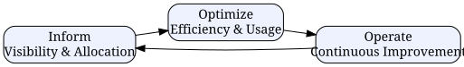

# FinOps in 2025: A Practical Guide to Cloud Cost Management and Optimization

*Reading time: 7 min · 1,460 words*

> FinOps is the discipline of managing cloud costs collaboratively across engineering, finance, and product teams. This guide covers the FinOps lifecycle, practical cost-saving techniques, real-world examples, and common pitfalls to avoid in 2025.

## Table of Contents
- [What Is FinOps?](#what-is-finops)
  - [Core Principles](#core-principles)
  - [The FinOps Lifecycle](#the-finops-lifecycle)
- [Why FinOps Matters More Than Ever in 2025](#why-finops-matters-more-than-ever-in-2025)
- [Key Practices That Actually Move the Needle](#key-practices-that-actually-move-the-needle)
  - [1. Tagging and Cost Allocation](#1-tagging-and-cost-allocation)
  - [2. Rightsizing](#2-rightsizing)
  - [3. Savings Plans and Reserved Capacity](#3-savings-plans-and-reserved-capacity)
  - [4. Autoscaling and Serverless](#4-autoscaling-and-serverless)
  - [5. Spot and Preemptible Instances](#5-spot-and-preemptible-instances)
  - [6. Storage Lifecycle Policies](#6-storage-lifecycle-policies)
  - [7. Data Egress Optimization](#7-data-egress-optimization)
- [The FinOps Maturity Model](#the-finops-maturity-model)
- [Real-World Example: Acme SaaS](#real-world-example-acme-saas)
- [Common Pitfalls to Avoid](#common-pitfalls-to-avoid)
- [Tools and Automation](#tools-and-automation)
- [Conclusion](#conclusion)
- [Key Takeaways](#key-takeaways)
- [Frequently Asked Questions](#frequently-asked-questions)

Cloud spending has quietly become one of the largest line items on many engineering budgets. By 2025, industry analysts projected worldwide public cloud end-user spending to exceed $700 billion, and multiple studies consistently note that a significant portion of that spend is wasted — often 30% or more — due to idle resources, overprovisioning, and lack of visibility. FinOps (a portmanteau of "Finance" and "DevOps") has emerged as the discipline that brings engineering, finance, and business teams together to manage cloud costs the same way they manage uptime and performance.


## What Is FinOps?

FinOps is a cultural and operational framework for managing cloud spend. It's not just a set of tools; it's a set of principles and practices that treat cloud cost as a first-class engineering metric.

### Core Principles

- **Collaboration**: Finance, engineering, and product teams share accountability for cloud spend.
- **Timely decision-making**: Cost data is available in near real-time, not at month-end.
- **Centralized accountability**: A centralized team (often called a Cloud Center of Excellence) sets policies, while individual teams own their usage.
- **Variable cost mindset**: Treat cloud as a variable cost that must be continuously tuned, not a fixed capital expense.

### The FinOps Lifecycle

The FinOps Foundation defines three recurring phases: Inform, Optimize, and Operate.

**Inform** — Establish visibility. Tag resources, allocate costs to teams, and build dashboards so everyone can see what they're spending.

**Optimize** — Find waste. Right-size instances, purchase savings plans, and automate scaling based on actual demand.

**Operate** — Continuously improve. Set budgets, alert on anomalies, and review usage in regular cadences.



## Why FinOps Matters More Than Ever in 2025

Several trends have made FinOps a board-level topic:

- **AI workloads**: Training and inference costs for LLMs have exploded. GPU clusters can cost six figures per month.
- **Multi-cloud sprawl**: Teams increasingly spread workloads across AWS, Azure, and GCP, making cost visibility harder.
- **Budget pressure**: Economic uncertainty has forced companies to scrutinize every dollar of cloud spend.

## Key Practices That Actually Move the Needle

### 1. Tagging and Cost Allocation

Tagging is the foundation of everything. Without consistent resource tags, you cannot answer "who spent what."

A simple tagging strategy:

| Tag | Purpose | Example |
|-----|---------|---------|
| `team` | Owner team | `payments-team` |
| `environment` | Dev/staging/prod | `production` |
| `cost-center` | Business unit | `checkout` |
| `project` | Initiative | `mobile-v3` |

> **Caution**: Tags are only useful if enforced. Use AWS Organizations SCPs, Azure Policy, or GCP Organization Policies to require mandatory tags on new resources. Un-tagged resources should be quarantined or flagged in daily reports.

### 2. Rightsizing

Rightsizing means matching instance types and sizes to actual workload demands. Most teams find that 20–40% of their compute instances are overprovisioned by at least one size.

Tools like AWS Compute Optimizer, Azure Advisor, and GCP Recommender provide automated suggestions based on utilization metrics. Look for instances running below 20% CPU utilization for more than two weeks — those are prime candidates for downsizing.

### 3. Savings Plans and Reserved Capacity

Committed-use discounts remain the single biggest lever for cost reduction:

- **AWS Savings Plans** (compute, EC2, SageMaker) — up to 72% off on-demand
- **Azure Reserved Instances** — up to 72% off
- **GCP Committed Use Discounts** — up to 70% off

The key is to commit only to predictable, steady-state usage. Never buy reservations for spiky or experimental workloads. Start by covering 50–60% of your baseline usage, then adjust quarterly.

### 4. Autoscaling and Serverless

Autoscaling is non-negotiable for production workloads. For bursty or unpredictable traffic, serverless options (Lambda, Cloud Functions, Azure Functions) eliminate idle capacity entirely. A common pattern is to keep a small always-on core and scale everything else dynamically.

### 5. Spot and Preemptible Instances

For fault-tolerant batch jobs, CI runners, and stateless services, spot instances offer 60–90% discounts. Design for interruption by using checkpoints and queue-based retries. Kubernetes users can leverage spot node pools with pod disruption budgets.

### 6. Storage Lifecycle Policies

Storage is easy to forget. Implement lifecycle rules to transition objects from hot to cold tiers (S3 Standard → IA → Glacier) and delete obsolete snapshots. A typical rule: move logs older than 30 days to IA, and archive anything older than 90 days to Glacier.

### 7. Data Egress Optimization

Data transfer costs can surprise you. Keep workloads in the same region, use CloudFront/CDN for repeated downloads, and avoid cross-region replication unless required. Be especially careful with database replicas and analytics pipelines that pull large datasets across regions.

## The FinOps Maturity Model

| Phase | Characteristics | Metrics |
|-------|----------------|---------|
| Crawl | Manual tagging, monthly reviews | Cost per account |
| Walk | Automated tagging, unit economics | Cost per customer, per deployment |
| Run | Real-time anomaly detection, chargeback | Cost per feature, per request |

Most organizations start at Crawl and should aim to reach Walk within two quarters. Run-level maturity is where the compounding benefits kick in.

## Real-World Example: Acme SaaS

Acme SaaS ran a multi-tenant application on AWS. Their monthly bill was $180,000. After launching a FinOps initiative:

1. **Inform**: They deployed a tagging standard across 3,000 resources and built a cost dashboard in Grafana with data from AWS Cost Explorer APIs.
2. **Optimize**:
   - Rightsized 340 EC2 instances (saved ~$18k/month)
   - Purchased Compute Savings Plans covering 60% of baseline usage (saved ~$22k/month)
   - Migrated CI runners to spot instances (saved ~$6k/month)
   - Added S3 lifecycle rules for logs (saved ~$3k/month)
3. **Operate**: Set budget alerts at 80% and 100% of forecast, and added a weekly cost review to the engineering standup.

Result: Monthly bill dropped to ~$108,000 — a 40% reduction in six months. The team reinvested the savings into additional development capacity.


## Common Pitfalls to Avoid

- **Chasing discounts before visibility**: Buying reservations without knowing your baseline leads to waste.
- **Tagging fatigue**: Too many tags with no enforcement leads to incomplete data.
- **Treating FinOps as a finance-only problem**: Engineers must own their costs for the practice to work.
- **Ignoring egress**: Data transfer is often the hidden tax that appears in the month-end bill.
- **Not automating**: Manual cost reviews become stale quickly. Automate alerts and policies.

## Tools and Automation

- **AWS Cost Explorer / Azure Cost Management / GCP Billing** — native visibility
- **OpenCost** (open-source, CNCF project) — Kubernetes cost monitoring
- **Kubecost** — advanced Kubernetes cost allocation
- **Infracost** — Terraform cost estimation in CI/CD

Example: failing a CI build when estimated cost exceeds a threshold

```yaml
# GitHub Actions snippet
- name: Cost check
  run: infracost breakdown --path . --format json | jq -e '.totalMonthlyCost < 500'
```

## Conclusion

FinOps is not a one-time project; it's a continuous practice. The teams that succeed treat cloud cost as an engineering metric, not a finance report. Start small: tag your resources, measure your waste, and pick one optimization lever to pull this quarter. The compounding effect of monthly reviews will surprise you.

## Key Takeaways

- FinOps is a cultural practice, not just a toolset — it requires collaboration across engineering, finance, and product.
- Visibility comes first: you cannot optimize what you cannot measure.
- Committed-use discounts are the biggest lever but only after you understand your baseline.
- Rightsizing and autoscaling deliver compounding savings with minimal risk.
- Spot instances are excellent for fault-tolerant workloads.
- Automate cost checks in CI/CD to prevent regressions.

## Frequently Asked Questions

**Q: What is the difference between FinOps and traditional IT cost management?**
A: Traditional cost management is often reactive and finance-led. FinOps is proactive, collaborative, and engineering-led, with near-real-time visibility and shared accountability.

**Q: How long does it take to see results from FinOps?**
A: Most organizations see meaningful savings within 3–6 months of starting, with the quickest wins coming from rightsizing and committed-use discounts.

**Q: Do we need a dedicated FinOps team?**
A: Not necessarily. A small cross-functional group (the "Cloud Center of Excellence") can drive the practice, but every team needs to own its costs.

**Q: Which cloud provider has the best FinOps tooling?**
A: All three major providers have strong native tools (AWS Cost Explorer, Azure Cost Management, GCP Billing). Many teams add open-source tools like OpenCost or Kubecost for Kubernetes-specific visibility.

**Q: Can FinOps apply to on-premises infrastructure?**
A: Partially. The cost-allocation and budgeting practices translate, but the elasticity and variable-cost dynamics are unique to public cloud.

## Frequently Asked Questions

**Q: What is the difference between FinOps and traditional IT cost management?**

A: Traditional cost management is often reactive and finance-led. FinOps is proactive, collaborative, and engineering-led, with near-real-time visibility and shared accountability.

**Q: How long does it take to see results from FinOps?**

A: Most organizations see meaningful savings within 3–6 months of starting, with the quickest wins coming from rightsizing and committed-use discounts.

**Q: Do we need a dedicated FinOps team?**

A: Not necessarily. A small cross-functional group (the "Cloud Center of Excellence") can drive the practice, but every team needs to own its costs.

**Q: Which cloud provider has the best FinOps tooling?**

A: All three major providers have strong native tools (AWS Cost Explorer, Azure Cost Management, GCP Billing). Many teams add open-source tools like OpenCost or Kubecost for Kubernetes-specific visibility.

**Q: Can FinOps apply to on-premises infrastructure?**

A: Partially. The cost-allocation and budgeting practices translate, but the elasticity and variable-cost dynamics are unique to public cloud.

## Key Takeaways

- FinOps is a cultural practice, not just a toolset — it requires collaboration across engineering, finance, and product.
- Visibility comes first: you cannot optimize what you cannot measure.
- Committed-use discounts are the biggest lever but only after you understand your baseline.
- Rightsizing and autoscaling deliver compounding savings with minimal risk.
- Spot instances are excellent for fault-tolerant workloads.
- Automate cost checks in CI/CD to prevent regressions.

## Related Articles

- kubernetes-cost-optimization
- cloud-architecture-patterns
- devops-metrics
- infrastructure-as-code

<!-- Cover image prompts (for editors):
  - A modern analytics dashboard showing cloud cost breakdown by team, with colorful bar charts and line graphs, dark theme, professional fintech aesthetic
  - An abstract illustration of money flowing through cloud servers, digital network nodes, glowing dollar signs on circuit boards, blue and green tones
  - A team of engineers and finance professionals collaborating around a screen with cost optimization charts, modern office setting, warm lighting
-->