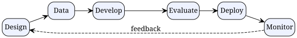

# AI Governance in 2025: A Practical Guide to Responsible AI Deployment

*Reading time: 8 min · 1,610 words*

> This guide explains what AI governance means in 2025, covering the EU AI Act, NIST AI RMF, and ISO/IEC 42001, plus practical steps to build a governance program: inventory, risk classification, roles, approval gates, and ongoing monitoring. It includes a real-world healthcare example and common pitfalls to avoid.

## Table of Contents
- [Why AI Governance Is No Longer Optional](#why-ai-governance-is-no-longer-optional)
- [What Is AI Governance?](#what-is-ai-governance)
  - [Core Pillars of AI Governance](#core-pillars-of-ai-governance)
- [The Regulatory Landscape in 2025](#the-regulatory-landscape-in-2025)
  - [The EU AI Act](#the-eu-ai-act)
  - [NIST AI Risk Management Framework](#nist-ai-risk-management-framework)
  - [ISO/IEC 42001](#isoiec-42001)
  - [Other Notable Developments](#other-notable-developments)
- [Building a Practical AI Governance Program](#building-a-practical-ai-governance-program)
  - [Step 1: Take Inventory](#step-1-take-inventory)
  - [Step 2: Classify Risk](#step-2-classify-risk)
  - [Step 3: Define Roles and Responsibilities](#step-3-define-roles-and-responsibilities)
  - [Step 4: Establish Approval Gates](#step-4-establish-approval-gates)
  - [Step 5: Document Everything](#step-5-document-everything)
  - [Step 6: Monitor and Respond](#step-6-monitor-and-respond)
- [The AI Governance Lifecycle](#the-ai-governance-lifecycle)
- [Real-World Example: AI Triage in Healthcare](#real-world-example-ai-triage-in-healthcare)
- [Common Pitfalls to Avoid](#common-pitfalls-to-avoid)
- [Conclusion](#conclusion)
- [Key Takeaways](#key-takeaways)
- [Frequently Asked Questions](#frequently-asked-questions)

## Why AI Governance Is No Longer Optional

In early 2025, artificial intelligence is no longer a pilot project—it's embedded in customer support, hiring, lending, healthcare triage, code generation, and thousands of other workflows. With that scale comes scrutiny. Regulators, customers, and business partners increasingly expect organizations to demonstrate that their AI systems are safe, fair, transparent, and accountable.

AI governance is the discipline that makes this possible. It's the framework of policies, processes, roles, and technical controls that ensure AI systems are developed and operated responsibly. Without it, organizations risk regulatory fines, reputational damage, biased outcomes, and costly rework.

This guide explains what AI governance means in 2025, what the regulatory landscape looks like, how to build a practical governance program, and how to operationalize it across the AI lifecycle.

## What Is AI Governance?

AI governance refers to the structures and practices that direct, monitor, and control how an organization develops and uses AI. It answers questions like:

- Who is accountable when an AI system makes a mistake?
- How do we know an AI system is fair and unbiased?
- What documentation must exist before deployment?
- How do we detect and respond to problems after launch?

### Core Pillars of AI Governance

Most mature programs rest on six pillars:

1. **Accountability** — clear ownership of AI systems, from design through retirement.
2. **Transparency** — stakeholders can understand how decisions are made.
3. **Fairness** — systems don't discriminate against protected groups.
4. **Safety and robustness** — systems perform reliably even under unexpected conditions.
5. **Privacy and data protection** — personal data is handled lawfully.
6. **Human oversight** — meaningful human control over high-stakes decisions.

These pillars translate into concrete artifacts: model cards, data sheets, risk registers, approval workflows, and audit trails.

## The Regulatory Landscape in 2025

The biggest driver of AI governance is regulation. Here's where things stand.

### The EU AI Act

The EU AI Act entered into force in August 2024 and is being phased in:

| Date | Obligation |
|------|------------|
| February 2025 | Prohibitions on unacceptable-risk AI apply |
| August 2025 | Obligations for general-purpose AI models apply |
| August 2026 | Most high-risk system obligations apply |

The Act classifies AI systems by risk level:

- **Unacceptable risk**: banned (e.g., social scoring, manipulative techniques).
- **High risk**: strict requirements (e.g., medical devices, hiring tools, credit scoring).
- **Limited risk**: transparency obligations (e.g., chatbots must disclose they're AI).
- **Minimal risk**: no additional obligations (e.g., spam filters).

### NIST AI Risk Management Framework

The U.S. National Institute of Standards and Technology published the AI RMF 1.0 in January 2023. It's voluntary and organized around four functions: **Govern, Map, Measure, Manage**. Many U.S. organizations adopt it as a de facto baseline.

### ISO/IEC 42001

This international standard specifies requirements for an AI management system. It's certifiable, similar to ISO 27001 for information security. Organizations seeking third-party validation often pursue this.

### Other Notable Developments

- **U.S. Executive Order 14110** (October 2023) directed federal agencies to develop AI guidance.
- **State laws**: Colorado's AI Act took effect in 2026, targeting algorithmic discrimination in high-risk systems.
- **Canada**: Bill C-27 (AIDA) proposes a federal AI framework.
- **China**: interim measures for generative AI require registration and labeling.

> **Note**: AI regulation is evolving quickly. The timelines above reflect information available as of early 2025; always verify current requirements with legal counsel before making compliance decisions.

## Building a Practical AI Governance Program

You don't need a massive bureaucracy to start. Here's a pragmatic path.

### Step 1: Take Inventory

You can't govern what you don't know about. Create a **model registry** — a central database of every AI system in production, including:

- System name, owner, and purpose
- Model type and version
- Training data sources and provenance
- Deployment date and environment
- Risk classification
- Associated documentation (model card, datasheet)

### Step 2: Classify Risk

Assign each system a risk tier based on potential harm. Use the EU AI Act categories as a starting point, adapted to your context. High-risk systems get more scrutiny and stricter controls.

### Step 3: Define Roles and Responsibilities

Common roles include:

- **AI Governance Committee** — sets policy and reviews high-risk deployments.
- **Responsible AI Officer / Lead** — owns the program day-to-day.
- **Model Risk Manager** — assesses and monitors model risk.
- **Engineering leads** — implement controls and documentation.
- **Legal & Compliance** — interpret regulations and handle incidents.
- **Internal Audit** — independently evaluate the program.

### Step 4: Establish Approval Gates

Create a review board that must approve high-risk models before deployment. The approval package typically includes:

- Risk assessment results
- Bias and fairness evaluation reports
- Security and privacy review
- Human oversight plan
- Monitoring and rollback plan

### Step 5: Document Everything

Produce **model cards** (describing intended use, performance, limitations) and **datasheets** (describing training data). These documents are the backbone of transparency and audit readiness.

### Step 6: Monitor and Respond

After deployment, continuously monitor for drift, performance degradation, and incidents. Maintain an incident response plan and a clear escalation path.

## The AI Governance Lifecycle

Governance isn't a one-time checklist—it's a continuous loop that spans the entire AI lifecycle.

Each phase has governance touchpoints:

- **Design**: document intended use, identify affected stakeholders, classify risk.
- **Data**: record provenance, assess representativeness, address bias.
- **Develop**: follow secure coding practices, log experiments, maintain version control.
- **Evaluate**: run bias tests, adversarial tests, and performance benchmarks.
- **Deploy**: obtain approval, set up monitoring, define rollback criteria.
- **Monitor**: track drift, investigate incidents, retrain or retire as needed.

## Real-World Example: AI Triage in Healthcare

Consider a regional health network deploying an AI system that triages patient messages and flags urgent cases for clinician review.

**Risk classification**: Under the EU AI Act, a medical AI system is high-risk. The network treats it accordingly.

**Inventory**: The system is registered in the model registry with its owner, version, and training data sources.

**Risk assessment**: The team evaluates failure modes — e.g., missing a critical symptom, or systematically underestimating risk for certain demographic groups. They run fairness analyses across age, gender, and ethnicity cohorts.

**Approval gate**: The AI governance committee reviews the evidence, including clinical validation results and a human oversight plan. Clinicians remain in the loop: the AI recommends, humans decide.

**Monitoring**: After launch, the team tracks prediction drift and sensitivity. They establish an incident protocol: any suspected failure triggers a review and, if needed, a rollback.

**Documentation**: A model card describes the system's intended use, limitations, and performance. This serves both internal accountability and external transparency.

The result: the health network gains efficiency while maintaining trust and regulatory readiness.

## Common Pitfalls to Avoid

1. **Checkbox governance** — creating policies but never enforcing them.
2. **Siloed ownership** — governance living only in legal, with no engineering involvement.
3. **No inventory** — not knowing which AI systems exist.
4. **Ignoring vendors** — failing to govern third-party and open-source models.
5. **Over-relying on tools** — buying software without fixing process gaps.
6. **Static thinking** — treating governance as a one-time exercise instead of a loop.

## Conclusion

AI governance in 2025 is moving from "nice to have" to "must have." Regulations like the EU AI Act are forcing action, but the real value of governance is operational: fewer failures, better trust, and faster, safer innovation.

Start small. Inventory your models, classify risk, assign owners, and build a review process. Then iterate. The goal isn't perfection—it's a system that learns and improves alongside your AI.

## Key Takeaways

- AI governance is a framework of policies, processes, roles, and technical controls for responsible AI.
- The EU AI Act, NIST AI RMF, and ISO/IEC 42001 are the dominant reference points in 2025.
- Start with a model registry and risk classification; you can't govern what you can't see.
- Assign clear accountability through a governance committee and model owners.
- Build governance into every phase of the AI lifecycle, from design to monitoring.
- Avoid checkbox governance: enforce, measure, and continuously improve.

## Frequently Asked Questions

**Q: Is AI governance only for large enterprises?**
A: No. Even small teams deploying AI face legal and ethical risks. A lightweight program—an inventory, a risk review, and basic documentation—is achievable at any scale.

**Q: How does the EU AI Act affect companies outside Europe?**
A: The Act applies to organizations that place AI systems on the EU market or whose outputs are used in the EU, regardless of where the company is headquartered. Global firms often comply globally to simplify operations.

**Q: What is the difference between AI governance and model risk management?**
A: Model risk management (MRM) is a subset of AI governance focused on financial and statistical model risk, common in banking. AI governance is broader, covering ethics, fairness, transparency, and regulatory compliance across all AI use cases.

**Q: Do open-source models need governance?**
A: Yes. Using an open-source foundation model doesn't remove your responsibility for how it's deployed. You still need to document intended use, evaluate bias, and monitor behavior in your specific context.

**Q: What tools can help with AI governance?**
A: Model registries, MLflow or Weights & Biases for experiment tracking, bias testing libraries (e.g., Fairlearn, AIF360), explainability tools (SHAP, LIME), and monitoring platforms (e.g., Evidently, WhyLabs). Tools support—but don't replace—good process.

## Frequently Asked Questions

**Q: Is AI governance only for large enterprises?**

A: No. Even small teams deploying AI face legal and ethical risks. A lightweight program—an inventory, a risk review, and basic documentation—is achievable at any scale.

**Q: How does the EU AI Act affect companies outside Europe?**

A: The Act applies to organizations that place AI systems on the EU market or whose outputs are used in the EU, regardless of where the company is headquartered. Global firms often comply globally to simplify operations.

**Q: What is the difference between AI governance and model risk management?**

A: Model risk management (MRM) is a subset of AI governance focused on financial and statistical model risk, common in banking. AI governance is broader, covering ethics, fairness, transparency, and regulatory compliance across all AI use cases.

**Q: Do open-source models need governance?**

A: Yes. Using an open-source foundation model doesn't remove your responsibility for how it's deployed. You still need to document intended use, evaluate bias, and monitor behavior in your specific context.

**Q: What tools can help with AI governance?**

A: Model registries, MLflow or Weights & Biases for experiment tracking, bias testing libraries (e.g., Fairlearn, AIF360), explainability tools (SHAP, LIME), and monitoring platforms (e.g., Evidently, WhyLabs). Tools support—but don't replace—good process.

## Key Takeaways

- AI governance is a framework of policies, processes, roles, and technical controls for responsible AI.
- The EU AI Act, NIST AI RMF, and ISO/IEC 42001 are the dominant reference points in 2025.
- Start with a model registry and risk classification; you can't govern what you can't see.
- Assign clear accountability through a governance committee and model owners.
- Build governance into every phase of the AI lifecycle, from design to monitoring.
- Avoid checkbox governance: enforce, measure, and continuously improve.

## Related Articles

- Responsible AI
- Model Risk Management
- EU AI Act Compliance
- AI Auditing

<!-- Cover image prompts (for editors):
  - A modern corporate boardroom with diverse professionals reviewing a large dashboard displaying AI risk metrics and compliance status, clean minimalist style, soft lighting, blue and teal color palette
  - An infographic-style illustration of the AI governance lifecycle with circular arrows connecting stages: design, data, development, evaluation, deployment, monitoring, flat vector style, professional color scheme
  - A close-up of a laptop screen showing a model registry interface with AI system entries, risk badges, and approval statuses, clean UI design, neutral background
-->