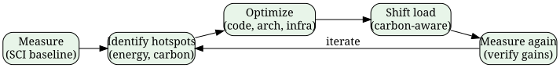

# Green Software Engineering in 2025: A Practical Guide to Sustainable Applications

*Reading time: 11 min · 2,231 words*

> Green software engineering is the practice of designing, building, and operating applications that minimize their environmental impact. This guide covers the core principles, measurement frameworks like Software Carbon Intensity, practical optimization strategies, and real-world examples to help you build more sustainable software in 2025.

## Table of Contents
- [Why Green Software Engineering Matters in 2025](#why-green-software-engineering-matters-in-2025)
- [What Is Green Software Engineering?](#what-is-green-software-engineering)
- [Measuring Carbon: The Software Carbon Intensity (SCI) Standard](#measuring-carbon-the-software-carbon-intensity-sci-standard)
  - [The Measurement Loop](#the-measurement-loop)
- [Practical Strategies for Reducing Carbon](#practical-strategies-for-reducing-carbon)
  - [1. Code-Level Optimizations](#1-code-level-optimizations)
  - [2. Architecture-Level Decisions](#2-architecture-level-decisions)
  - [3. Infrastructure and Platform-Level Levers](#3-infrastructure-and-platform-level-levers)
- [Real-World Example: Cutting a Streaming Service's Carbon by 30%](#real-world-example-cutting-a-streaming-services-carbon-by-30)
- [Challenges and Trade-offs](#challenges-and-trade-offs)
- [Tools to Get Started](#tools-to-get-started)
- [Conclusion](#conclusion)
- [Key Takeaways](#key-takeaways)
- [Frequently Asked Questions](#frequently-asked-questions)

## Why Green Software Engineering Matters in 2025

The digital economy runs on electricity, and the bill is growing. Data centers worldwide consume an estimated 1–2% of global electricity today, and with the explosion of generative AI training and inference workloads, that share is climbing fast. At the same time, regulators in the European Union (CSRD), the United States (SEC climate disclosure rules), and elsewhere are pushing organizations to report their environmental impact with increasing granularity.

Green software engineering is the discipline of building software that minimizes its carbon footprint. It is not about planting trees or buying offsets — it is about making concrete engineering decisions that reduce the energy and carbon required to deliver a feature, a request, or a product.

This guide will walk you through the core principles, the measurement frameworks, and the practical techniques you can apply today. Whether you are a backend engineer, a platform team lead, or an architect evaluating new systems, you will leave with actionable steps.


## What Is Green Software Engineering?

Green software engineering applies sustainability thinking to the entire software lifecycle: design, development, deployment, and operation. It overlaps with, but is distinct from, "green IT," which traditionally focuses on hardware efficiency — better cooling, more efficient processors, and renewable-powered data centers.

The Green Software Foundation — a nonprofit hosted by the Linux Foundation — has defined four core principles that form the foundation of the discipline:

| Principle | Definition | Example |
|-----------|-----------|---------|
| Carbon efficiency | Emit the least amount of carbon possible | Choose regions powered by clean grids |
| Energy efficiency | Use the least amount of energy possible | Optimize algorithms, reduce idle polling |
| Hardware efficiency | Use the least amount of embodied carbon possible | Right-size VMs, reuse existing capacity |
| Carbon awareness | Do more work when carbon is low, less when it is high | Shift batch jobs to windy/sunny hours |

Note that these principles sometimes conflict. A highly energy-efficient algorithm might still run on a dirty grid, emitting more carbon than a slightly less efficient algorithm running on a clean grid. The goal is to optimize for carbon, not just energy.

> **Important:** Green software engineering is not a performance regression. Many carbon optimizations — such as reducing wasted compute and shrinking payloads — also improve latency and reduce cloud bills.

## Measuring Carbon: The Software Carbon Intensity (SCI) Standard

You cannot manage what you do not measure. In 2021, the Green Software Foundation introduced the Software Carbon Intensity (SCI) specification, now a proposed IEEE standard (P2864). The SCI formula provides a standardized way to score the carbon emissions of a software system:

```
SCI = (E × I + M) / R
```

Where:

- **E** is the energy consumed by the software in kilowatt-hours (kWh).
- **I** is the location-based carbon intensity of the energy grid, expressed in grams of CO₂-equivalent per kWh (gCO₂e/kWh).
- **M** is the embodied carbon of the hardware the software runs on, amortized over its lifetime (gCO₂e).
- **R** is a functional unit — for example, per request, per user, per transaction, or per hour of use.

The result is a carbon intensity score in grams of CO₂e per functional unit. Lower is better.

Here is a simple example. Suppose a microservice consumes 0.01 kWh per request on a grid with a carbon intensity of 400 gCO₂e/kWh, and the embodied carbon amortization is 2 gCO₂e per request:

```
SCI = (0.01 × 400 + 2) / 1 request = 6 gCO₂e per request
```

If you move the same service to a region with a carbon intensity of 100 gCO₂e/kWh, the score drops to 3 gCO₂e per request — a 50% improvement without changing a single line of code.

### The Measurement Loop

Measuring carbon is not a one-time activity. It is a continuous loop:



## Practical Strategies for Reducing Carbon

Let us translate the principles into concrete engineering actions, organized by the layer you control.

### 1. Code-Level Optimizations

The cheapest kilowatt-hour is the one you never use. Small code changes can have outsized effects:

- **Avoid busy-wait loops and aggressive polling.** Replace them with event-driven or push-based mechanisms. A poller that wakes up every second burns energy even when there is nothing to do.
- **Use efficient algorithms and data structures.** A quadratic algorithm that runs in 10 ms instead of 1 ms may not matter for one request, but at millions of requests, it becomes a meaningful energy sink.
- **Compress and shrink payloads.** Smaller responses mean fewer bytes over the wire, less network equipment energy, and faster clients.
- **Cache aggressively.** Serving a response from cache can be orders of magnitude cheaper than recomputing it. This is both a performance win and a carbon win.
- **Turn off what you do not use.** Development environments, staging clusters, and forgotten test instances left running overnight are pure waste.

### 2. Architecture-Level Decisions

Architecture determines where and when work happens — and thus how much carbon it emits.

- **Carbon-aware scheduling.** If you run batch jobs (ETL pipelines, model training, report generation), schedule them for hours when the local grid is cleanest. In many markets, this is at night when wind is high or during midday when solar peaks. The Carbon Aware SDK from the Green Software Foundation provides APIs to query forecasted carbon intensity and pick optimal windows.
- **Right-size your resources.** Over-provisioned instances waste energy and money. Use autoscaling with sane minimums, and periodically review utilization. An idle VM still draws power and carries embodied carbon.
- **Choose your regions deliberately.** Cloud providers publish carbon intensity data per region. Moving latency-tolerant workloads to regions with cleaner grids can cut emissions dramatically. For example, running a non-interactive analytics job in a hydro-powered region in Quebec instead of a coal-heavy region can reduce carbon by 80% or more.
- **Data lifecycle management.** Not all data needs to live in hot storage. Tier cold data to archive storage, which uses less energy. Delete stale test data and old artifacts.
- **Consider serverless for spiky workloads.** Functions-as-a-service scale to zero when idle, eliminating the energy cost of idle containers. However, be aware that cold starts can consume burst energy; evaluate the trade-off for your traffic pattern.

### 3. Infrastructure and Platform-Level Levers

Platform teams have the biggest lever of all: they set the defaults.

- **Default to cleaner regions.** Make the "green" region the default for new services, unless latency requirements dictate otherwise.
- **Enforce quotas and budgets.** Just as FinOps enforces cost budgets, green engineering can enforce carbon budgets using the SCI metric as a guardrail in CI/CD.
- **Monitor energy at the pod level.** Tools like Kepler and Scaphandre estimate energy consumption of Kubernetes pods using eBPF and hardware counters. This gives you per-service visibility.
- **Use renewable-energy-matched providers.** Many hyperscalers and smaller providers offer options to match compute with renewable energy purchases. This shifts the carbon intensity of your workload even if the physical grid remains mixed.

## Real-World Example: Cutting a Streaming Service's Carbon by 30%

Let us make this concrete with a realistic scenario. Imagine a video-on-demand company running a recommendation service and a batch transcoding pipeline on AWS.

**Baseline:** The transcoding pipeline runs continuously, processing 100,000 videos per day on 20 large EC2 instances in a region with an average carbon intensity of 450 gCO₂e/kWh. The recommendation service runs on 15 always-on instances with an average utilization of 15%.

**Actions taken:**

1. **Carbon-aware batch scheduling.** The team used the Carbon Aware SDK to shift transcoding jobs to the 6-hour window each day when regional carbon intensity was lowest (averaging 200 gCO₂e/kWh). They also reduced instance count from 20 to 14 by improving parallelism and using spot instances for interruptible chunks.
2. **Right-sizing the recommendation service.** Utilization analysis showed the service rarely exceeded 30% CPU. The team moved from 15 m5.large instances to 8 m5.xlarge instances with autoscaling between 4 and 12, cutting idle energy by roughly 40%.
3. **Payload and caching improvements.** By enabling CDN caching for popular titles and compressing metadata responses, the team reduced data transfer by 25%, cutting network energy and improving perceived latency.

**Results:** Total energy consumption dropped by ~28%, and because a larger share of work ran during low-carbon hours, the carbon footprint fell by ~33%. The company also saved approximately 22% on its cloud bill — carbon optimization and cost optimization aligned.


This example illustrates a key insight: green software engineering is often just good engineering, measured in a new unit.

## Challenges and Trade-offs

Be honest about the obstacles:

- **Measurement is hard.** Estimating embodied carbon and getting accurate per-region intensity requires assumptions. The SCI standard helps, but it is not magic. Start with approximations and refine.
- **Latency vs. carbon.** Moving workloads to distant clean-grid regions can add latency. For interactive user-facing services, you may need to keep compute close to users and accept higher carbon intensity, while shifting only background work.
- **Cost vs. carbon.** Occasionally, the greenest option is more expensive. Spot instances are cheap and green (they reuse idle capacity), but they are less reliable. Weigh priorities per workload.
- **Organizational inertia.** Green initiatives need executive sponsorship. Tie carbon metrics to existing FinOps and SRE reporting so they become part of normal operations rather than a separate project.

## Tools to Get Started

Here is a quick reference of tools and standards mentioned in this guide:

| Tool / Standard | Purpose |
|-----------------|---------|
| Software Carbon Intensity (SCI) | Standardized carbon scoring for software |
| Carbon Aware SDK | APIs for carbon-aware scheduling decisions |
| Cloud Carbon Footprint | Estimates cloud emissions across AWS, Azure, GCP |
| AWS Customer Carbon Footprint Tool | AWS-specific emissions dashboard |
| Azure Emissions Impact Dashboard | Azure-specific emissions reporting |
| GCP Carbon Footprint | Google Cloud emissions reporting |
| Kepler | Kubernetes energy monitoring via eBPF |
| Scaphandre | Host-level energy metering agent |

## Conclusion

In 2025, software sustainability is moving from a nice-to-have to a requirement. Regulators are demanding transparency, customers are voting with their wallets, and — as our real-world example shows — the engineering practices that reduce carbon also tend to reduce cost and improve performance.

Start small. Measure your baseline SCI for one service. Identify the biggest energy consumers. Apply one or two optimizations, then measure again. Build the loop into your team's definition of done. Green software engineering is not a destination; it is a continuous improvement practice — and it is one every engineer can contribute to.

## Key Takeaways

- Start by measuring your baseline carbon intensity (SCI) before optimizing anything.
- Apply the four Green Software Foundation principles: carbon efficiency, energy efficiency, hardware efficiency, and carbon awareness.
- Shift flexible workloads to times and regions with lower grid carbon intensity using tools like the Carbon Aware SDK.
- Right-size infrastructure and eliminate idle waste; unused resources emit carbon whether or not they serve traffic.
- Use the SCI standard to track progress consistently and communicate it to stakeholders.
- Treat green software as an ongoing practice woven into CI/CD and SRE workflows, not a one-off project.

## Frequently Asked Questions

**Q: What is the difference between green IT and green software engineering?**
A: Green IT focuses on hardware and facility efficiency — cooling, processor design, and renewable-powered data centers. Green software engineering focuses on the software layer: how code, architecture, and operational decisions affect energy use and carbon emissions. Both are complementary, but green software is where developers can have direct impact.

**Q: How is Software Carbon Intensity (SCI) calculated?**
A: The SCI formula is `SCI = (E × I + M) / R`, where E is energy consumed in kWh, I is the grid carbon intensity in gCO₂e/kWh, M is the amortized embodied carbon of hardware, and R is a functional unit such as per request or per user. The result is grams of CO₂e per functional unit.

**Q: Does optimizing for carbon hurt performance or increase costs?**
A: Often the opposite is true. Eliminating wasted compute, improving caching, and right-sizing resources typically improve latency and lower cloud bills. Some trade-offs exist — for example, moving workloads to distant clean-grid regions can add latency — so you should apply carbon-aware strategies selectively based on workload characteristics.

**Q: What tools can I use to measure my application's carbon footprint?**
A: Start with the Software Carbon Intensity (SCI) standard, then use tooling like the Carbon Aware SDK, Cloud Carbon Footprint, and your cloud provider's carbon dashboard (AWS, Azure, or GCP). For Kubernetes-level energy visibility, look at Kepler and Scaphandre.

**Q: Is green software engineering only relevant for large cloud deployments?**
A: No. The principles apply at any scale. Even a small application can benefit from efficient code, caching, and choosing a hosting provider that uses renewable energy. The measurement and optimization loop scales down as easily as it scales up.

## Frequently Asked Questions

**Q: What is the difference between green IT and green software engineering?**

A: Green IT focuses on hardware and facility efficiency — cooling, processor design, and renewable-powered data centers. Green software engineering focuses on the software layer: how code, architecture, and operational decisions affect energy use and carbon emissions. Both are complementary, but green software is where developers can have direct impact.

**Q: How is Software Carbon Intensity (SCI) calculated?**

A: The SCI formula is `SCI = (E × I + M) / R`, where E is energy consumed in kWh, I is the grid carbon intensity in gCO₂e/kWh, M is the amortized embodied carbon of hardware, and R is a functional unit such as per request or per user. The result is grams of CO₂e per functional unit.

**Q: Does optimizing for carbon hurt performance or increase costs?**

A: Often the opposite is true. Eliminating wasted compute, improving caching, and right-sizing resources typically improve latency and lower cloud bills. Some trade-offs exist — for example, moving workloads to distant clean-grid regions can add latency — so you should apply carbon-aware strategies selectively based on workload characteristics.

**Q: What tools can I use to measure my application's carbon footprint?**

A: Start with the Software Carbon Intensity (SCI) standard, then use tooling like the Carbon Aware SDK, Cloud Carbon Footprint, and your cloud provider's carbon dashboard (AWS, Azure, or GCP). For Kubernetes-level energy visibility, look at Kepler and Scaphandre.

**Q: Is green software engineering only relevant for large cloud deployments?**

A: No. The principles apply at any scale. Even a small application can benefit from efficient code, caching, and choosing a hosting provider that uses renewable energy. The measurement and optimization loop scales down as easily as it scales up.

## Key Takeaways

- Start by measuring your baseline carbon intensity (SCI) before optimizing anything.
- Apply the four Green Software Foundation principles: carbon efficiency, energy efficiency, hardware efficiency, and carbon awareness.
- Shift flexible workloads to times and regions with lower grid carbon intensity using tools like the Carbon Aware SDK.
- Right-size infrastructure and eliminate idle waste; unused resources emit carbon whether or not they serve traffic.
- Use the SCI standard to track progress consistently and communicate it to stakeholders.
- Treat green software as an ongoing practice woven into CI/CD and SRE workflows, not a one-off project.

## Related Articles

- FinOps in 2025: A Practical Guide to Cloud Cost Management and Optimization
- AI Governance in 2025: A Practical Guide to Responsible AI Deployment
- Observability in 2025: A Practical Guide to OpenTelemetry and Unified Telemetry
- Platform Engineering in 2025: A Practical Guide to Building Internal Developer Platforms

<!-- Cover image prompts (for editors):
  - A wide-angle photograph of a modern, energy-efficient data center with green LED lighting and server racks, conveying sustainable technology operations
  - An infographic illustration of the green software principles: carbon efficiency, energy efficiency, hardware efficiency, and carbon awareness, arranged in a circular diagram with icons
  - A photo of wind turbines at sunrise with a laptop in the foreground displaying a carbon metrics dashboard, representing sustainable software development
-->