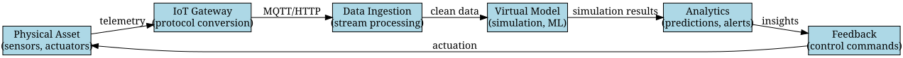

# Digital Twins in 2025: A Practical Guide to Building Virtual Replicas

*Reading time: 8 min · 1,582 words*

> Digital twins are virtual replicas of physical systems that enable real-time monitoring, simulation, and optimization. This guide covers the core concepts, architecture, implementation steps, and real-world applications of digital twin technology.

## Table of Contents
- [Introduction](#introduction)
- [What Is a Digital Twin?](#what-is-a-digital-twin)
  - [Types of Digital Twins](#types-of-digital-twins)
- [How Digital Twins Work: Architecture](#how-digital-twins-work-architecture)
- [Key Technologies Behind Digital Twins](#key-technologies-behind-digital-twins)
- [Benefits of Digital Twins](#benefits-of-digital-twins)
- [Challenges and Considerations](#challenges-and-considerations)
- [Real-World Example: Wind Turbine Digital Twin](#real-world-example-wind-turbine-digital-twin)
- [Steps to Implement a Digital Twin](#steps-to-implement-a-digital-twin)
- [Future Trends](#future-trends)
- [Conclusion](#conclusion)
- [Key Takeaways](#key-takeaways)
- [Frequently Asked Questions](#frequently-asked-questions)

## Introduction

Imagine being able to see inside a jet engine, a wind turbine, or a whole factory floor in real time—not just the data, but the entire operational state, stress points, and predicted failures—without touching the physical asset. That is the promise of a **digital twin**: a living, virtual model that mirrors a physical object or process and evolves with it.

Digital twins have moved from the realm of aerospace and manufacturing into mainstream engineering, energy, healthcare, and smart cities. By 2025, the technology has become more accessible thanks to cheaper sensors, edge computing, and mature cloud platforms. This guide explains what digital twins are, how they work, and how you can build one for your own systems.

## What Is a Digital Twin?

A digital twin is a digital representation of a physical asset, system, or process. It is not a static 3D model; it is a live, data-driven simulation that updates continuously based on real-world inputs. The concept was first popularized by Michael Grieves in 2002, and NASA used early versions for spacecraft simulations. Today, digital twins are a cornerstone of Industry 4.0.

A digital twin typically consists of three parts:

- **Physical asset**: The real-world object or system (e.g., a turbine, a building, a vehicle).
- **Virtual model**: A computational representation of the asset, often using physics-based simulations, machine learning, or both.
- **Data connection**: The bidirectional flow of data between the physical and virtual worlds, usually via IoT sensors and actuators.

### Types of Digital Twins

| Type | Scope | Example |
|------|-------|---------|
| **Product twin** | A single product or component | A car engine's digital replica |
| **Production twin** | A manufacturing process or line | A factory assembly line simulation |
| **Performance twin** | The operational behavior of an asset | A wind farm's energy output model |
| **System twin** | A collection of assets or an entire facility | A smart city traffic system |

## How Digital Twins Work: Architecture

The core of a digital twin is a continuous loop of data exchange. Sensors on the physical asset collect telemetry (temperature, vibration, pressure, location, etc.) and stream it to a cloud or edge platform. There, the data is processed and fed into a simulation model. The model generates insights, predictions, and recommendations, which can be sent back to the physical asset as commands or alerts.

Here is a simplified architecture diagram:



This loop runs at different frequencies depending on the use case. For a wind turbine, you might update the model every second; for a building's energy system, every minute; for a city-scale model, every hour.

## Key Technologies Behind Digital Twins

Building a digital twin requires a stack of complementary technologies:

- **IoT sensors**: Low-cost, low-power devices that measure physical properties. Examples include temperature, vibration, humidity, and GPS sensors.
- **Edge computing**: Processing data closer to the source to reduce latency and bandwidth usage. This is critical for real-time control.
- **Cloud platforms**: Scalable infrastructure for storing large datasets and running heavy simulations. AWS IoT TwinMaker, Azure Digital Twins, and Google Cloud's Digital Twin offerings are common choices.
- **AI and machine learning**: Used for predictive analytics, anomaly detection, and optimizing the virtual model itself.
- **Simulation software**: Physics-based engines (e.g., finite element analysis, computational fluid dynamics) that model the asset's behavior.
- **Visualization**: 3D dashboards and AR/VR interfaces for human interaction.

## Benefits of Digital Twins

Organizations adopt digital twins for several compelling reasons:

- **Predictive maintenance**: Detect anomalies before they cause failures, reducing unplanned downtime and maintenance costs.
- **Operational optimization**: Run what-if scenarios to find the most efficient operating parameters.
- **Remote monitoring**: Gain visibility into assets in hazardous or inaccessible locations.
- **Product design**: Test new designs virtually before building physical prototypes, speeding up innovation.
- **Training and simulation**: Provide realistic training environments for operators without risking real equipment.

## Challenges and Considerations

While powerful, digital twins are not a silver bullet. Key challenges include:

- **Data quality**: Garbage in, garbage out. Sensors must be calibrated, and data pipelines must handle missing or noisy data.
- **Security**: Digital twins expand the attack surface. A compromised twin could feed false data or even send harmful commands to physical assets.
- **Cost**: Sensors, cloud storage, and simulation licenses add up. Start small and scale.
- **Complexity**: Building an accurate virtual model requires domain expertise and significant modeling effort.

> **Caution**: Do not treat a digital twin as a perfect replica. It is an approximation that depends on the quality of your data and assumptions. Always validate the model against real-world behavior.

## Real-World Example: Wind Turbine Digital Twin

Let's make this concrete with a wind turbine example. A typical turbine has sensors for blade pitch, rotor speed, nacelle direction, temperature, and vibration. These sensors send data every 100 milliseconds to an edge gateway on the turbine.

The edge gateway preprocesses the data (filtering noise, aggregating) and sends it to a cloud platform. There, a digital twin model uses computational fluid dynamics to simulate airflow and structural mechanics to calculate stress on blades. Machine learning models predict remaining useful life of components.

If the model detects unusual vibration patterns that indicate a bearing fault, it issues an alert to the maintenance team. The team can inspect the turbine and replace the bearing before a catastrophic failure. In one real deployment, a wind farm operator reduced maintenance costs by 30% and increased energy output by 5% by adjusting blade pitch based on twin simulations.

## Steps to Implement a Digital Twin

If you're considering building a digital twin, follow these steps:

1. **Define the objective**: What problem are you solving? Predictive maintenance, optimization, or training?
2. **Select the asset**: Choose a critical asset where the ROI is highest.
3. **Instrument the asset**: Install sensors to capture the necessary physical parameters.
4. **Set up data ingestion**: Build a pipeline to stream data to your processing platform.
5. **Develop the virtual model**: Start with a physics-based model, then enrich with ML if needed.
6. **Calibrate and validate**: Compare model outputs with real measurements and refine.
7. **Deploy and monitor**: Run the twin in production and continuously update it with new data.
8. **Iterate**: Expand to more assets and add advanced analytics.

Here's a simple Python snippet that simulates a telemetry ingestion step:

```python
import time
import json
from random import uniform

def read_sensor():
    # Simulate a vibration sensor reading
    return {"vibration": uniform(0.1, 0.5), "timestamp": time.time()}

while True:
    data = read_sensor()
    # Send to processing (e.g., via MQTT)
    print(json.dumps(data))
    time.sleep(0.1)
```

## Future Trends

Digital twins are evolving rapidly. Expect to see:

- **AI-integrated twins**: Large language models and generative AI will make it easier to query and interact with twins using natural language.
- **Edge-native twins**: More processing moves to the edge, enabling real-time control in remote or disconnected environments.
- **Standardization**: Groups like the Digital Twin Consortium are working on interoperability standards, making it easier to combine twins from different vendors.
- **Digital twin of the human body**: In healthcare, patient-specific twins could personalize treatments and predict outcomes.

## Conclusion

Digital twins are transforming how we monitor, simulate, and control physical systems. While they require investment in sensors, data infrastructure, and modeling expertise, the payoffs in efficiency, reliability, and innovation are substantial. Start with a single critical asset, prove the value, and scale from there.

## Key Takeaways

- A digital twin is a live, data-driven virtual replica of a physical asset, not a static model.
- The core loop involves sensors → ingestion → simulation → analytics → feedback.
- Digital twins enable predictive maintenance, operational optimization, and safer training.
- Data quality and security are top concerns; validate models against reality.
- Start small: choose one asset, define a clear objective, and iterate.
- The technology is becoming more accessible with cloud offerings and standardization efforts.

## Frequently Asked Questions

Q: What is the difference between a digital twin and a simulation?
A: A simulation is a one-time or on-demand model of a system, while a digital twin is continuously updated with real-time data from the physical asset, making it a living model.

Q: Do I need expensive sensors to build a digital twin?
A: Not necessarily. You can start with existing data sources (e.g., SCADA systems, IoT devices) and add sensors only where gaps exist. The cost depends on the level of fidelity required.

Q: Can digital twins be used for non-physical systems?
A: Yes, digital twins can represent processes, organizations, or even human behavior. For example, a digital twin of a supply chain can simulate logistics scenarios.

Q: What are the main security risks of digital twins?
A: Risks include unauthorized access to telemetry data, manipulation of the model, and attacks that send malicious commands to physical assets. Use strong authentication, encryption, and network segmentation.

Q: How long does it take to build a digital twin?
A: It varies widely. A simple prototype can be built in weeks, while a high-fidelity twin for a complex asset may take months. Focus on a minimal viable twin first.

## Frequently Asked Questions

**Q: What is the difference between a digital twin and a simulation?**

A: A simulation is a one-time or on-demand model of a system, while a digital twin is continuously updated with real-time data from the physical asset, making it a living model.

**Q: Do I need expensive sensors to build a digital twin?**

A: Not necessarily. You can start with existing data sources (e.g., SCADA systems, IoT devices) and add sensors only where gaps exist. The cost depends on the level of fidelity required.

**Q: Can digital twins be used for non-physical systems?**

A: Yes, digital twins can represent processes, organizations, or even human behavior. For example, a digital twin of a supply chain can simulate logistics scenarios.

**Q: What are the main security risks of digital twins?**

A: Risks include unauthorized access to telemetry data, manipulation of the model, and attacks that send malicious commands to physical assets. Use strong authentication, encryption, and network segmentation.

**Q: How long does it take to build a digital twin?**

A: It varies widely. A simple prototype can be built in weeks, while a high-fidelity twin for a complex asset may take months. Focus on a minimal viable twin first.

## Key Takeaways

- A digital twin is a live, data-driven virtual replica of a physical asset, not a static model.
- The core loop involves sensors → ingestion → simulation → analytics → feedback.
- Digital twins enable predictive maintenance, operational optimization, and safer training.
- Data quality and security are top concerns; validate models against reality.
- Start small: choose one asset, define a clear objective, and iterate.
- The technology is becoming more accessible with cloud offerings and standardization efforts.

## Related Articles

- IoT and Edge Computing Architectures
- Predictive Maintenance with Machine Learning
- Industry 4.0 and Smart Manufacturing
- Data Engineering for Real-Time Analytics

<!-- Cover image prompts (for editors):
  - A digital twin dashboard showing a 3D model of a wind turbine with real-time sensor data overlays, in a modern control room.
  - An abstract illustration of a physical factory connected to a virtual replica via glowing data streams, representing the digital twin concept.
  - A schematic diagram of a digital twin architecture with IoT sensors, cloud processing, and feedback loops, in a clean flat design.
-->