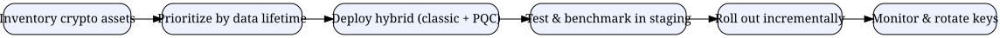

# Post-Quantum Cryptography in 2026: A Practical Guide to Future-Proofing Your Security

*Reading time: 8 min · 1,682 words*

> Quantum computers threaten RSA and ECC, and attackers are already harvesting encrypted data to decrypt later. This 2026 guide explains the NIST post-quantum standards, how to adopt crypto agility, and a step-by-step migration playbook for securing long-lived data.

## Table of Contents
- [Why 2026 is the year to act](#why-2026-is-the-year-to-act)
- [The quantum threat: what actually breaks](#the-quantum-threat-what-actually-breaks)
- [The NIST toolbox: what to deploy](#the-nist-toolbox-what-to-deploy)
- [Crypto agility: the design principle that saves you](#crypto-agility-the-design-principle-that-saves-you)
- [A migration playbook for 2026](#a-migration-playbook-for-2026)
  - [Step 1: Inventory your cryptographic assets](#step-1-inventory-your-cryptographic-assets)
  - [Step 2: Prioritize by data lifetime and sensitivity](#step-2-prioritize-by-data-lifetime-and-sensitivity)
  - [Step 3: Pilot with hybrid TLS](#step-3-pilot-with-hybrid-tls)
  - [Step 4: Roll out incrementally](#step-4-roll-out-incrementally)
  - [Step 5: Monitor, measure, and rotate](#step-5-monitor-measure-and-rotate)
- [Real-world example: migrating a mid-size bank](#real-world-example-migrating-a-mid-size-bank)
- [Common pitfalls and how to avoid them](#common-pitfalls-and-how-to-avoid-them)
- [Getting started: a 2026 checklist](#getting-started-a-2026-checklist)
- [Conclusion](#conclusion)
- [Key Takeaways](#key-takeaways)
- [Frequently Asked Questions](#frequently-asked-questions)

In 2026, the question is no longer *whether* quantum computers will break classical encryption, but *when* — and whether your organization will be ready. Adversaries are already collecting encrypted traffic and stored ciphertext in "harvest now, decrypt later" campaigns, betting that a future fault-tolerant quantum computer will let them unlock decades of secrets. This guide explains the practical steps you can take this year to migrate to post-quantum cryptography (PQC) using the NIST-standardized algorithms, without disrupting your operations.

## Why 2026 is the year to act

The cryptographic landscape changed decisively in August 2024, when NIST finalized the first three post-quantum standards: FIPS 203 (ML-KEM), FIPS 204 (ML-DSA), and FIPS 205 (SLH-DSA). In 2025, a fourth standard, FIPS 206 (FN-DSA, based on Falcon), was added. Since then, mainstream libraries and platforms have shipped production-grade support: OpenSSL 3.5, BoringSSL, Java's Bouncy Castle, and major cloud KMS offerings all support at least one hybrid or pure PQC scheme.

Government mandates are also forcing the pace. The U.S. National Security Memorandum 10 (NSM-10) directs agencies to prioritize migrating crown-jewel systems, and regulators in the EU and elsewhere are beginning to bake crypto agility into cyber resilience frameworks. For enterprises, 2026 is the sweet spot: the standards are stable, tooling exists, and the cost of waiting grows every quarter as more data is harvested.

## The quantum threat: what actually breaks

Quantum computers don't threaten all cryptography equally. The critical vulnerability comes from **Shor's algorithm**, which can factor large integers and compute discrete logarithms exponentially faster than classical computers. That means:

- **RSA** (used in many certificates and signatures) is broken.
- **Elliptic curve cryptography (ECC)** — including ECDSA and ECDH, the backbone of modern TLS, SSH, and blockchain — is broken.
- **Symmetric ciphers** like AES and SHA-2 are only weakened, not broken; Grover's algorithm roughly halves their effective key strength, so doubling key sizes (e.g., AES-256) remains safe.

The practical consequence: any data encrypted today with RSA or ECC can be recorded and decrypted later. If your data has a long confidentiality lifetime — medical records, trade secrets, national security information, personal data — it is at risk right now.

> **Caution:** "Harvest now, decrypt later" is not a distant scenario. In 2026, multiple threat intelligence reports document active collection of encrypted VPN, email, and government traffic. Assume anything you encrypt today may be decrypted in 15–20 years, and plan accordingly.

## The NIST toolbox: what to deploy

NIST's standardized algorithms give you a complete toolkit for key establishment and digital signatures. Here's a quick reference:

| Standard | Algorithm | Purpose | Typical key/ciphertext size |
|----------|-----------|---------|------------------------------|
| FIPS 203 | ML-KEM (Kyber) | Key encapsulation (like ECDH) | ~800–1,600 bytes ciphertext |
| FIPS 204 | ML-DSA (Dilithium) | Digital signatures (like ECDSA) | ~2,400–4,600 byte signatures |
| FIPS 205 | SLH-DSA (SPHINCS+) | Stateless hash-based signatures | Large signatures (~17K+ bytes) |
| FIPS 206 | FN-DSA (Falcon) | Compact digital signatures | ~666–1,280 byte signatures |

**Practical guidance:**
- Use **ML-KEM** for TLS key exchange and hybrid encryption.
- Use **ML-DSA** for code signing, certificates, and general signatures where signature size isn't critical.
- Use **FN-DSA** when you need small signatures (e.g., embedded devices, firmware).
- Use **SLH-DSA** when you want conservative, hash-based security and can tolerate larger signatures.

## Crypto agility: the design principle that saves you

The single most important architectural change you can make in 2026 is to adopt **crypto agility** — the ability to swap algorithms without rewriting applications. Too many systems hardcode "RSA" or "P-256" in configuration files, protocol constants, and hardware. To migrate smoothly:

- Abstract cryptographic operations behind interfaces (e.g., Java JCA/JCE, OpenSSL providers, cloud KMS SDKs).
- Store algorithm identifiers in configuration, not code, and version them.
- Prefer **hybrid schemes** during transition: combine a classical algorithm with a PQC algorithm so that even if one is broken, the other protects you.
- Test your ability to rotate algorithms on a schedule, not just in response to an incident.

## A migration playbook for 2026

Here's a structured approach that works for most organizations, from startups to regulated enterprises.

### Step 1: Inventory your cryptographic assets

You cannot protect what you don't know about. Build a catalog of:

- TLS certificates and the servers/clients using them
- Code signing and software update chains
- Internal PKI and certificate authorities
- VPN gateways (IPsec, WireGuard, OpenVPN)
- Email encryption (S/MIME, PGP)
- Database and storage encryption
- Hardware security modules (HSMs) and their supported algorithms

### Step 2: Prioritize by data lifetime and sensitivity

Not everything needs to move first. Rank assets by:
- Confidentiality lifetime of the data (how long must it stay secret?)
- Regulatory exposure (health, finance, government)
- Difficulty of migration (legacy hardware vs. modern cloud)

### Step 3: Pilot with hybrid TLS

Start with a low-risk, high-visibility pilot: your public website's TLS termination. Modern load balancers and CDNs support hybrid certificates that include both a classical and a PQC key exchange. Validate that handshake latency, CPU usage, and client compatibility meet your SLOs.

### Step 4: Roll out incrementally

Gradually expand PQC to internal services, API gateways, and machine-to-machine authentication. Keep the classical algorithm enabled in parallel until you're confident in interoperability.

### Step 5: Monitor, measure, and rotate

Add telemetry for handshake failure rates, negotiation times, and certificate issuance. Schedule periodic key rotation, and keep an eye on vendor announcements for updated PQC support.

## Real-world example: migrating a mid-size bank

Consider a regional bank with 2,000 employees, 40 public TLS endpoints, and an internal mTLS mesh of 300 services. In early 2026, they began a PQC migration:

1. **Inventory:** They discovered 12% of certificates were still RSA-2048, and two HSMs didn't support PQC.
2. **Priority:** Customer-facing web and mobile APIs moved first (data lifetime: decades); internal batch jobs moved last.
3. **Pilot:** They enabled hybrid TLS (X25519 + ML-KEM768) on their public gateway. Handshake latency rose by ~15 ms (from ~90 ms to ~105 ms) — negligible for users, and CPU overhead stayed under 5%.
4. **Expansion:** Over six months, they rolled hybrid mTLS to all internal services using a service mesh sidecar, and upgraded the two HSMs to models with native ML-DSA support.
5. **Result:** By Q3 2026, 100% of external and 85% of internal connections negotiate a PQC key exchange. The remaining 15% are legacy mainframe integrations scheduled for replacement.

The lesson: start with inventory, use hybrid mode to de-risk, and let data lifetime drive priority.

## Common pitfalls and how to avoid them

- **Ignoring legacy hardware.** Old HSMs, IoT devices, and mainframes may lack PQC support. Plan for upgrades or network segmentation.
- **Performance surprises.** ML-KEM and ML-DSA have larger keys and slower operations than ECC, especially on constrained devices. Benchmark before committing.
- **Interoperability gaps.** Not all vendors implement the same hybrid identifiers or OIDs. Test cross-vendor handshakes early.
- **Compliance drift.** Regulators increasingly ask for evidence of crypto agility. Document your migration and keep an audit trail.

## Getting started: a 2026 checklist

1. Assign a crypto-agility owner (usually CISO or platform team).
2. Run an automated crypto inventory scan (tools like `openssl` scans, Nmap NSE scripts, or commercial CSPM).
3. Identify your top 10 highest-risk assets by data lifetime.
4. Enable hybrid TLS on your public edge using ML-KEM768.
5. Update libraries to versions with PQC support (OpenSSL 3.5+, Java 21+ with Bouncy Castle).
6. Test handshake latency and client compatibility in staging.
7. Create a rotation runbook and rehearse it quarterly.
8. Track progress in your security dashboard and report to leadership.

## Conclusion

Post-quantum cryptography is no longer a research topic — it's an operational requirement. In 2026, the standards are final, tooling is mature, and attackers are already stockpiling encrypted data. By adopting crypto agility, deploying hybrid schemes, and following a prioritized migration playbook, your organization can protect its long-lived secrets without a disruptive "big bang" rewrite. The best time to start was yesterday; the second-best time is now.

## Key Takeaways

- Shor's algorithm breaks RSA and ECC; only symmetric algorithms like AES-256 remain safe against quantum attacks.
- NIST has finalized four PQC standards: ML-KEM, ML-DSA, SLH-DSA, and FN-DSA.
- "Harvest now, decrypt later" makes long-lived data vulnerable today, even if a quantum computer is years away.
- Hybrid schemes (classical + PQC) let you migrate safely without trusting any single algorithm.
- Crypto agility — abstracting algorithms behind configurable interfaces — is the key enabler for smooth migration.
- Start with inventory, prioritize by data lifetime, and use staged rollouts to minimize disruption.

## Frequently Asked Questions

Q: When will quantum computers actually break RSA?
A: Most experts estimate fault-tolerant quantum computers with enough logical qubits are 10–20 years away, but timelines are uncertain. The risk is that data harvested today will be decryptable later, so migration should start now.

Q: Do I need to replace AES?
A: No. AES-256 and SHA-256 are considered quantum-safe because Grover's algorithm only halves effective key strength. You mainly need to replace RSA and elliptic-curve algorithms.

Q: What is a hybrid certificate?
A: A hybrid certificate contains both a classical algorithm (e.g., ECDSA) and a post-quantum algorithm (e.g., ML-DSA), so either one alone provides security. It eases transition and interoperability.

Q: Will PQC slow down my website?
A: Handshake latency may increase by tens of milliseconds and CPU usage slightly, but for most web traffic the impact is negligible after optimization. Always benchmark in your environment.

Q: Do cloud providers support PQC?
A: Yes. Major cloud KMS and TLS services added PQC support in 2025–2026, including hybrid key exchange options. Check your provider's documentation for specific algorithm and region availability.

## Frequently Asked Questions

**Q: When will quantum computers actually break RSA?**

A: Most experts estimate fault-tolerant quantum computers with enough logical qubits are 10–20 years away, but timelines are uncertain. The risk is that data harvested today will be decryptable later, so migration should start now.

**Q: Do I need to replace AES?**

A: No. AES-256 and SHA-256 are considered quantum-safe because Grover's algorithm only halves effective key strength. You mainly need to replace RSA and elliptic-curve algorithms.

**Q: What is a hybrid certificate?**

A: A hybrid certificate contains both a classical algorithm (e.g., ECDSA) and a post-quantum algorithm (e.g., ML-DSA), so either one alone provides security. It eases transition and interoperability.

**Q: Will PQC slow down my website?**

A: Handshake latency may increase by tens of milliseconds and CPU usage slightly, but for most web traffic the impact is negligible after optimization. Always benchmark in your environment.

**Q: Do cloud providers support PQC?**

A: Yes. Major cloud KMS and TLS services added PQC support in 2025–2026, including hybrid key exchange options. Check your provider's documentation for specific algorithm and region availability.

## Key Takeaways

- Shor's algorithm breaks RSA and ECC; only symmetric algorithms like AES-256 remain safe against quantum attacks.
- NIST has finalized four PQC standards: ML-KEM, ML-DSA, SLH-DSA, and FN-DSA.
- "Harvest now, decrypt later" makes long-lived data vulnerable today, even if a quantum computer is years away.
- Hybrid schemes (classical + PQC) let you migrate safely without trusting any single algorithm.
- Crypto agility — abstracting algorithms behind configurable interfaces — is the key enabler for smooth migration.
- Start with inventory, prioritize by data lifetime, and use staged rollouts to minimize disruption.

## Related Articles

- Zero-trust architecture fundamentals
- Hardware security modules (HSM) and key management
- PKI and certificate lifecycle management
- Cloud key management services (KMS) best practices

<!-- Cover image prompts (for editors):
  - A sleek modern quantum computer with a glowing cryogenic chamber, surrounded by fiber optic cables, dark laboratory background, photorealistic, high detail, cool blue lighting
  - A digital padlock wrapped in a shimmering lattice of light particles, symbolizing post-quantum encryption, abstract technology illustration, deep blue and violet palette, futuristic
  - An enterprise network architecture diagram with nodes labeled 'hybrid TLS' and 'ML-KEM', clean flat design, informative infographic style, soft gradients, professional
-->