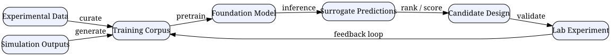

# AI for Science in 2026: How Foundation Models Are Accelerating Discovery

*Reading time: 10 min · 1,992 words*

> A practical guide to AI for science in 2026, covering how foundation models, surrogate simulations, and active learning loops are accelerating discovery in biology, materials, and chemistry — including real-world examples like AlphaFold and GNoME, plus how to get started.

## Table of Contents
- [Introduction](#introduction)
- [What Is AI for Science?](#what-is-ai-for-science)
  - [Major application areas](#major-application-areas)
- [Why Now? The 2026 Context](#why-now-the-2026-context)
- [The Core Toolkit in 2026](#the-core-toolkit-in-2026)
  - [Foundation models for molecules and materials](#foundation-models-for-molecules-and-materials)
  - [Surrogate models for expensive simulations](#surrogate-models-for-expensive-simulations)
  - [Generative design](#generative-design)
  - [Active learning loops](#active-learning-loops)
- [How the Workflow Works](#how-the-workflow-works)
- [Real-World Example: Discovering New Battery Materials](#real-world-example-discovering-new-battery-materials)
- [Challenges and Limitations in 2026](#challenges-and-limitations-in-2026)
- [Getting Started in 2026](#getting-started-in-2026)
- [The Road Ahead](#the-road-ahead)
- [Key Takeaways](#key-takeaways)
- [Frequently Asked Questions](#frequently-asked-questions)

## Introduction

In 2026, the most consequential applications of artificial intelligence are no longer confined to chatbots, code assistants, and image generators. Across biology, chemistry, materials science, and climate research, foundation models have become everyday laboratory instruments — predicting protein structures, proposing new molecules, and suggesting materials that could make batteries lighter, solar cells more efficient, and carbon capture cheaper.

This transition has been building for years. In 2024, the Nobel Prize in Chemistry recognized David Baker for computational protein design and Demis Hassabis and John Jumper for AlphaFold's breakthrough in protein structure prediction — an explicit acknowledgment that machine learning had become central to the scientific method. Two years later, in 2026, the field has matured from headline-grabbing demonstrations into production-grade research infrastructure used by thousands of labs worldwide.

This article is a practical guide to AI for science as it stands in 2026: what it is, how the core workflows operate, what real teams are achieving today, and how you can get started.

## What Is AI for Science?

AI for science is the application of machine learning to problems where the goal is discovery, prediction, or design in the physical world — rather than generating text, images, or code. It is distinct from general-purpose AI in several important ways:

- **Physics-awareness.** Many models are built with inductive biases that respect physical laws. Equivariant neural networks, for example, guarantee that predictions transform correctly under rotations, translations, and reflections.
- **Uncertainty quantification.** Scientists need to know when a model is confident and when it is guessing. Calibrated confidence estimates are often as important as the prediction itself.
- **Experimental feedback.** The best AI-for-science systems are not one-shot predictors; they are embedded in closed loops that include real experiments, whose results refine the model.

### Major application areas

| Area | What AI does | Example questions |
| --- | --- | --- |
| Structural biology | Predicts 3D structures from sequences | How does this protein fold? What does it bind? |
| Materials discovery | Proposes new crystals, alloys, electrolytes | Which composition is stable and conducts ions well? |
| Molecular design | Generates drug candidates, catalysts, polymers | Can we design a molecule that inhibits this enzyme? |
| Climate & weather | Produces faster, higher-resolution forecasts | What will the local weather be in 10 days? |
| Genomics & synthetic biology | Predicts gene function, designs pathways | Which edit improves yield of this metabolite? |

## Why Now? The 2026 Context

AI for science is not new — machine learning has assisted chemistry and physics for decades. What changed between roughly 2020 and 2026 is the convergence of several forces:

1. **Foundation models for scientific data.** Large models pretrained on proteins, crystal structures, molecular graphs, and spectra now serve as reusable starting points, much like LLMs do for text.
2. **Massive open datasets.** Resources such as the Protein Data Bank, the Materials Project, PubChem, and the Cambridge Structural Database provide millions of labeled examples.
3. **Cheaper, specialized compute.** GPU clusters and AI accelerators are now accessible to mid-sized academic groups, not just large companies.
4. **Laboratory automation.** Robotic liquid handlers, automated synthesizers, and high-throughput screening make experimental validation faster and cheaper, closing the loop with ML.
5. **Maturing benchmarks.** Shared evaluation suites let researchers compare methods fairly, accelerating progress.

## The Core Toolkit in 2026

### Foundation models for molecules and materials

Just as GPT-style models learn statistical patterns in language, scientific foundation models learn patterns in nature. Common architectures include:

- **Protein language models** trained on tens of millions of amino-acid sequences, useful for predicting structure, function, and fitness.
- **Graph neural networks (GNNs)** operating on molecular graphs and crystal structures, capturing how atoms connect and arrange.
- **Diffusion models** that generate novel 3D structures atom by atom, widely used for de novo protein and small-molecule design.

### Surrogate models for expensive simulations

Many scientific workflows rely on computationally heavy simulations — density functional theory (DFT) for electronic structure, molecular dynamics (MD) for atomic motion. In 2026, it is routine to train a fast ML surrogate on a few thousand simulation outputs and then use the surrogate to explore millions of candidates in seconds.

### Generative design

Rather than screening a fixed library, generative models propose entirely new candidates. Diffusion-based approaches are now standard for both small molecules and proteins, often guided by target properties such as binding affinity or thermal stability.

### Active learning loops

The most powerful pattern couples ML with experimentation. The model proposes a batch of candidates, an automated or manual experiment tests them, and the results update the model. This dramatically reduces the number of experiments needed to find a good candidate.

## How the Workflow Works

A typical AI-for-science project in 2026 follows the pipeline below:

1. **Curate data.** Aggregate public databases and your own experimental records into a consistent format. Quality beats quantity — label errors propagate through every downstream step.
2. **Pretrain or fine-tune.** Start from an existing foundation model when possible, then fine-tune on your domain's data.
3. **Generate candidates.** Use a generative model to propose thousands or millions of new structures, constrained by desired properties.
4. **Score and rank.** Apply surrogate models to filter candidates by stability, synthesizability, solubility, or other criteria.
5. **Validate experimentally.** Test the top handful of candidates in the lab. This step is non-negotiable.
6. **Feed results back.** Add experimental outcomes to the training corpus and repeat. Each cycle should improve the model.

> **Important note:** The surrogate model is a hypothesis generator, not a ground truth. Every computational prediction must ultimately be verified by experiment before it informs a real product or publication.

## Real-World Example: Discovering New Battery Materials

Let's make this concrete with one of the most active areas in 2026: discovering new solid electrolytes for solid-state batteries. Conventional trial-and-error campaigns take years and rely heavily on the intuition of expert electrochemists.

A modern AI-driven workflow looks like this:

- **Data.** Start with the Materials Project, a public database of hundreds of thousands of computed crystal structures and properties.
- **Model.** Train a graph neural network to predict formation energy — a proxy for thermodynamic stability — from crystal structure. Equivariant GNNs are the standard choice here because they respect the symmetries of crystals.
- **Generate.** Use a diffusion model conditioned on desired ionic conductivity to propose new crystal compositions.
- **Filter.** Run the surrogate on millions of candidates; keep those predicted to be stable and conductive. Then run full DFT on only the top few hundred to confirm.
- **Validate.** Synthesize and test the top few candidates in the laboratory.

This is exactly the pattern behind DeepMind's GNoME project, published in Nature in 2023, which predicted 2.2 million new crystal structures — including around 380,000 predicted to be stable. Several of those predictions have since been synthesized and confirmed in independent labs. By 2026, similar pipelines are running at universities, national laboratories, and startups worldwide, and several teams report cutting discovery timelines from years to months.

## Challenges and Limitations in 2026

For all its promise, AI for science faces real obstacles:

- **Hallucination of impossible structures.** Generative models can propose molecules that violate chemistry — unstable rings, strained bonds, unphysical geometries. Strong physics-based constraints help but do not eliminate the problem.
- **The validation bottleneck.** Computational predictions vastly outpace experimental capacity. Only a tiny fraction of AI-proposed candidates ever reach a lab, so false positives waste scarce resources.
- **Compute and energy costs.** Training large scientific models is expensive. Researchers increasingly report carbon footprints alongside accuracy metrics, mirroring the broader green software movement.
- **Reproducibility.** Many published results omit training data versions, hyperparameters, or random seeds, making them hard to reproduce. Community-led benchmark suites are helping, but adoption is uneven.
- **Data bias.** Public databases overrepresent well-studied chemistries and organisms. Models trained on them generalize poorly to exotic elements or understudied species.

## Getting Started in 2026

If you want to work in this area, here is a realistic path:

1. **Pick a concrete problem.** "Drug discovery" is too broad; "predict whether this class of molecules inhibits kinase X" is actionable.
2. **Use public data first.** The Materials Project API, Protein Data Bank, and PubChem are excellent starting points. No need to generate your own dataset initially.
3. **Stand on pretrained models.** Start with OpenFold for protein structure, or a pretrained GNN for materials, rather than training from scratch.
4. **Learn the tooling.** PyTorch Geometric, e3nn for equivariant layers, RDKit for cheminformatics, and the Materials Project Python client are the de facto standard toolkit.
5. **Benchmark rigorously.** Compare against simple baselines and published state-of-the-art results before claiming novelty.
6. **Partner with domain experts.** A machine learning expert working alone will produce plausible-looking nonsense. Pair with a chemist, biologist, or physicist.

## The Road Ahead

Looking past 2026, three trends stand out:

- **Self-driving laboratories.** Robotics, lab automation, and active learning are merging into closed-loop systems that design, run, and interpret experiments with minimal human intervention.
- **Multi-scale foundation models.** The frontier is models that span scales — from quantum mechanics to molecular interactions to whole organisms — enabling predictions that current single-scale models cannot make.
- **Clinical and commercial impact.** Several AI-discovered molecules have already entered clinical trials, and more are expected to follow. Regulators are developing frameworks for evaluating AI-generated evidence, which will shape how quickly these discoveries reach patients.

## Key Takeaways

- AI for science applies machine learning to physical-world discovery — proteins, materials, molecules, climate — and has moved from demos to production infrastructure in 2026.
- The core pattern is a closed loop: curate data, train a foundation model, generate candidates, score with a surrogate, validate experimentally, and feed results back.
- Equivariant neural networks, diffusion models, and active learning are the dominant techniques.
- Real successes include AlphaFold for protein structure and GNoME for crystals, which predicted hundreds of thousands of stable materials.
- The biggest bottleneck is experimental validation, not compute — always verify AI predictions in the lab.
- Get started with public datasets, pretrained models, and a concrete problem; partner with domain experts early.

## Frequently Asked Questions

**Q: Is AI for science the same as generative AI for text and images?**
A: No. While both use similar deep learning architectures, AI for science emphasizes physical validity, uncertainty quantification, and experimental verification. A molecule that "looks" plausible is useless if it cannot be synthesized or does not obey the laws of chemistry.

**Q: Do I need a PhD in chemistry to work in this field?**
A: Not necessarily, but domain knowledge is a huge advantage. Many practitioners are ML engineers who collaborate closely with domain scientists. At minimum, you need enough domain literacy to ask the right questions and interpret results.

**Q: How accurate are AI protein structure predictions in 2026?**
A: For single proteins, AlphaFold-class models achieve near-experimental accuracy in many cases. Predicting complexes, conformational changes, and disordered regions remains harder, and experimental validation is still required for critical applications.

**Q: What are the main risks of using AI in scientific discovery?**
A: The main risks are hallucinated or physically impossible results, biased training data, poor reproducibility, and the temptation to trust computational predictions without experimental confirmation.

**Q: Can small labs or students realistically participate?**
A: Yes. Public datasets, open-source models like OpenFold, and cloud GPU credits make entry far cheaper than it was five years ago. Starting with a well-scoped problem and a good benchmark is the most reliable route.

## Frequently Asked Questions

**Q: Is AI for science the same as generative AI for text and images?**

A: No. While both use similar deep learning architectures, AI for science emphasizes physical validity, uncertainty quantification, and experimental verification. A molecule that "looks" plausible is useless if it cannot be synthesized or does not obey the laws of chemistry.

**Q: Do I need a PhD in chemistry to work in this field?**

A: Not necessarily, but domain knowledge is a huge advantage. Many practitioners are ML engineers who collaborate closely with domain scientists. At minimum, you need enough domain literacy to ask the right questions and interpret results.

**Q: How accurate are AI protein structure predictions in 2026?**

A: For single proteins, AlphaFold-class models achieve near-experimental accuracy in many cases. Predicting complexes, conformational changes, and disordered regions remains harder, and experimental validation is still required for critical applications.

**Q: What are the main risks of using AI in scientific discovery?**

A: The main risks are hallucinated or physically impossible results, biased training data, poor reproducibility, and the temptation to trust computational predictions without experimental confirmation.

**Q: Can small labs or students realistically participate?**

A: Yes. Public datasets, open-source models like OpenFold, and cloud GPU credits make entry far cheaper than it was five years ago. Starting with a well-scoped problem and a good benchmark is the most reliable route.

## Key Takeaways

- AI for science applies machine learning to physical-world discovery — proteins, materials, molecules, climate — and has moved from demos to production infrastructure in 2026.
- The core pattern is a closed loop: curate data, train a foundation model, generate candidates, score with a surrogate, validate experimentally, and feed results back.
- Equivariant neural networks, diffusion models, and active learning are the dominant techniques in 2026.
- Real successes include AlphaFold for protein structure and GNoME for crystals, which predicted hundreds of thousands of stable materials.
- The biggest bottleneck is experimental validation, not compute — always verify AI predictions in the lab.
- Get started with public datasets, pretrained models, and a concrete problem; partner with domain experts early.

## Related Articles

- self-driving-laboratories
- equivariant-neural-networks
- diffusion-models-for-drug-design
- scientific-machine-learning-benchmarks

<!-- Cover image prompts (for editors):
  - A photorealistic illustration of a scientist viewing a 3D protein structure hologram in a modern laboratory, with a neural network visualization overlaying the molecule, blue and teal lighting, futuristic yet realistic, 16:9 aspect ratio.
  - An abstract visualization of a crystal lattice being generated by an AI diffusion model, with glowing nodes representing atoms and particles converging into a stable structure, dark background with cyan and purple gradients, high detail.
  - A self-driving laboratory with robotic arms performing high-throughput experiments, screens showing machine learning dashboards, clean bright environment, photorealistic, 16:9 aspect ratio.
-->