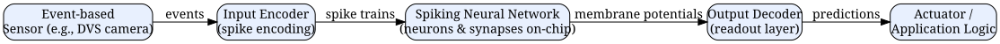

# Neuromorphic Computing in 2026: A Practical Guide to Brain-Inspired AI Hardware

*Reading time: 10 min · 1,902 words*

> Neuromorphic computing uses brain-inspired architectures like spiking neural networks and in-memory compute to run AI at a fraction of the power of GPUs. This guide explains the core concepts, real-world applications, and practical adoption considerations for 2026.

## Table of Contents
- [Introduction](#introduction)
- [What Is Neuromorphic Computing?](#what-is-neuromorphic-computing)
  - [Key Principles](#key-principles)
  - [Spiking Neural Networks (SNNs)](#spiking-neural-networks-snns)
- [Why Neuromorphic Computing Matters in 2026](#why-neuromorphic-computing-matters-in-2026)
  - [The Energy Ceiling of Conventional AI](#the-energy-ceiling-of-conventional-ai)
  - [The Rise of Edge AI](#the-rise-of-edge-ai)
  - [Advances in Algorithmic Research](#advances-in-algorithmic-research)
  - [Commercial Maturity](#commercial-maturity)
- [The Hardware Landscape in 2026](#the-hardware-landscape-in-2026)
- [How Neuromorphic Chips Work](#how-neuromorphic-chips-work)
- [Real-World Applications](#real-world-applications)
  - [1. Always-On Sensing and IoT](#1-always-on-sensing-and-iot)
  - [2. Robotics and Autonomous Navigation](#2-robotics-and-autonomous-navigation)
  - [3. Wearables and Health Monitoring](#3-wearables-and-health-monitoring)
  - [4. Autonomous Vehicles (Edge Cases)](#4-autonomous-vehicles-edge-cases)
  - [5. Scientific Instrumentation](#5-scientific-instrumentation)
- [A Real-World Example: Predictive Maintenance on Industrial Sensors](#a-real-world-example-predictive-maintenance-on-industrial-sensors)
- [Challenges and Limitations](#challenges-and-limitations)
- [How to Evaluate Neuromorphic Computing for Your Use Case](#how-to-evaluate-neuromorphic-computing-for-your-use-case)
- [Conclusion](#conclusion)
- [Key Takeaways](#key-takeaways)
- [Frequently Asked Questions](#frequently-asked-questions)

## Introduction

In 2026, the AI industry faces a fundamental tension: models keep getting smarter, but the energy cost of running them keeps climbing. Data centers now consume more electricity than ever, and training a single frontier model can emit thousands of tons of CO2. Meanwhile, edge devices — from industrial sensors to wearables — need AI capabilities without the luxury of a data center's power budget.

Neuromorphic computing offers a radically different path. Instead of simulating neural networks on general-purpose hardware built for von Neumann architectures, neuromorphic chips physically implement neurons and synapses in silicon. They process information in an event-driven, asynchronous manner, mimicking how biological brains achieve remarkable efficiency: a human brain runs on roughly 20 watts.

This guide explores what neuromorphic computing is, why it matters in 2026, how it works, and how you can begin evaluating it for your own workloads.

## What Is Neuromorphic Computing?

Neuromorphic computing is an approach to hardware design that takes inspiration from biological nervous systems. The term was coined by Carver Mead in the late 1980s, but only in the last few years has the technology matured enough for commercial deployment.

At its heart, neuromorphic computing departs from the classic von Neumann architecture, where memory and computation are separate. In a neuromorphic chip, memory and computation are co-located in artificial neurons and synapses, much like in a biological brain.

### Key Principles

1. **Event-driven processing**: Unlike conventional chips that process data in continuous clock cycles, neuromorphic chips operate asynchronously. Neurons fire spikes only when input crosses a threshold.
2. **In-memory computing**: Synapses store weights locally, eliminating the von Neumann bottleneck of shuttling data between CPU/GPU and memory.
3. **Sparsity**: Because neurons only fire when needed, much of the chip is idle at any moment, saving power.
4. **Plasticity**: Many neuromorphic systems support local learning rules, such as spike-timing-dependent plasticity (STDP), enabling on-chip adaptation.

### Spiking Neural Networks (SNNs)

The software counterpart to neuromorphic hardware is the spiking neural network. Unlike traditional artificial neural networks (ANNs) that pass continuous values (activations) between layers, SNNs communicate using discrete spikes over time. Information is encoded in the timing and rate of spikes.

This temporal dimension makes SNNs well-suited to processing time-series data, sensor streams, and event-based signals — often with far fewer operations than equivalent ANNs.

## Why Neuromorphic Computing Matters in 2026

Several forces have converged to make neuromorphic computing commercially relevant in 2026.

### The Energy Ceiling of Conventional AI

The exponential growth in model size and inference demand has collided with physical limits. GPUs are power-hungry; a single A100 or H100 GPU can draw 400–700 watts under load. Running large language models at scale requires entire data centers, and grid capacity is becoming a bottleneck. Neuromorphic chips, by contrast, target milliwatt-to-watt power envelopes for comparable inference tasks.

### The Rise of Edge AI

With on-device AI becoming a major trend in 2026, there is enormous demand for ultra-low-power inference. Neuromorphic processors are a natural fit for battery-powered devices, always-on sensors, and robotics.

### Advances in Algorithmic Research

Researchers have made significant progress in converting deep learning models to spiking form, achieving near-parity accuracy on many tasks. Training methods like surrogate gradient descent and ANN-to-SNN conversion have matured, making SNNs practical.

### Commercial Maturity

Companies including Intel (Loihi 2), IBM (NorthPole), BrainChip (Akida), SynSense, and others now offer commercial or near-commercial neuromorphic products. The ecosystem around SDKs, compilers, and reference designs is growing quickly.

## The Hardware Landscape in 2026

Let's look at the major players and platforms.

| Vendor | Chip / Platform | Key Features | Status |
|---|---|---|---|
| Intel | Loihi 2 | 128 cores, up to 1M neurons per chip, programmable learning rules | Research/commercial pilots |
| IBM | NorthPole | 22 billion transistors, 256 cores, on-chip SRAM | Research prototypes |
| BrainChip | Akida | Event-domain processor, on-chip learning, CNN support | Commercial |
| SynSense | Speck / Xylo | Ultra-low-power audio/vision processing | Commercial |
| imec | Neuropixels | Neural recording arrays (more neuroscience than compute) | Research |

Note that the field is moving fast; specifications change frequently. Treat vendor claims with healthy skepticism and benchmark against your own workloads.

## How Neuromorphic Chips Work

To understand neuromorphic computing, it helps to see the flow of data through a typical chip.

// caption: Data flow through a neuromorphic inference pipeline.

In a typical pipeline:

1. A sensor (e.g., a dynamic vision sensor, or DVS camera) produces event-based output — asynchronous changes in light intensity — rather than full frames.
2. An encoder converts continuous signals into spike trains, either using rate coding, temporal coding, or delta modulation.
3. The spiking neural network processes these spikes on-chip. Each neuron integrates incoming spikes; when its membrane potential exceeds a threshold, it emits an output spike.
4. A readout layer decodes the final spike activity into a prediction, classification, or control signal.

Because computation only happens when spikes occur, energy consumption scales with activity rather than with clock speed.

## Real-World Applications

### 1. Always-On Sensing and IoT

Neuromorphic chips excel at monitoring sensor streams continuously. For example, a smart building with embedded neuromorphic processors can detect occupancy, anomalies, or equipment failures using microamps of power, enabling years of battery life.

### 2. Robotics and Autonomous Navigation

Robots and drones need to react to their environment in real time while carrying limited batteries. Neuromorphic vision systems (event cameras + SNNs) offer low-latency, low-power obstacle avoidance. Several research groups have demonstrated drones flying with neuromorphic controllers.

### 3. Wearables and Health Monitoring

From ECG anomaly detection to seizure prediction, wearable medical devices benefit from continuous, low-power inference. Neuromorphic chips can run classification models on raw biosignals at sub-milliwatt levels.

### 4. Autonomous Vehicles (Edge Cases)

While full self-driving still relies on powerful GPUs, neuromorphic accelerators are being explored as a complementary, low-power "reflex" layer for critical safety functions like pedestrian detection at ultra-low latency.

### 5. Scientific Instrumentation

Neuromorphic processors are used in particle physics and neuroscience experiments to filter high-throughput event streams, reducing data volumes before they reach conventional compute clusters.

## A Real-World Example: Predictive Maintenance on Industrial Sensors

Consider a manufacturing plant that wants to monitor vibration and temperature sensors on rotating machinery to predict bearing failures. Traditional approaches stream all sensor data to a central server, where an ML model runs on a GPU cluster. This consumes significant bandwidth and power, and introduces latency.

With a neuromorphic approach:

- A low-power neuromorphic module is embedded next to each machine.
- The sensor's analog signal is converted to spikes by a small front-end.
- An SNN trained on historical vibration signatures classifies patterns as "normal," "warning," or "failure."
- The chip only sends an alert to the cloud when a warning or failure is detected.

The result: milliwatt-level power consumption, no continuous network traffic, and immediate local response. One industrial pilot reported a 50× reduction in energy per inference compared to a microcontroller-based baseline (figures vary by deployment; verify with your own benchmarks).

> **Important note:** Neuromorphic hardware is not a drop-in replacement for GPUs. Accuracy, programming effort, and tooling maturity vary significantly across platforms. Start with a well-scoped pilot before committing to production.

## Challenges and Limitations

Despite the promise, neuromorphic computing has real hurdles in 2026:

- **Programming complexity**: Most developers know PyTorch or TensorFlow, not spike-based frameworks like Nengo, Lava (Intel), or BindsNET. The learning curve is steep.
- **Accuracy trade-offs**: SNNs often lag ANNs on complex tasks like large language modeling, though they excel on certain time-series and edge-vision tasks.
- **Tooling immaturity**: Compilers, debuggers, and profiling tools are less mature than those for GPUs.
- **Limited ecosystem**: Fewer pre-trained models, libraries, and community resources exist compared to mainstream ML.
- **Standards gaps**: There is no universal interchange format for spiking models, making portability difficult.

## How to Evaluate Neuromorphic Computing for Your Use Case

If you're considering neuromorphic hardware in 2026, follow this practical checklist:

1. **Define your constraint**: Is the problem power, latency, or cost? Neuromorphic is rarely the right choice if you just need maximum accuracy on a GPU.
2. **Start with simulation**: Prototype your SNN in simulation (e.g., using Lava, Norse, or snnTorch) before buying hardware.
3. **Benchmark against baselines**: Compare energy per inference, latency, and accuracy against your current solution on the same dataset.
4. **Consider hybrid architectures**: Many deployments combine a neuromorphic accelerator for low-power, always-on tasks with a conventional processor for heavier workloads.
5. **Check vendor support**: Evaluate the SDK quality, documentation, and community activity before committing.

## Conclusion

Neuromorphic computing has moved from academic curiosity to practical technology in 2026. It won't replace GPUs for training frontier models, but it offers a compelling path for ultra-low-power inference at the edge, always-on sensing, and real-time robotics. As tooling matures and the ecosystem grows, we expect adoption to accelerate across industrial IoT, healthcare, and automotive domains.

The key is to match the technology to the problem. If your workload involves continuous sensor streams, tight power budgets, or millisecond-level response times, neuromorphic computing deserves a serious look.

## Key Takeaways

- Neuromorphic chips mimic biological neurons and synapses, using event-driven, asynchronous processing to achieve dramatically lower power consumption than GPUs.
- Spiking neural networks (SNNs) encode information in spike timing, making them naturally suited to time-series and sensor data.
- In 2026, commercial platforms like Intel Loihi 2, IBM NorthPole, and BrainChip Akida are available or in advanced pilots.
- Neuromorphic computing excels at edge AI, robotics, wearables, and predictive maintenance, but is not a drop-in GPU replacement.
- Expect a steeper learning curve and less mature tooling; prototype in simulation first and benchmark against your own baselines.
- Hybrid architectures — pairing a neuromorphic accelerator with a conventional processor — are often the most pragmatic starting point.

## Frequently Asked Questions

**Q: Is neuromorphic computing faster than GPUs?**
A: Not in general. Neuromorphic chips excel at low-power, event-driven inference and can have very low latency for sparse inputs, but they generally cannot match GPU throughput for dense, parallel workloads like training large models.

**Q: Can I run my existing PyTorch model on neuromorphic hardware?**
A: Not directly. You typically need to convert your model to a spiking representation (ANN-to-SNN conversion) or retrain using spike-based frameworks. Tools like snnTorch, Norse, and Intel's Lava help, but expect to invest engineering time.

**Q: What is the power consumption of neuromorphic chips?**
A: It varies widely by chip and workload, but many neuromorphic processors operate in the milliwatt-to-watt range, compared to hundreds of watts for GPUs. Exact numbers depend on the model and utilization.

**Q: Are neuromorphic chips commercially available, or are they research-only?**
A: Both. BrainChip's Akida is commercially available, and several vendors offer evaluation kits. Intel's Loihi 2 and IBM's NorthPole are primarily research platforms, though Intel has engaged with commercial partners.

**Q: What kinds of workloads benefit most from neuromorphic computing?**
A: Always-on sensor processing, low-latency robotics control, wearable health monitoring, predictive maintenance, and any application where power budget and/or response time are the binding constraints.

## Frequently Asked Questions

**Q: Is neuromorphic computing faster than GPUs?**

A: Not in general. Neuromorphic chips excel at low-power, event-driven inference and can have very low latency for sparse inputs, but they generally cannot match GPU throughput for dense, parallel workloads like training large models.

**Q: Can I run my existing PyTorch model on neuromorphic hardware?**

A: Not directly. You typically need to convert your model to a spiking representation (ANN-to-SNN conversion) or retrain using spike-based frameworks. Tools like snnTorch, Norse, and Intel's Lava help, but expect to invest engineering time.

**Q: What is the power consumption of neuromorphic chips?**

A: It varies widely by chip and workload, but many neuromorphic processors operate in the milliwatt-to-watt range, compared to hundreds of watts for GPUs. Exact numbers depend on the model and utilization.

**Q: Are neuromorphic chips commercially available, or are they research-only?**

A: Both. BrainChip's Akida is commercially available, and several vendors offer evaluation kits. Intel's Loihi 2 and IBM's NorthPole are primarily research platforms, though Intel has engaged with commercial partners.

**Q: What kinds of workloads benefit most from neuromorphic computing?**

A: Always-on sensor processing, low-latency robotics control, wearable health monitoring, predictive maintenance, and any application where power budget and/or response time are the binding constraints.

## Key Takeaways

- Neuromorphic chips mimic biological neurons and synapses, using event-driven, asynchronous processing to achieve dramatically lower power consumption than GPUs.
- Spiking neural networks (SNNs) encode information in spike timing, making them naturally suited to time-series and sensor data.
- In 2026, commercial platforms like Intel Loihi 2, IBM NorthPole, and BrainChip Akida are available or in advanced pilots.
- Neuromorphic computing excels at edge AI, robotics, wearables, and predictive maintenance, but is not a drop-in GPU replacement.
- Expect a steeper learning curve and less mature tooling; prototype in simulation first and benchmark against your own baselines.
- Hybrid architectures — pairing a neuromorphic accelerator with a conventional processor — are often the most pragmatic starting point.

## Related Articles

- On-Device AI in 2026: Deploying Small Language Models
- Green Software Engineering: Building Sustainable Applications
- Edge AI and TinyML: Inference at the Network Edge
- Energy-Efficient AI Hardware: Beyond GPUs

<!-- Cover image prompts (for editors):
  - A close-up photorealistic rendering of a neuromorphic chip die, showing intricate neuron-like circuits and synaptic connections, glowing blue and green traces on dark silicon, macro photography style, high detail
  - An infographic-style diagram comparing energy consumption of a GPU versus a neuromorphic chip for the same inference task, featuring a bar chart and icons of a brain and a server rack, clean modern design
  - A futuristic industrial factory floor with small embedded neuromorphic sensor modules attached to rotating machinery, emitting subtle light pulses, clean modern aesthetic, depth of field
-->