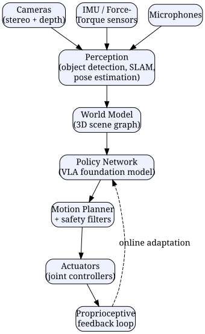

# Humanoid Robots in 2026: A Practical Guide to Embodied AI and General-Purpose Automation

*Reading time: 9 min · 1,714 words*

> Humanoid robots moved from demo videos to real supervised pilot programs in 2026. This guide breaks down the perception, planning, and hardware stack behind modern humanoids, examines where they are actually deployed, and outlines the safety, economics, and technical challenges that remain.

## Table of Contents
- [Why Now: The Convergence Behind the 2026 Moment](#why-now-the-convergence-behind-the-2026-moment)
  - [Foundation models for control](#foundation-models-for-control)
  - [Hardware cost declines](#hardware-cost-declines)
  - [Labor market pressure](#labor-market-pressure)
  - [Capital and ecosystem](#capital-and-ecosystem)
- [The Anatomy of a Modern Humanoid Robot](#the-anatomy-of-a-modern-humanoid-robot)
  - [Perception](#perception)
  - [The brain: VLA foundation models](#the-brain-vla-foundation-models)
  - [Planning and safety](#planning-and-safety)
  - [The body: actuators, batteries, hands](#the-body-actuators-batteries-hands)
  - [Simulation and sim-to-real](#simulation-and-sim-to-real)
- [Where Humanoids Are Actually Being Deployed in 2026](#where-humanoids-are-actually-being-deployed-in-2026)
  - [Automotive manufacturing](#automotive-manufacturing)
  - [Warehousing and logistics](#warehousing-and-logistics)
  - [Healthcare and service](#healthcare-and-service)
  - [Construction and hazardous environments](#construction-and-hazardous-environments)
  - [A real-world example](#a-real-world-example)
- [The Economics of Humanoid Deployment](#the-economics-of-humanoid-deployment)
- [Evaluating a Humanoid Platform: A Practical Checklist](#evaluating-a-humanoid-platform-a-practical-checklist)
- [The Hard Problems Still Unsolved](#the-hard-problems-still-unsolved)
  - [Battery and thermal management](#battery-and-thermal-management)
  - [Dexterity](#dexterity)
  - [Reliability and mean time between failures](#reliability-and-mean-time-between-failures)
  - [Data scarcity](#data-scarcity)
  - [Cost](#cost)
- [Safety, Standards, and Regulation](#safety-standards-and-regulation)
- [What to Watch in 2026–2027](#what-to-watch-in-20262027)
- [Key Takeaways](#key-takeaways)
- [Frequently Asked Questions](#frequently-asked-questions)

In 2026, humanoid robots have crossed a practical threshold. After decades of research demos and carefully choreographed videos, general-purpose humanoids are running supervised pilot deployments in car plants, distribution centers, and hospitals. The shift is powered by the same force that reshaped software: foundation models. Vision-language-action (VLA) models give robots a flexible "brain," while cheaper actuators, better batteries, and mature simulation tools make the "body" commercially viable.

This article is a practical guide to the humanoid robotics landscape in 2026. We'll cover why now, the core technology stack, real-world deployments, the economics, and the hard problems that remain.

## Why Now: The Convergence Behind the 2026 Moment

### Foundation models for control
The biggest change is the rise of vision-language-action (VLA) models. These neural networks are trained on massive datasets of images, text, and robot trajectories. They take camera feeds and a language instruction such as "pick up the blue bin" and output actions directly. Unlike classical robotics pipelines that required hand-coded perception and planning modules, VLA models generalize across objects and tasks. By 2026, several open-weight VLA models are available, and they have become the default "brain" for new humanoid platforms.

### Hardware cost declines
Humanoid bodies are getting cheaper. Electric linear actuators, once exotic and expensive, are now mass-produced. Depth cameras, IMUs, and force-torque sensors have fallen in price thanks to automotive and consumer electronics supply chains. Battery energy density keeps improving, extending runtime.

### Labor market pressure
Manufacturers face chronic shortages of workers for repetitive, physically demanding roles. Humanoids are attractive because they can operate in environments built for humans—stairs, doors, tools, workstations—without redesigning the facility.

### Capital and ecosystem
Between 2023 and 2026, billions of dollars flowed into humanoid startups, with major investments from automotive and technology companies. This funding accelerated iteration cycles and attracted top engineering talent.

## The Anatomy of a Modern Humanoid Robot

A modern humanoid is best understood as a layered stack: perception, world modeling, policy, planning, and actuation.

### Perception
Robots sense the world through stereo cameras, depth sensors, microphones, and proprioceptive sensors (encoders, IMUs, force-torque sensors). Onboard perception detects objects, estimates poses, and builds a 3D representation of the scene. In 2026, most perception runs on lightweight neural networks optimized for edge GPUs or custom accelerators.

### The brain: VLA foundation models
The central "brain" is a VLA model. It ingests images and language instructions and emits action tokens. These models are typically trained in two phases: first on large internet-scale image and text data for general understanding, then fine-tuned on robot interaction data. Some systems add a learned world model that predicts the consequences of actions before execution.

### Planning and safety
Raw policy outputs are rarely sent directly to motors. A motion planner refines them into smooth, feasible trajectories, and safety filters enforce joint limits, collision avoidance, and speed bounds. This layer is essential for working alongside people.

### The body: actuators, batteries, hands
Mechanical designs vary widely. High-end humanoids use electric linear actuators at the hips and knees for strength and efficiency. Dexterous hands with 12–20 degrees of freedom are a major frontier; most production robots still rely on simpler grippers. Batteries typically allow 2–4 hours of continuous operation, with hot-swappable packs.

### Simulation and sim-to-real
Most training happens in simulation. Physics engines and GPU-accelerated environments generate millions of trajectories cheaply. Domain randomization helps policies transfer from simulation to the real world.

Here is a simplified architecture diagram:

## Where Humanoids Are Actually Being Deployed in 2026

### Automotive manufacturing
Automotive is the flagship vertical. Car makers have deployed humanoids for moving totes, loading parts into fixtures, and applying sealants. These are structured, repetitive tasks where return on investment is easiest to justify.

### Warehousing and logistics
Distribution centers are another hotspot. Humanoids handle parcel induction, depalletizing, and item picking. Many warehouse operators still prefer wheeled or fixed robotic arms; humanoids win where the environment demands stairs or narrow aisles.

### Healthcare and service
Hospitals are piloting humanoids for delivering linens, meals, and medications. In hospitality, robots assist with cleaning and concierge duties. These deployments are smaller and more experimental.

### Construction and hazardous environments
Some teams are testing humanoids for construction tasks—drywall installation, rebar tying, material handling—and for inspecting hazardous sites like chemical plants. Autonomy is lower here; teleoperation remains common.

### A real-world example
Consider a mid-sized automotive parts supplier that deployed two humanoids on a kitting line in early 2026. The robots pick components from bins and place them into kits for assembly stations. Operators supervise and intervene via a tablet when a novel part appears. In the first quarter, the supplier reported fewer ergonomic injuries and freed workers for higher-skill tasks. The robots run approximately 70% autonomously; the rest requires remote assistance. This pattern—supervised autonomy with human-in-the-loop—is typical of 2026 deployments.

> Important: Almost every production deployment in 2026 is supervised. Fully autonomous, unattended humanoids remain rare. Plan for human oversight, teleoperation fallback, and exception handling.

## The Economics of Humanoid Deployment

Total cost of ownership (TCO) includes the robot purchase price, maintenance, energy, software subscriptions, and the staff who supervise and teleoperate. Early adopters report that humanoids are competitive with human labor only in specific high-cost, high-turnover roles. Traditional fixed automation is still cheaper for high-volume, single-task lines.

Payback periods in favorable cases are estimated at two to five years. As component costs fall and reliability improves, the addressable market widens. Vendors are also shifting toward robot-as-a-service models, lowering the upfront barrier.

## Evaluating a Humanoid Platform: A Practical Checklist

When comparing platforms in 2026, consider:

- **Degrees of freedom and payload**: Does the robot match your task requirements?
- **Runtime and charging**: How long can it work between charges? Is battery swapping supported?
- **Software stack openness**: Is there an SDK, API, and documentation? Can you integrate your own perception or planning?
- **Safety certifications**: What standards does the platform meet (ISO 10218, ISO/TS 15066)?
- **Teleoperation support**: How mature is remote supervision? What latency and bandwidth are needed?
- **Vendor track record**: Ask about field deployments, uptime data, and service SLAs.
- **Data and training access**: Can you fine-tune the policy on your own task data?

## The Hard Problems Still Unsolved

### Battery and thermal management
Energy density limits runtime. Heavy computation and actuation generate heat; thermal management adds weight. Most humanoids operate 2–4 hours per charge.

### Dexterity
Hands remain the hardest problem. Robust in-hand manipulation, tactile sensing, and grasping unknown objects are unsolved at scale. Many robots still use parallel-jaw grippers.

### Reliability and mean time between failures
Mechanical failures are common. Joints, cables, and fingers wear out. Achieving the reliability of traditional industrial robots (tens of thousands of hours) will take years.

### Data scarcity
VLA models need diverse robot data. Collecting real demonstrations is slow and expensive. Teleoperation pipelines help, but scaling data remains a bottleneck.

### Cost
Early units cost hundreds of thousands of dollars. Prices are falling, but the sub-$50,000 range that would unlock mass adoption is still ahead.

## Safety, Standards, and Regulation

Safety is the gating factor for deployment. Relevant standards include:

| Standard | Scope |
| --- | --- |
| ISO 10218 | Industrial robot safety |
| ISO/TS 15066 | Collaborative robot safety |
| IEC 61508 | Functional safety of electronic systems |
| EU AI Act | Risk-based regulation of AI systems |

Most factory deployments follow a risk assessment under ISO 10218-style rules, often adding physical barriers or speed limits. The EU AI Act classifies high-risk AI systems; workplace robots may fall under obligations for risk management, logging, and human oversight. Regulators are still catching up with mobile manipulation robots, so expect evolving guidance.

## What to Watch in 2026–2027

- **Open-weight VLA models**: continued progress will let smaller teams build robot brains.
- **Tactile sensing**: cheap, robust tactile skins will unlock dexterity.
- **Teleoperation at scale**: remote human supervision will remain central.
- **Battery advances**: solid-state batteries could extend runtime significantly.
- **Standardization**: new safety standards for mobile manipulation are in development.

## Key Takeaways

- Humanoid robots are in supervised pilot deployments across automotive, logistics, and healthcare in 2026.
- The core innovation is the VLA foundation model, replacing hand-coded perception and control pipelines.
- The stack is layered: perception → world model → policy → planner → actuation, with safety filters throughout.
- Dexterity, battery life, reliability, and cost remain the biggest unsolved problems.
- Expect human-in-the-loop supervision and teleoperation for the foreseeable future.
- Standards like ISO 10218 and the EU AI Act shape where and how humanoids can be deployed.

## Frequently Asked Questions

Q: Are humanoid robots truly autonomous in 2026?
A: Not fully. Most production deployments use supervised autonomy, where operators monitor and intervene via teleoperation. Full autonomy is limited to narrow, well-defined tasks.

Q: How much does a humanoid robot cost in 2026?
A: Prices vary widely by vendor and configuration. Early units range from roughly $100,000 to several hundred thousand dollars. Costs are declining as components commoditize, but mass-market pricing is still years away.

Q: What is a VLA model?
A: A vision-language-action model is a neural network trained on images, text, and robot actions. It lets a robot interpret visual scenes and natural-language instructions and output motor commands directly.

Q: Which industries deploy humanoids first?
A: Automotive manufacturing and warehousing lead, followed by healthcare logistics and construction pilots. Structured, repetitive tasks with clear ROI are the entry points.

Q: What safety standards apply to humanoid robots?
A: ISO 10218 and ISO/TS 15066 cover industrial and collaborative robots. The EU AI Act may also apply to workplace AI systems. Deployments require risk assessments and often physical safeguards.

## Frequently Asked Questions

**Q: Are humanoid robots truly autonomous in 2026?**

A: Not fully. Most production deployments use supervised autonomy, where operators monitor and intervene via teleoperation. Full autonomy is limited to narrow, well-defined tasks.

**Q: How much does a humanoid robot cost in 2026?**

A: Prices vary widely by vendor and configuration. Early units range from roughly $100,000 to several hundred thousand dollars. Costs are declining as components commoditize, but mass-market pricing is still years away.

**Q: What is a VLA model?**

A: A vision-language-action model is a neural network trained on images, text, and robot actions. It lets a robot interpret visual scenes and natural-language instructions and output motor commands directly.

**Q: Which industries deploy humanoids first?**

A: Automotive manufacturing and warehousing lead, followed by healthcare logistics and construction pilots. Structured, repetitive tasks with clear ROI are the entry points.

**Q: What safety standards apply to humanoid robots?**

A: ISO 10218 and ISO/TS 15066 cover industrial and collaborative robots. The EU AI Act may also apply to workplace AI systems. Deployments require risk assessments and often physical safeguards.

## Key Takeaways

- Humanoid robots are in supervised pilot deployments across automotive, logistics, and healthcare in 2026.
- The core innovation is the VLA foundation model, replacing hand-coded perception and control pipelines.
- The stack is layered: perception → world model → policy → planner → actuation, with safety filters throughout.
- Dexterity, battery life, reliability, and cost remain the biggest unsolved problems.
- Expect human-in-the-loop supervision and teleoperation for the foreseeable future.
- Standards like ISO 10218 and the EU AI Act shape where and how humanoids can be deployed.

## Related Articles

- vision-language-action-models
- robot-learning-and-imitation
- edge-ai-for-robotics
- simulation-and-sim-to-real

<!-- Cover image prompts (for editors):
  - A photorealistic wide shot of a modern humanoid robot working on an automotive assembly line in 2026, wearing a safety vest, with robotic arms handling parts, industrial lighting, shallow depth of field, editorial photography style.
  - An isometric cutaway illustration of a humanoid robot's software and hardware architecture, showing cameras, neural network layers, actuators, and battery pack, labeled diagram style, clean white background, tech blueprint aesthetic.
  - A close-up of a dexterous robotic hand with tactile sensors picking up a small object, macro photography, soft studio lighting, futuristic robotics laboratory setting.
-->