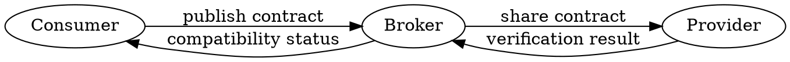

# Contract Testing for Microservices: A Practical Guide for Testers

*Reading time: 8 min · 1,537 words*

> Learn how contract testing verifies API compatibility between microservices without slow end-to-end suites. This guide covers consumer-driven contracts, tools like Pact, adoption strategies, and a real-world e-commerce example.

## Table of Contents
- [Introduction](#introduction)
- [What Is Contract Testing?](#what-is-contract-testing)
  - [Consumer-Driven vs. Provider-Driven Contracts](#consumer-driven-vs-provider-driven-contracts)
  - [Contract Testing vs. Integration Testing](#contract-testing-vs-integration-testing)
- [Core Concepts](#core-concepts)
- [How Contract Testing Works](#how-contract-testing-works)
- [Tools and Frameworks](#tools-and-frameworks)
- [Adopting Contract Testing in Your Organization](#adopting-contract-testing-in-your-organization)
  - [Where Contract Testing Fits in the Test Pyramid](#where-contract-testing-fits-in-the-test-pyramid)
- [Real-World Example: E-Commerce Checkout](#real-world-example-e-commerce-checkout)
- [Common Pitfalls and Best Practices](#common-pitfalls-and-best-practices)
- [Conclusion](#conclusion)
- [Key Takeaways](#key-takeaways)
- [Frequently Asked Questions](#frequently-asked-questions)

## Introduction

Microservices have changed how teams build software, but they also introduced a new class of testing problems. When a checkout service depends on a payment service, a tiny change in the payment API can break every consumer. Traditional integration tests often spin up the entire stack, which is slow, flaky, and hard to maintain. Contract testing offers a faster, more focused way to catch API mismatches before they reach production.

In this guide, you will learn what contract testing is, how it fits into a modern testing strategy, and how to adopt it with tools like Pact and Spring Cloud Contract. You will also see a real-world example that makes the concepts concrete.


## What Is Contract Testing?

Contract testing verifies that two services can communicate according to an agreed-upon "contract." The contract defines the expected requests and responses for a given interaction. Unlike end-to-end tests, which exercise many services at once, contract tests run against a single consumer and provider pair.

A contract is often consumer-driven. The consumer (the service making the request) writes a test that captures its expectations. The provider (the service receiving the request) then runs those expectations against its own implementation. If the provider satisfies the contract, both sides can be deployed independently with confidence.

### Consumer-Driven vs. Provider-Driven Contracts

- Consumer-driven: Consumers publish their expectations, and providers verify them. This is the most common pattern because it reflects real usage.
- Provider-driven: Providers publish a specification (like an OpenAPI document), and consumers generate tests from it. This works well when a team owns a public API.

Both approaches share a core idea: define the interaction explicitly, then verify it automatically.

### Contract Testing vs. Integration Testing

Integration tests are valuable, but they are not the same as contract tests. Integration tests usually deploy multiple services together and send real traffic. They can catch issues like network latency, authentication failures, and data inconsistencies. However, they are expensive to run and often become flaky.

Contract tests, by contrast, run in isolation. They mock the other side of the interaction, so they are fast and deterministic. They do not replace integration tests; they complement them.

## Core Concepts

| Concept | Description |
| --- | --- |
| Consumer | The service that makes an HTTP request to another service. |
| Provider | The service that receives the request and returns a response. |
| Contract | A formal description of the expected request and response for one interaction. |
| Broker | A central repository where contracts are published and shared. |
| Provider State | A setup condition that lets the provider simulate a specific scenario, such as "user has no orders." |
| Verification | The process of running a contract against the provider's actual behavior. |

## How Contract Testing Works

The typical workflow follows a loop:

1. The consumer writes a test that describes the interaction.
2. The test generates a contract file.
3. The contract is published to a broker.
4. The provider fetches the contract and runs a verification suite.
5. The provider publishes the verification result.
6. The consumer can see whether the provider is compatible.

Here is a simple Graphviz diagram of that flow:



This loop gives teams fast feedback. If a provider changes its response shape, the verification fails before the provider is deployed.

## Tools and Frameworks

Several tools support contract testing. The most popular are:

- Pact: A mature, multi-language consumer-driven contract testing framework. It has a broker and supports many platforms.
- Spring Cloud Contract: A JVM-focused tool that can generate tests from Groovy or YAML contracts.
- Schemathesis: A property-based testing tool that checks OpenAPI schemas by generating random requests.
- Postman/Swagger: Useful for API design, but not full contract testing frameworks.

Here is a minimal Pact example in JavaScript for a consumer:

```javascript
const { Pact } = require('@pact-foundation/pact');

const provider = new Pact({
  consumer: 'CheckoutService',
  provider: 'PaymentService'
});

test('payment provider returns a successful charge', async () => {
  await provider.addInteraction({
    state: 'a valid payment method',
    uponReceiving: 'a request to charge a customer',
    withRequest: {
      method: 'POST',
      path: '/charges',
      headers: { 'Content-Type': 'application/json' }
    },
    willRespondWith: {
      status: 201,
      body: { id: 'ch_123', status: 'succeeded' }
    }
  });

  const response = await requestCharge({ amount: 100 });
  expect(response.status).toBe(201);
});
```

The provider side would fetch this contract and verify that its real endpoint matches.

## Adopting Contract Testing in Your Organization

Start small and focus on the highest-value interactions.

- Identify critical service-to-service dependencies.
- Choose a pilot team that already has good API documentation.
- Set up a broker early so contracts are visible to everyone.
- Integrate contract generation into the consumer's CI pipeline.
- Add provider verification to the provider's CI pipeline.
- Define a clear ownership model for contracts.

### Where Contract Testing Fits in the Test Pyramid

Contract tests sit above unit tests and below end-to-end tests. They are broader than unit tests because they check a real API contract, but narrower than end-to-end tests because they only exercise one interaction. A healthy test suite might look like:

- Many unit tests
- Several contract tests
- A few integration tests
- A handful of end-to-end tests

This balance keeps the suite fast while still catching interface drift.

## Real-World Example: E-Commerce Checkout

Imagine an online store with three services: Checkout, Inventory, and Payment. The Checkout service calls Payment to charge customers. The Payment team wants to add a new optional field to the response, but they are worried about breaking Checkout.

Using contract testing, the Checkout team writes a consumer test that expects a `status` field and an `id` field. They publish the contract to the broker. The Payment team runs verification against that contract. The verification passes because the new field is optional and the old fields still exist. Both teams can deploy safely.

Later, the Payment team decides to rename `status` to `state`. The next verification run fails. The Payment team sees the failure before release and either updates the contract or coordinates a migration. This prevents a production incident.

This example shows how contract testing turns a potentially dangerous change into a safe, automated check.


## Common Pitfalls and Best Practices

Contract testing is powerful, but it is not a silver bullet.

- Do not test everything with contracts. Only use them for cross-service boundaries.
- Keep contracts small and focused. A contract with dozens of interactions becomes hard to maintain.
- Treat contracts as versioned artifacts. Use semantic versioning and avoid breaking changes without a migration plan.
- Make provider states explicit. They are essential for testing different scenarios.
- Do not rely solely on contract tests. You still need integration and end-to-end tests for runtime concerns.

> **Caution:** Contract tests verify API shape, not behavior like authentication, timeout handling, or database consistency. Always combine them with other test levels.

## Conclusion

Contract testing is a practical technique for taming microservice complexity. It gives teams fast, reliable feedback about API compatibility and reduces the risk of breaking downstream consumers. By starting with a small pilot, using a broker, and integrating verification into CI, you can make contract testing a natural part of your delivery pipeline.

The key is to treat contracts as living artifacts that reflect real consumer expectations. When you do, you will spend less time debugging mysterious integration failures and more time shipping value.

## Key Takeaways

- Contract testing verifies API compatibility between a consumer and provider without deploying the full stack.
- Consumer-driven contracts are the most common pattern and reflect actual usage.
- A broker centralizes contracts and verification results, making compatibility visible.
- Tools like Pact and Spring Cloud Contract fit well into CI/CD pipelines.
- Start with high-risk dependencies and expand gradually.
- Combine contract tests with integration and end-to-end tests for complete coverage.

## Frequently Asked Questions

Q: What is the difference between contract testing and integration testing?
A: Contract testing checks the shape of an API interaction in isolation, while integration testing runs multiple services together and validates runtime behavior. Contract tests are faster and more deterministic, but they do not catch infrastructure-level issues.

Q: Can contract testing replace end-to-end tests?
A: No. Contract testing only verifies the contract between two services. End-to-end tests are still needed to validate user journeys, authentication, and real network behavior.

Q: Which tools support contract testing?
A: Pact is the most widely used multi-language tool. Spring Cloud Contract is popular in JVM ecosystems. Schemathesis can help validate OpenAPI schemas with generated requests.

Q: How do I handle breaking changes in a contract?
A: Version your contracts and coordinate with consumers. Use a broker to see who is affected. Prefer additive changes, and deprecate old fields over time.

Q: Is contract testing only for microservices?
A: No. It is useful for any distributed system with service-to-service APIs, including serverless functions, mobile backends, and third-party integrations.

## Frequently Asked Questions

**Q: What is the difference between contract testing and integration testing?**

A: Contract testing checks the shape of an API interaction in isolation, while integration testing runs multiple services together and validates runtime behavior. Contract tests are faster and more deterministic, but they do not catch infrastructure-level issues.

**Q: Can contract testing replace end-to-end tests?**

A: No. Contract testing only verifies the contract between two services. End-to-end tests are still needed to validate user journeys, authentication, and real network behavior.

**Q: Which tools support contract testing?**

A: Pact is the most widely used multi-language tool. Spring Cloud Contract is popular in JVM ecosystems. Schemathesis can help validate OpenAPI schemas with generated requests.

**Q: How do I handle breaking changes in a contract?**

A: Version your contracts and coordinate with consumers. Use a broker to see who is affected. Prefer additive changes, and deprecate old fields over time.

**Q: Is contract testing only for microservices?**

A: No. It is useful for any distributed system with service-to-service APIs, including serverless functions, mobile backends, and third-party integrations.

## Key Takeaways

- Contract testing verifies API compatibility between a consumer and provider without deploying the full stack.
- Consumer-driven contracts are the most common pattern and reflect actual usage.
- A broker centralizes contracts and verification results, making compatibility visible.
- Tools like Pact and Spring Cloud Contract fit well into CI/CD pipelines.
- Start with high-risk dependencies and expand gradually.
- Combine contract tests with integration and end-to-end tests for complete coverage.

## Related Articles

- consumer-driven-contracts
- pact-broker-setup
- api-compatibility-testing
- test-pyramid-strategies

<!-- Cover image prompts (for editors):
  - A clean diagram showing a consumer, provider, and broker exchanging contract files with arrows labeled publish, share, verify, and notify.
  - A developer writing a contract test in an IDE with Pact code visible and a terminal showing verification results.
  - A CI pipeline visualization with a contract verification step highlighted between build and deploy stages.
  - A team dashboard showing contract verification status across multiple microservices with green and red indicators.
-->