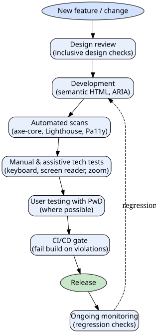

# Accessibility Testing in 2025: A Practical Guide for Testers

*Reading time: 10 min · 2,049 words*

> A practical guide to accessibility testing in 2025, covering WCAG 2.2 standards, automated tools, manual testing techniques, and how to integrate accessibility checks into CI/CD workflows. Includes a real-world checkout flow example and actionable tips for testers.

## Table of Contents
- [Why Accessibility Testing Matters More Than Ever](#why-accessibility-testing-matters-more-than-ever)
- [Understanding the Core Standards: WCAG and POUR](#understanding-the-core-standards-wcag-and-pour)
- [The Four Layers of Accessibility Testing](#the-four-layers-of-accessibility-testing)
  - [1. Automated Testing](#1-automated-testing)
  - [2. Manual Testing](#2-manual-testing)
  - [3. Assistive Technology Testing](#3-assistive-technology-testing)
  - [4. User Testing with People with Disabilities](#4-user-testing-with-people-with-disabilities)
- [Building an Accessibility Testing Workflow](#building-an-accessibility-testing-workflow)
  - [Shifting Left: Testing in Design and Development](#shifting-left-testing-in-design-and-development)
  - [Automating Accessibility in CI/CD](#automating-accessibility-in-cicd)
- [Real-World Example: Testing a Checkout Flow](#real-world-example-testing-a-checkout-flow)
- [Common Pitfalls and How to Avoid Them](#common-pitfalls-and-how-to-avoid-them)
- [Tools Quick Reference](#tools-quick-reference)
- [Conclusion](#conclusion)
- [Key Takeaways](#key-takeaways)
- [Frequently Asked Questions](#frequently-asked-questions)

Accessibility testing has moved from a nice-to-have afterthought to a hard requirement for digital products. With the European Accessibility Act (EAA) becoming enforceable in June 2025, WCAG 2.2 raising the bar, and a steady rise in accessibility-related litigation worldwide, testers who can navigate this domain are in high demand. This guide walks through the standards, tools, and workflows you need to build a practical accessibility testing practice.

## Why Accessibility Testing Matters More Than Ever

The EAA requires that digital products and services—including e-commerce sites, banking apps, e-books, and ticketing systems—meet accessibility standards across EU member states. In the United States, lawsuits under the Americans with Disabilities Act (ADA) continue to target websites and mobile apps. Meanwhile, WCAG 2.2, published in October 2023, added new success criteria that go beyond what many teams were already testing.

For testers, this creates a clear mandate: accessibility is no longer optional. It is a quality attribute with legal, financial, and reputational consequences. The good news is that accessibility testing follows a learnable, repeatable process—and you already have most of the skills you need.

## Understanding the Core Standards: WCAG and POUR

The Web Content Accessibility Guidelines (WCAG) are the de facto global standard for digital accessibility. The current version, WCAG 2.2, builds on 2.1 with nine new success criteria, including focus not obscured, dragging movements, target size minimum, and accessible authentication.

WCAG is organized around four principles, remembered by the acronym **POUR**:

| Principle | Meaning | Example criteria |
|-----------|---------|-----------------|
| **Perceivable** | Information must be presentable in ways users can perceive | Alt text, captions, color contrast |
| **Operable** | Interface components must be usable | Keyboard navigation, sufficient time, no seizures |
| **Understandable** | Content and operation must be understandable | Readable language, predictable behavior, input assistance |
| **Robust** | Content must work with current and future user agents | Valid HTML, accessible names, ARIA usage |

Each criterion has a conformance level: **A** (must support), **AA** (should support), and **AAA** (may support). Most regulations, including the EAA and Section 508, require at least AA conformance.

> **Note:** WCAG 2.2 introduced new AA-level criteria like "Focus Not Obscured (Minimum)" and "Accessible Authentication (Minimum)". If you were already testing against 2.1 AA, you now have additional criteria to verify.

## The Four Layers of Accessibility Testing

A robust accessibility testing strategy combines four complementary approaches. No single method catches everything, and each layer covers blind spots in the others.

### 1. Automated Testing

Automated tools scan the DOM and detect a subset of issues—roughly 30–50% of WCAG failures, depending on the tool and context. They excel at catching:

- Missing or empty alt text
- Insufficient color contrast (when computed from CSS)
- Missing form labels
- Invalid ARIA attributes
- Duplicate IDs
- Landmark misuse

Popular tools include:

- **axe-core** (Deque) — the industry-standard open-source engine, available as browser extensions, npm packages, and CI integrations
- **Lighthouse** (Google) — built into Chrome DevTools, includes an accessibility audit section
- **Pa11y** — a command-line accessibility testing tool with multiple flavors (pa11y-ci, pa11y-webservice)
- **WAVE** (WebAIM) — a visual evaluation tool that overlays icons directly on the page
- **Accessibility Insights** (Microsoft) — free, with fast-pass and assessment modes


### 2. Manual Testing

Automated tools miss many issues that require human judgment. Manual testing involves:

- **Keyboard-only navigation** — tab through the entire page, check focus order, visible focus indicators, and trap-free navigation
- **Screen reader testing** — using NVDA (Windows), VoiceOver (macOS/iOS), or TalkBack (Android) to experience the page as a non-visual user
- **Zoom and magnification** — test at 200%, 400%, and with browser zoom
- **Color and contrast checks** — beyond automated contrast, verify that information is not conveyed by color alone
- **Motion and animation** — check for flashing content, auto-playing media, and reduced-motion preferences

### 3. Assistive Technology Testing

This goes beyond basic screen reader checks to include:

- **Speech recognition** — Dragon NaturallySpeaking or built-in OS speech-to-text
- **Switch devices** — testing with switch access for users with motor impairments
- **Eye tracking** — less common but relevant for certain kiosks or specialized software
- **Braille displays** — verifying that dynamic content updates reach the braille output

### 4. User Testing with People with Disabilities

The gold standard. Recruiting users with disabilities—whether through agencies, community organizations, or your own user base—reveals issues that no tool or checklist can predict. Even a small panel of 3–5 users can surface critical usability barriers.

## Building an Accessibility Testing Workflow

Here is a practical workflow you can adapt to your team:



### Shifting Left: Testing in Design and Development

Accessibility bugs found late in the cycle are expensive to fix. The best strategy is to embed accessibility checks as early as possible:

- **Design phase:** Review mockups for color contrast (using a tool like Stark or Contrast), ensure touch targets are at least 24×24 CSS pixels (WCAG 2.2 requires 24×24 minimum for target size), and confirm that interactive elements have visible focus states.
- **Development phase:** Encourage developers to use semantic HTML (`<button>`, `<nav>`, `<main>`, etc.) instead of generic `<div>`s with JavaScript handlers. Semantic HTML is the foundation of accessibility—it gives assistive technology the structure it needs for free.
- **Code review:** Add accessibility to your pull request checklist. Simple checks like "does this new component have a label?" and "is the focus order logical?" catch many issues before they reach QA.

### Automating Accessibility in CI/CD

You can integrate automated accessibility checks directly into your pipeline:

```bash
# Example: run axe-core via @axe-core/cli in CI
npx @axe-core/cli https://staging.example.com --exit
```

Or with Playwright:

```javascript
const { AxeBuilder } = require('@axe-core/playwright');

test('checkout page has no serious a11y violations', async ({ page }) => {
  await page.goto('/checkout');
  const results = await new AxeBuilder({ page }).analyze();
  expect(results.violations.filter(v => v.impact === 'serious')).toEqual([]);
});
```

Key considerations for CI integration:

- **Fail the build** on serious/critical violations, but allow warnings to pass initially so teams aren't overwhelmed.
- **Run on every PR** for changed pages, and nightly for the full site.
- **Use a baseline** to track trends over time rather than requiring zero violations from day one.

## Real-World Example: Testing a Checkout Flow

Let's walk through a realistic scenario. You're testing an e-commerce checkout flow with three steps: cart → shipping → payment.

**Step 1: Automated scan.** You run axe-core on each step. It finds:

- Missing alt text on a product thumbnail (critical)
- Color contrast failure on the "Place Order" button (serious)
- A form field missing a programmatic label (critical)

**Step 2: Manual keyboard test.** You unplug the mouse and tab through. You discover:

- The focus order jumps from shipping address to payment details, skipping the "Save this address" checkbox
- The focus indicator is invisible on the "Continue" button because it uses `outline: none` with no replacement
- A custom dropdown widget traps focus—you cannot Tab out of it

**Step 3: Screen reader test.** Using NVDA with Firefox, you find:

- The error message after submitting an invalid zip code is not announced—it appears visually but the screen reader user hears nothing
- The credit card expiry date field is announced as "edit, expired" because the placeholder text is being read as the label


**Step 4: Fix and re-test.** The team fixes the issues: adds alt text, adjusts contrast, adds proper labels, restores focus outlines, fixes the tab order, and adds `aria-live="assertive"` to the error region. You re-run the automated scan (now clean) and repeat the manual passes. The checkout flow now works for keyboard-only, screen reader, and magnified view users.

This example illustrates why you need all four layers: the automated tool caught static issues, but the tab order and screen reader problems required human judgment.

## Common Pitfalls and How to Avoid Them

| Pitfall | Consequence | Mitigation |
|---------|-------------|------------|
| Relying only on automated tools | Misses ~50–70% of issues | Always pair automated scans with manual testing |
| Testing accessibility only at the end | Expensive rework, missed deadlines | Shift left: test in design and development |
| Ignoring dynamic content | SPAs and AJAX updates break accessibility silently | Test after state changes; use `aria-live` correctly |
| Treating accessibility as a checklist | Passes checks but still unusable | Include real users with disabilities |
| Not testing on real devices | Emulators miss mobile-specific issues | Test on actual iOS/Android devices with VoiceOver/TalkBack |

## Tools Quick Reference

| Tool | Type | Best for |
|------|------|----------|
| axe-core | Automated library | CI/CD integration, unit test assertions |
| Lighthouse | Automated browser audit | Quick page-level scan, performance + a11y |
| Pa11y | CLI/automated | Multi-page crawls, HTML report generation |
| WAVE | Browser extension | Visual inspection of rendered page |
| Accessibility Insights | Free tool | FastPass + guided manual assessments |
| NVDA / VoiceOver | Screen readers | Manual screen reader testing |
| Stark / Contrast | Design plugins | Contrast and color checks in Figma/Sketch |

## Conclusion

Accessibility testing is not a separate discipline—it is part of quality engineering. By combining automated scans, manual keyboard and screen reader checks, assistive technology validation, and real-user feedback, you can deliver products that work for everyone. With the EAA enforcement date upon us and WCAG 2.2 raising the bar, there has never been a better time to invest in accessibility testing skills.

Start small: pick one critical user journey, run an automated scan, do a keyboard-only pass, and fix what you find. Build from there.

## Key Takeaways

- WCAG 2.2 is the current standard; EAA enforcement in June 2025 makes accessibility a legal requirement across the EU.
- Automated tools catch only 30–50% of issues—always combine them with manual testing.
- Keyboard-only navigation and screen reader testing are the two highest-value manual checks you can perform.
- Shift accessibility testing left into design and development to reduce rework costs.
- Integrate automated accessibility checks into CI/CD with a fail-on-serious-violations policy.
- Real user testing with people with disabilities remains the gold standard for uncovering usability barriers.

## Frequently Asked Questions

**Q: What is the difference between WCAG 2.1 and 2.2?**
A: WCAG 2.2 adds nine new success criteria to 2.1, including Focus Not Obscured, Dragging Movements, Target Size (Minimum), and Accessible Authentication. Several criteria that were AAA in 2.1 (like Focus Appearance) are now AA in 2.2, making them more commonly required.

**Q: Do I need to test with a screen reader if I already use automated tools?**
A: Yes. Automated tools cannot evaluate whether content makes sense when read aloud, whether focus order is logical, or whether dynamic updates are announced. Screen reader testing typically uncovers issues that automated tools miss entirely.

**Q: Which WCAG conformance level should my organization target?**
A: Level AA is the standard required by most regulations, including the EAA, Section 508, and the ADA. Aim for AA conformance as your baseline, and consider AAA for specific high-impact areas like public-facing forms.

**Q: How do I get started with accessibility testing if my team has no experience?**
A: Start with automated tools (axe-core or Lighthouse) to find easy wins, then learn keyboard navigation basics, and gradually add screen reader testing. Consider training or hiring an accessibility specialist for the manual aspects.

**Q: Can accessibility testing be fully automated?**
A: No. While automated tools can catch many objective issues (contrast, missing labels, ARIA errors), subjective aspects—such as whether a page is understandable, whether navigation is intuitive, and whether a screen reader experience is coherent—require human judgment.

## Frequently Asked Questions

**Q: What is the difference between WCAG 2.1 and 2.2?**

A: WCAG 2.2 adds nine new success criteria to 2.1, including Focus Not Obscured, Dragging Movements, Target Size (Minimum), and Accessible Authentication. Several criteria that were AAA in 2.1 (like Focus Appearance) are now AA in 2.2, making them more commonly required.

**Q: Do I need to test with a screen reader if I already use automated tools?**

A: Yes. Automated tools cannot evaluate whether content makes sense when read aloud, whether focus order is logical, or whether dynamic updates are announced. Screen reader testing typically uncovers issues that automated tools miss entirely.

**Q: Which WCAG conformance level should my organization target?**

A: Level AA is the standard required by most regulations, including the EAA, Section 508, and the ADA. Aim for AA conformance as your baseline, and consider AAA for specific high-impact areas like public-facing forms.

**Q: How do I get started with accessibility testing if my team has no experience?**

A: Start with automated tools (axe-core or Lighthouse) to find easy wins, then learn keyboard navigation basics, and gradually add screen reader testing. Consider training or hiring an accessibility specialist for the manual aspects.

**Q: Can accessibility testing be fully automated?**

A: No. While automated tools can catch many objective issues (contrast, missing labels, ARIA errors), subjective aspects—such as whether a page is understandable, whether navigation is intuitive, and whether a screen reader experience is coherent—require human judgment.

## Key Takeaways

- WCAG 2.2 is the current standard; EAA enforcement in June 2025 makes accessibility a legal requirement across the EU.
- Automated tools catch only 30–50% of issues—always combine them with manual testing.
- Keyboard-only navigation and screen reader testing are the two highest-value manual checks you can perform.
- Shift accessibility testing left into design and development to reduce rework costs.
- Integrate automated accessibility checks into CI/CD with a fail-on-serious-violations policy.
- Real user testing with people with disabilities remains the gold standard for uncovering usability barriers.

## Related Articles

- AI-Powered Test Automation: A Practical Guide for Testers
- Synthetic Test Data: A Practical Guide to Generating Realistic, Privacy-Compliant Test Data
- Contract Testing for Microservices: A Practical Guide for Testers
- Observability in 2025: A Practical Guide to OpenTelemetry and Unified Telemetry

<!-- Cover image prompts (for editors):
  - A diverse team of software testers collaborating around a large monitor displaying accessibility audit results with axe-core, with one tester using a keyboard-only navigation approach and another wearing headphones using a screen reader
  - A close-up of a browser DevTools panel showing an accessibility audit report from Lighthouse, with color contrast violations highlighted in red and green checkmarks for passing audits
  - A tester using a screen reader on a laptop with a braille display attached, examining a web checkout form, with a clean modern office environment in the background
  - A flowchart-style illustration of an accessibility testing pipeline: design review, automated scans, manual keyboard testing, screen reader testing, and CI/CD gate, with icons for each stage
-->