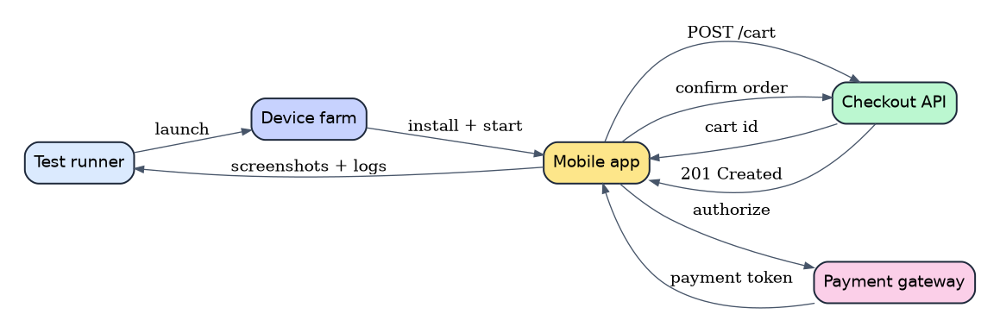

# Mobile App Testing in 2026 - Appium 2, Maestro and the Real-Device Strategy That Catches What Emulators Miss

Mobile applications have become the primary way many people interact with software, yet mobile testing often receives less engineering attention than web or API testing. A team will build a sophisticated CI pipeline for its backend, run thousands of unit tests in minutes, and then verify the Android and iOS apps with a handful of manual checks before release. That imbalance becomes expensive when a permissions dialog, a slow network, or an unusual screen size breaks a checkout flow that looked perfect in a simulator.

This article presents a practical mobile testing strategy for 2026. It covers the trade-offs between emulators and real devices, how Appium 2 changed the automation landscape, where Maestro fits, and how to build a device matrix and CI pipeline that provide useful feedback without turning every pull request into an hour-long queue.

## Table of Contents

- [Why Mobile Testing Still Breaks in 2026](#why-mobile-testing-still-breaks-in-2026)
- [The Mobile Test Pyramid, Revisited](#the-mobile-test-pyramid-revisited)
- [Appium 2 Architecture and Setup That Scales](#appium-2-architecture-and-setup-that-scales)
  - [The Client-Server Model](#the-client-server-model)
  - [Drivers as Plugins](#drivers-as-plugins)
  - [A Minimal Appium Test](#a-minimal-appium-test)
- [Maestro and Declarative Flows](#maestro-and-declarative-flows)
  - [When Maestro Beats Appium](#when-maestro-beats-appium)
- [Real Devices, Emulators and Device Farms](#real-devices-emulators-and-device-farms)
  - [What Emulators Miss](#what-emulators-miss)
  - [Building a Device Matrix](#building-a-device-matrix)
- [Testing the Awkward Parts](#testing-the-awkward-parts)
  - [Permissions, Notifications and Biometrics](#permissions-notifications-and-biometrics)
  - [Network Conditions and Offline Mode](#network-conditions-and-offline-mode)
  - [Deep Links and App Lifecycle](#deep-links-and-app-lifecycle)
- [A Real-World Example of a Checkout Flow](#a-real-world-example-of-a-checkout-flow)
- [Wiring It Into CI Without Slowing Everyone Down](#wiring-it-into-ci-without-slowing-everyone-down)
- [Metrics and Quality Gates](#metrics-and-quality-gates)
- [Common Pitfalls](#common-pitfalls)
- [Conclusion](#conclusion)
- [Key Takeaways](#key-takeaways)
- [Frequently Asked Questions](#frequently-asked-questions)


## Why Mobile Testing Still Breaks in 2026

Mobile quality is difficult for reasons that have little to do with writing test scripts. The execution environment is fragmented and partially outside your control:

- **Operating system versions.** Users may run the latest iOS release, a version several years old, or an Android build customized by the device manufacturer.
- **Hardware diversity.** Screen density, memory, CPU performance, camera capabilities, and sensor availability vary enormously across Android devices.
- **Permissions and privacy controls.** Camera, location, notifications, tracking, and background execution are all gated by dialogs and OS policies that change between releases.
- **Network reality.** Mobile users move between Wi-Fi, cellular, weak signal, captive portals, and complete offline periods.
- **Lifecycle interruptions.** A phone call, low battery warning, or notification can pause or kill an app at any moment.
- **Release channels.** Beta programs, staged rollouts, and app store review introduce delays that web teams never face.

A test suite that ignores these conditions is not really testing a mobile app. It is testing a desktop application that happens to render inside a phone-shaped window.

## The Mobile Test Pyramid, Revisited

The classic test pyramid still applies, but mobile teams need to adjust the proportions. Unit and widget tests should carry most of the logic verification because they are fast and deterministic. End-to-end mobile tests are slower and more fragile, so they should focus on critical user journeys rather than every possible branch.

| Layer | Typical tools | Speed | Best for |
|---|---|---|---|
| Unit tests | JUnit, XCTest, Vitest | Seconds | Business logic, formatting, state reducers |
| Widget or component tests | Compose testing, SwiftUI tests | Seconds to minutes | Screen rendering, local interactions |
| API contract tests | Pact, schema validation | Seconds | Backend compatibility and response shapes |
| End-to-end UI tests | Appium, Maestro, Espresso, XCUITest | Minutes | Critical journeys such as login and checkout |
| Exploratory testing | Manual sessions with charters | Hours | Usability, edge cases, and unknown risks |

The pyramid is a guide, not a law. A fintech app may need heavier end-to-end coverage around payments and authentication. A content app may get more value from visual checks and offline behavior. The important principle is to place each check at the lowest layer that can detect the failure reliably.


## Appium 2 Architecture and Setup That Scales

Appium remains one of the most widely used cross-platform mobile automation frameworks. Appium 2 introduced a more modular architecture that changed how teams install and maintain drivers.

### The Client-Server Model

Appium follows a client-server design. Your test code uses an Appium client library to send WebDriver commands to an Appium server. The server translates those commands into interactions with the target platform, such as Android's UiAutomator or iOS's XCUITest. This separation means you can write tests in Java, Python, JavaScript, Ruby, or C# while the server handles platform specifics.

### Drivers as Plugins

In Appium 2, platform drivers are installed separately rather than being bundled into one monolithic package. A typical setup installs the server, the Android driver, and the iOS driver explicitly:

```bash
npm install -g appium
appium driver install uiautomator2
appium driver install xcuitest
appium driver list --installed
```

This modularity is useful in CI because an Android-only job does not need the iOS driver, and teams can pin driver versions independently. It also means your build scripts must be explicit about driver installation rather than assuming everything is present.

### A Minimal Appium Test

The following TypeScript example uses the WebdriverIO client to launch an Android app, find a login field, and assert that a welcome message appears. Selectors vary by app, so treat this as a structural example rather than a drop-in script.

```typescript
import { remote } from "webdriverio";

const driver = await remote({
  hostname: "127.0.0.1",
  port: 4723,
  capabilities: {
    platformName: "Android",
    "appium:deviceName": "Pixel 7",
    "appium:app": "/builds/app-debug.apk",
    "appium:automationName": "UiAutomator2",
    "appium:noReset": false,
  },
});

try {
  const email = await driver.$("~login-email");
  await email.setValue("tester@example.com");

  const password = await driver.$("~login-password");
  await password.setValue("correct-horse-battery-staple");

  await driver.$("~login-submit").click();

  const welcome = await driver.$("~welcome-heading");
  await welcome.waitForDisplayed({ timeout: 10000 });
  console.log("Login succeeded:", await welcome.getText());
} finally {
  await driver.deleteSession();
}
```

Use accessibility identifiers rather than text labels or coordinates wherever possible. Text changes with localization, and coordinates break when the layout shifts. A stable accessibility ID is also useful for accessibility testing and makes the test suite easier to maintain.

## Maestro and Declarative Flows

Maestro takes a different approach. Instead of writing imperative code that drives a WebDriver session, you describe user flows in YAML. Maestro is designed to be approachable for developers, testers, and product engineers who need to verify common journeys without building a full automation framework.

A simple Maestro flow can look like this:

```yaml
appId: com.example.shop
---
- launchApp
- tapOn: "Sign in"
- tapOn:
    id: "login-email"
- inputText: "tester@example.com"
- tapOn:
    id: "login-password"
- inputText: "correct-horse-battery-staple"
- tapOn: "Continue"
- assertVisible: "Welcome back"
- takeScreenshot: "logged-in-home"
```

The declarative style reduces boilerplate and makes smoke tests readable by people outside the automation team. Maestro also supports reusable flows, environment variables, and conditional logic, so it can grow beyond a few happy-path checks.

### When Maestro Beats Appium

Maestro is often a better fit when:

- You need fast feedback on a small number of critical journeys.
- The team wants readable tests that product managers can review.
- You are testing a mostly standard app with stable accessibility labels.
- You want to avoid maintaining a large custom framework.

Appium is often a better fit when:

- You need deep control over device capabilities, sessions, and platform APIs.
- You already have a large investment in a WebDriver-based framework.
- You need complex test data setup, custom waits, or integration with existing Java or Python test infrastructure.
- You must support unusual device interactions or advanced hybrid app scenarios.

Many teams use both. Maestro handles a small smoke suite on every pull request, while Appium covers deeper regression journeys nightly.


## Real Devices, Emulators and Device Farms

Emulators and simulators are essential for fast feedback. They boot quickly, can be scripted in CI, and cost far less than maintaining a physical device lab. But they are not a complete substitute for real hardware.

### What Emulators Miss

Emulators approximate the operating system, not the physical world. They can miss or simplify:

- Camera and sensor behavior.
- Battery consumption and thermal throttling.
- Real network handoffs between Wi-Fi and cellular.
- Bluetooth and wearable interactions.
- Manufacturer-specific Android customizations.
- Performance characteristics under memory pressure.
- Certain biometric and secure-enclave flows.

> **Caution:** A green emulator suite is evidence, not proof. If your release process never touches a physical device, you are shipping with an untested class of risk, especially around permissions, biometrics, and low-end hardware performance.

### Building a Device Matrix

A useful device matrix is risk-based. You do not need every device on the market. You need coverage of the combinations that matter to your users and your business.

| Segment | Example coverage | Why it matters |
|---|---|---|
| Current flagship | Latest iPhone, current Pixel | Primary experience and new OS features |
| Popular mid-range | Common Samsung, Xiaomi, or Motorola models | Largest user base in many markets |
| Older supported device | Device near minimum OS version | Compatibility and performance |
| Small and large screens | Compact phone and tablet or foldable | Layout and touch-target issues |
| Low-memory device | Budget Android model | Crashes, image loading, background limits |

Review analytics regularly. If a device family disappears from your user base, remove it from the matrix. If a new OS version reaches a meaningful share, add it before your support team starts hearing about crashes.

### Cloud Device Farms

Cloud device farms provide access to real devices without maintaining a physical lab. They are useful for broad coverage, parallel execution, and testing on devices that are difficult to buy in every region. The trade-off is cost, queue time, and dependence on a vendor's device availability. A practical approach is to keep a small local device set for fast debugging and use a cloud farm for nightly regression and release candidates.

## Testing the Awkward Parts

The most valuable mobile tests often cover the parts that are hardest to automate. These are the conditions where real users experience the most friction.

### Permissions, Notifications and Biometrics

Permission dialogs are a common source of flakiness. A test that assumes the camera permission is already granted will fail on a fresh install. Use platform APIs or automation hooks to set permission state before the test, and include at least one journey that exercises the denial path. The same applies to notification permissions and biometric prompts. If biometric authentication cannot be automated reliably, document the manual check and run it as part of release verification.

### Network Conditions and Offline Mode

Mobile apps must handle slow and unreliable networks gracefully. Test:

- Cold start with no connectivity.
- Losing connectivity in the middle of a form submission.
- Retry behavior after a timeout.
- Offline caching and sync conflicts.
- Error messages that are understandable rather than generic.

Some of these checks can be automated with network-condition tools, but exploratory testing is often more effective for judging whether the experience is acceptable.

### Deep Links and App Lifecycle

Deep links, push notification taps, and app lifecycle transitions are easy to overlook. Verify that a link opens the correct screen, that authentication state is handled correctly, and that the back stack behaves as users expect. Also test what happens when the app is backgrounded during a payment or upload, or when the OS kills the process to reclaim memory.

## A Real-World Example of a Checkout Flow

Consider a retail app with a checkout journey that involves a cart, a payment authorization, and an order confirmation. A robust test strategy might combine a Maestro smoke flow, an Appium regression test, and a real-device release check.



The smoke flow might cover signing in, adding a known item to the cart, and reaching the payment screen with a mocked payment provider. The regression test might exercise a declined card, a retry, and an expired session. The release check on a real device verifies that the native payment sheet, biometric prompt, and push confirmation all behave correctly.

## Wiring It Into CI Without Slowing Everyone Down

Mobile pipelines can become painfully slow if every commit runs the full device matrix. A tiered approach works better:

1. **On every pull request:** run unit tests, widget tests, and a short Maestro smoke flow on one emulator per platform.
2. **On merge to main:** run the broader Appium regression suite on a small set of emulators and one physical device per platform.
3. **Nightly:** run the full device matrix in the cloud, including older OS versions and low-memory devices.
4. **Before release:** run a focused real-device checklist covering payments, authentication, permissions, and offline behavior.

A simplified GitHub Actions job might start an Android emulator, install the app, and run Maestro:

```yaml
name: mobile-smoke
on:
  pull_request:
    paths:
      - "mobile/**"

jobs:
  smoke:
    runs-on: ubuntu-latest
    steps:
      - uses: actions/checkout@v4
      - uses: actions/setup-java@v4
        with:
          distribution: temurin
          java-version: "17"
      - name: Start emulator
        uses: reactivecircus/android-emulator-runner@v2
        with:
          api-level: 34
          target: google_apis
          arch: x86_64
          script: |
            ./gradlew installDebug
            maestro test flows/smoke.yaml
```

Keep test artifacts such as screenshots, videos, and device logs. When a mobile test fails in CI, the first question is almost always what the screen looked like and which device it ran on. Without artifacts, debugging becomes guesswork.

## Metrics and Quality Gates

Mobile quality metrics should inform decisions rather than become vanity numbers. Useful signals include:

- **Smoke pass rate on main:** should be stable and close to 100 percent.
- **Flake rate by flow:** identifies tests that need better selectors or waits.
- **Crash-free sessions:** a product health metric that complements test results.
- **Device coverage:** the share of your supported matrix exercised before release.
- **Time to feedback:** how long a pull request waits for mobile checks.
- **Escaped defects by device or OS:** shows where the test strategy has blind spots.

Avoid using raw test counts as a quality gate. A thousand brittle UI tests can provide less confidence than fifty well-chosen journeys backed by strong unit and contract coverage.

## Common Pitfalls

- **Testing only the happy path.** Real users deny permissions, lose connectivity, and background the app at inconvenient moments.
- **Hard-coding waits.** Fixed sleeps make suites slow and flaky. Wait for a condition instead.
- **Depending on text selectors.** Localization and copy changes will break tests that should be stable.
- **Ignoring test data.** Shared accounts and stale carts create failures that have nothing to do with the app.
- **Running everything on emulators.** Some defects only appear on real hardware.
- **Treating mobile tests as a separate silo.** Testers, developers, and product engineers should share ownership of the smoke suite and release checklist.

## Conclusion

Mobile testing in 2026 is less about choosing a single framework and more about designing a layered strategy. Appium 2 provides a flexible, modular foundation for deep cross-platform automation. Maestro offers a readable, low-boilerplate way to protect critical journeys. Emulators provide speed, while real devices and device farms provide the hardware reality that catches the bugs users actually experience.

The teams that ship reliable mobile apps are not the ones with the largest test suites. They are the ones that place the right checks at the right layer, run them on the right devices, and keep the feedback loop fast enough that engineers actually use it.

## Key Takeaways

- Use unit and widget tests for most logic verification, and reserve end-to-end mobile tests for critical journeys.
- Appium 2's modular driver model requires explicit driver installation and version management in CI.
- Maestro is an excellent fit for readable smoke flows and fast pull-request feedback.
- Emulators are necessary but insufficient; a risk-based real-device matrix catches hardware and OS-specific defects.
- Tier your pipeline so pull requests stay fast while nightly and release runs provide broad device coverage.
- Store screenshots, videos, and device logs as test artifacts to make mobile failures debuggable.

## Frequently Asked Questions

### Should we replace Appium with Maestro?

Not necessarily. Maestro is simpler for smoke flows, while Appium offers deeper control and a mature WebDriver ecosystem. Many teams use Maestro for fast checks and Appium for broader regression coverage.

### How many real devices do we need?

Start with a risk-based matrix rather than a large device collection. Cover a current flagship, a popular mid-range device, an older supported OS version, and at least one small and one large screen. Use a cloud device farm for breadth.

### Why are mobile UI tests so flaky?

Common causes include fixed sleeps, text-based selectors, permission dialogs, shared test data, and device performance differences. Stable accessibility IDs, condition-based waits, isolated test accounts, and artifact capture address most of these issues.

### Can we run mobile tests on every pull request?

You can, but it may be slow and expensive. A better approach is a short smoke suite on one emulator per platform for pull requests, with broader regression and real-device coverage on merge, nightly, or release triggers.

### Is manual testing still relevant for mobile apps?

Yes. Exploratory and usability testing remain essential for judging whether the experience feels right, especially around gestures, accessibility, permissions, and real-world network conditions. Automation verifies known behavior; exploration discovers unknown problems.

## Related Articles

- Flaky Tests Explained - A Practical Guide to Finding and Eliminating Test Unreliability
- Visual Regression Testing - The Complete Guide to Catching Broken UIs Before Your Users Do
- Contract Testing Explained - Consumer-Driven Contracts for Microservices
- Performance Testing Masterclass - Load, Stress, and Scalability with k6
