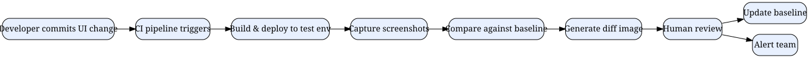

# Visual Regression Testing in 2025: A Practical Guide for Testers

*Reading time: 9 min · 1,934 words*

> Visual regression testing compares screenshots of your UI against baselines to catch pixel-level bugs that functional tests miss. This guide covers how it works, popular tools, workflow setup, flakiness fixes, and a real-world design system migration example.

## Table of Contents
- [Introduction](#introduction)
- [What Is Visual Regression Testing?](#what-is-visual-regression-testing)
  - [Why Functional Tests Miss Visual Bugs](#why-functional-tests-miss-visual-bugs)
  - [The Core Loop](#the-core-loop)
- [How Visual Regression Tools Work](#how-visual-regression-tools-work)
  - [Pixel Comparison vs. Perceptual Diffing](#pixel-comparison-vs-perceptual-diffing)
- [Types of Visual Regression Testing](#types-of-visual-regression-testing)
  - [1. Component-Level Snapshot Testing](#1-component-level-snapshot-testing)
  - [2. Full-Page Testing](#2-full-page-testing)
  - [3. Cross-Browser and Cross-Device Testing](#3-cross-browser-and-cross-device-testing)
  - [4. Responsive Breakpoint Testing](#4-responsive-breakpoint-testing)
- [Popular Tools in 2025](#popular-tools-in-2025)
- [Building a Visual Regression Testing Workflow](#building-a-visual-regression-testing-workflow)
  - [Step 1: Define Your Scope](#step-1-define-your-scope)
  - [Step 2: Stabilize the Environment](#step-2-stabilize-the-environment)
  - [Step 3: Establish Baselines](#step-3-establish-baselines)
  - [Step 4: Integrate with CI](#step-4-integrate-with-ci)
  - [Step 5: Review Diffs Efficiently](#step-5-review-diffs-efficiently)
- [Handling Flakiness and False Positives](#handling-flakiness-and-false-positives)
- [Real-World Example: A Design System Migration](#real-world-example-a-design-system-migration)
- [Integrating with Other Testing Layers](#integrating-with-other-testing-layers)
- [Visual Regression Testing and AI](#visual-regression-testing-and-ai)
- [Best Practices Summary](#best-practices-summary)
- [Key Takeaways](#key-takeaways)
- [Frequently Asked Questions](#frequently-asked-questions)

## Introduction

Functional tests verify that buttons work, forms submit, and APIs return the right payloads. But they rarely catch the subtle visual defects—a misaligned header, a font that renders differently across browsers, a button that shifts 2 pixels when a sibling element loads—that degrade user experience. Visual regression testing fills this gap by comparing screenshots of your application before and after code changes.

In 2025, as design systems and component libraries become standard and teams ship faster with CI/CD pipelines, visual regression testing has moved from "nice-to-have" to a core practice in the tester's toolkit. This guide explains what visual regression testing is, how it works, which tools lead the space, and how to build a workflow that minimizes false positives while catching real bugs.

## What Is Visual Regression Testing?

Visual regression testing (also called visual snapshot testing or screenshot testing) is an automated technique that captures screenshots of UI components or full pages and compares them against a stored baseline. When differences appear, the tool flags them for review. If the change is intentional (a new design), the tester updates the baseline; if not, the tester investigates and fixes the underlying issue.

### Why Functional Tests Miss Visual Bugs

Consider a typical functional test:

```python
def test_login_button_visible(page):
    page.goto("/login")
    expect(page.locator("button[type=submit]")).to_be_visible()
```

This test passes even if the button is rendered at 12px instead of 16px, overlaps the password field, or uses a color with a 1.2:1 contrast ratio. Functional assertions check existence and state, not appearance. Visual regression testing adds the missing layer of assertion: *pixel-level* comparison.

### The Core Loop

1. Capture a baseline screenshot of a known-good state.
2. On each new build, capture fresh screenshots of the same views.
3. Compare pixel-by-pixel (or perceptually) and generate a diff image.
4. Review diffs: approve intentional changes (update baseline) or reject unexpected ones (file a bug).


## How Visual Regression Tools Work

At a high level, all visual regression tools share the same architecture:

- **A browser automation layer** (Playwright, Puppeteer, Selenium) drives the browser to a specific URL or component state.
- **A screenshot engine** captures images at a fixed viewport size, device scale factor, and theme (light/dark).
- **A comparison algorithm** computes differences. Early tools used simple pixel-by-pixel equality; modern tools use perceptual diffing (e.g., pixelmatch, resemble.js) that tolerates anti-aliasing and sub-pixel rendering differences.
- **A diff report** highlights changed regions, often with heatmaps or bounding boxes, so reviewers can focus on the affected areas.

### Pixel Comparison vs. Perceptual Diffing

| Approach | How it works | Pros | Cons |
|----------|-------------|------|------|
| Exact pixel match | Compares every pixel value | Simple, deterministic | High false-positive rate from anti-aliasing, font smoothing, animation timing |
| Perceptual diffing | Compares color distance with tolerance thresholds | Robust to rendering nuances | Can miss subtle changes below threshold |
| Layout-aware diffing | Detects structural shifts (element bounding boxes) | Catches movement/reflow issues | Requires DOM instrumentation |

Most modern tools combine perceptual diffing with layout heuristics to balance sensitivity and noise.

## Types of Visual Regression Testing

### 1. Component-Level Snapshot Testing

Tools like Storybook + Chromatic or Playwright component testing capture individual components in isolation. This is fast, deterministic, and ideal for design systems. Each story becomes a test case.

### 2. Full-Page Testing

Captures entire routes. Useful for end-to-end visual coverage but more prone to flakiness from dynamic content, ads, third-party embeds, and animations.

### 3. Cross-Browser and Cross-Device Testing

Cloud services (Percy, Applitools, Sauce Labs) render the same page across multiple browser/OS combinations, catching WebKit vs. Blink rendering differences. This is critical for organizations that support Safari, Chrome, Firefox, and Edge.

### 4. Responsive Breakpoint Testing

Captures the same page at multiple viewport widths (mobile, tablet, desktop) to catch layout breakage at specific breakpoints.

## Popular Tools in 2025

| Tool | Type | Strengths | Best For |
|------|------|-----------|----------|
| Playwright (built-in `toHaveScreenshot`) | Open-source framework | Fast, no cloud dependency, integrates with test runner | Teams already using Playwright |
| Percy (BrowserStack) | SaaS | Cross-browser, visual review UI, GitHub integration | Enterprise teams wanting a managed workflow |
| Chromatic | SaaS | Purpose-built for Storybook, auto-baseline management | Design system teams |
| Applitools Eyes | SaaS | AI-powered visual AI, layout regions, cross-browser | Complex apps needing flexible matching |
| BackstopJS | Open-source | Config-driven, Docker-friendly, multiple engines | Teams preferring a lightweight CLI tool |
| Lost Pixel | Open-source | Self-hosted, supports multiple browsers, CI-native | Teams needing on-premise control |

> **Note:** Tool choice is less important than process. Even a minimal open-source setup (Playwright + pixelmatch) can deliver most of the value if you invest in a clean baseline review workflow.

## Building a Visual Regression Testing Workflow

### Step 1: Define Your Scope

Start small. Pick the top 10–20 user journeys or the core components of your design system. You don't need to screenshot every page on day one.

### Step 2: Stabilize the Environment

Visual tests are only as reliable as their environment. Control:

- Viewport size and device scale factor
- Browser version (pin via Docker or Playwright's browser channel)
- Fonts (load the same web fonts and fallbacks everywhere)
- Network conditions (mock external requests or use a fixture server)
- Animations (disable CSS transitions/animations during capture)
- Date/time and locale (freeze with clock mocking)

### Step 3: Establish Baselines

Run your suite once against a reviewed, known-good build. Store baseline images in version control (for open-source tools) or in the SaaS vendor's storage. Treat baseline updates as code reviews: require a human to approve any change.

### Step 4: Integrate with CI

Add a job to your pipeline that runs visual tests on pull requests. Use the tool's GitHub/GitLab app to post comments with diff images directly on the PR.

### Step 5: Review Diffs Efficiently

Set a policy:

- **Intentional design change** → approve and update baseline.
- **Unintentional regression** → file a bug with the diff image attached.
- **Flaky diff** (animation, dynamic data) → stabilize the test, don't just accept it.



## Handling Flakiness and False Positives

Flakiness is the #1 reason teams abandon visual regression testing. Here are the most common causes and fixes:

| Cause | Fix |
|-------|-----|
| Animations mid-capture | Disable transitions via `prefers-reduced-motion` or injected CSS |
| Dynamic third-party content | Mock or stub network calls; use recorded fixtures |
| Font loading races | Use `document.fonts.ready` before capturing |
| Anti-aliasing differences | Use perceptual diffing with reasonable threshold |
| Time-dependent UI (clock widgets) | Freeze time with Playwright's clock API |
| Lazy-loaded images | Scroll into view and wait for `loading="lazy"` to resolve |

A practical Playwright snippet that disables animations:

```javascript
await page.addStyleTag({
  content: `
    *, *::before, *::after {
      transition: none !important;
      animation: none !important;
      caret-color: transparent !important;
    }
  `
});
```

## Real-World Example: A Design System Migration

**Scenario:** A fintech startup with a 40-component design system decides to migrate from Bootstrap to a custom design system. The team has 200+ screens relying on legacy components.

**Challenge:** The migration touches every page. Functional tests pass because selectors remain stable, but spacing, typography, and color tokens change subtly. The team needs to verify the migration didn't break visual consistency.

**Approach:**

1. Before migration, the team used Chromatic with Storybook to capture baselines for all 40 components across light/dark themes and 3 viewports.
2. During migration, each PR that swapped a Bootstrap component for a custom one triggered visual tests. The diff reports showed exactly which component instances changed.
3. The team reviewed diffs in batches: approved intentional token changes, flagged unintended spacing regressions (e.g., a 4px padding lost in a button).
4. After the migration, they expanded to full-page screenshots on the 10 highest-traffic routes, running them in CI on every merge to main.

**Outcome:** The team caught 23 visual regressions during the migration—none of which would have been caught by functional tests. Baseline review time averaged under 10 minutes per PR.


## Integrating with Other Testing Layers

Visual regression testing complements, not replaces, other test types:

- **Functional tests** verify behavior; visual tests verify appearance.
- **Accessibility tests** check semantics and contrast programmatically; visual tests catch spatial and layout issues that axe-core can't see.
- **Contract tests** validate API shape; visual tests validate the UI that consumes those APIs.

A balanced test pyramid for UI includes unit tests at the base, component/integration tests in the middle, and a thin layer of end-to-end + visual tests at the top.

## Visual Regression Testing and AI

In 2025, AI-assisted visual testing is maturing. Applitools' Visual AI and similar tools use machine learning to classify diffs (e.g., "text changed" vs. "layout shifted") and automatically ignore benign changes. Some tools can even suggest whether a diff matches a previous pattern of intentional changes. Still, human judgment remains the final arbiter—AI reduces noise but doesn't replace the reviewer.

## Best Practices Summary

- Start with a small, high-value subset of screens/components.
- Freeze time, fonts, network, and animations for deterministic captures.
- Store baselines in version control or a managed service with review workflows.
- Run visual tests on every PR, not just nightly.
- Use perceptual diffing over exact pixel matching.
- Keep a visual "budget": cap the number of screenshots per run to keep CI fast.
- Document your review policy so teammates know when to update baselines.

## Key Takeaways

- Visual regression testing catches pixel-level UI bugs that functional assertions miss, making it essential for design systems and frequent UI changes.
- Modern tools combine browser automation (Playwright), perceptual diffing, and cloud-based review dashboards.
- Environment stability is the biggest success factor: control fonts, animations, viewports, and network responses.
- Start small, establish reviewed baselines, and integrate into CI on every pull request.
- AI-assisted diff classification reduces false positives but human review remains necessary.
- Visual testing complements functional, accessibility, and contract testing—it does not replace them.

## Frequently Asked Questions

**Q: How much time does visual regression testing add to CI?**
A: It depends on scope. A focused suite of 50–100 screenshots typically runs in 2–5 minutes when parallelized. Cloud tools charge per screenshot, so there's a cost dimension too.

**Q: Should we store baseline images in Git?**
A: For open-source tools like Playwright or BackstopJS, yes—store them in a separate directory or Git LFS. For SaaS tools, baselines live in the vendor's storage, which simplifies team collaboration.

**Q: What viewport sizes should we test?**
A: Cover the breakpoints your product actually supports—commonly 375px (mobile), 768px (tablet), and 1280px (desktop). More viewports multiply cost and maintenance.

**Q: How do we handle intentionally changing designs?**
A: Use the review workflow: approve the diff, which updates the baseline. Require a second reviewer for large batches of changes to avoid rubber-stamping regressions.

**Q: Can visual regression testing replace accessibility testing?**
A: No. Visual tests catch layout/spacing issues but cannot determine whether text meets WCAG contrast ratios or whether elements have proper ARIA semantics. Use both.

## Frequently Asked Questions

**Q: How much time does visual regression testing add to CI?**

A: It depends on scope. A focused suite of 50–100 screenshots typically runs in 2–5 minutes when parallelized. Cloud tools charge per screenshot, so there's a cost dimension too.

**Q: Should we store baseline images in Git?**

A: For open-source tools like Playwright or BackstopJS, yes—store them in a separate directory or Git LFS. For SaaS tools, baselines live in the vendor's storage, which simplifies team collaboration.

**Q: What viewport sizes should we test?**

A: Cover the breakpoints your product actually supports—commonly 375px (mobile), 768px (tablet), and 1280px (desktop). More viewports multiply cost and maintenance.

**Q: How do we handle intentionally changing designs?**

A: Use the review workflow: approve the diff, which updates the baseline. Require a second reviewer for large batches of changes to avoid rubber-stamping regressions.

**Q: Can visual regression testing replace accessibility testing?**

A: No. Visual tests catch layout/spacing issues but cannot determine whether text meets WCAG contrast ratios or whether elements have proper ARIA semantics. Use both.

## Key Takeaways

- Visual regression testing catches pixel-level UI bugs that functional assertions miss, making it essential for design systems and frequent UI changes.
- Modern tools combine browser automation (Playwright), perceptual diffing, and cloud-based review dashboards.
- Environment stability is the biggest success factor: control fonts, animations, viewports, and network responses.
- Start small, establish reviewed baselines, and integrate into CI on every pull request.
- AI-assisted diff classification reduces false positives but human review remains necessary.
- Visual testing complements functional, accessibility, and contract testing—it does not replace them.

## Related Articles

- AI-Powered Test Automation: A Practical Guide for Testers
- Accessibility Testing in 2025: A Practical Guide for Testers
- Synthetic Test Data: A Practical Guide to Generating Realistic, Privacy-Compliant Test Data
- Contract Testing for Microservices: A Practical Guide for Testers

<!-- Cover image prompts (for editors):
  - A modern QA tester reviewing visual diff screenshots on a large monitor, with highlighted UI regions overlaid in red and green, showing a before/after comparison of a website layout
  - An abstract illustration of a pixel grid being compared side by side, with one half showing a clean UI and the other half showing misaligned elements highlighted in neon colors
  - A CI/CD pipeline dashboard showing visual regression test results, with pass/fail status indicators and diff thumbnails in a clean developer-tool aesthetic
-->