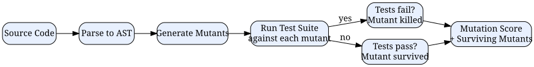

# Mutation Testing in 2026: A Practical Guide to Measuring Test Suite Effectiveness

*Reading time: 10 min · 1,968 words*

> Mutation testing measures whether your test suite would actually catch bugs by injecting faults into your code. This 2026 guide covers how it works, the best tools, real-world examples, and how to integrate it into CI/CD without slowing down your team.

## Table of Contents
- [Introduction](#introduction)
- [What Is Mutation Testing?](#what-is-mutation-testing)
  - [Key Terminology](#key-terminology)
- [How Mutation Testing Works](#how-mutation-testing-works)
- [Common Mutation Operators](#common-mutation-operators)
- [Tools in 2026](#tools-in-2026)
- [Real-World Example: A Payment Service](#real-world-example-a-payment-service)
- [Challenges and Mitigation](#challenges-and-mitigation)
  - [Computational Cost](#computational-cost)
  - [Equivalent Mutants](#equivalent-mutants)
  - [Developer Experience](#developer-experience)
- [Integrating Mutation Testing into CI/CD](#integrating-mutation-testing-into-cicd)
- [Mutation Testing and AI in 2026](#mutation-testing-and-ai-in-2026)
- [Where Mutation Testing Fits in Your Quality Strategy](#where-mutation-testing-fits-in-your-quality-strategy)
- [Getting Started: A 30-Day Adoption Plan](#getting-started-a-30-day-adoption-plan)
- [Conclusion](#conclusion)
- [Key Takeaways](#key-takeaways)
- [Frequently Asked Questions](#frequently-asked-questions)

## Introduction

Every team knows the feeling: your test suite reports 95% line coverage, the CI pipeline is green, and yet a bug slips into production. Coverage percentages have long been the default proxy for test quality, but anyone who has chased a "covered but untested" line knows the metric lies.

In 2026, as software systems grow more complex—microservices, AI agents, event-driven architectures—the gap between "tests that run" and "tests that actually catch bugs" has never mattered more. Mutation testing closes that gap. It doesn't ask how much of your code runs during tests; it asks whether your tests would fail if your code were wrong.

This guide explains what mutation testing is, how it works, the tools available in 2026, and how to integrate it into your quality strategy without turning your CI pipeline into a bottleneck.

## What Is Mutation Testing?

Mutation testing is a fault-injection technique for evaluating the effectiveness of a test suite. It works by introducing small, deliberate changes—called mutations—into your source code, then running your tests against each mutated version. If your tests pass despite the mutation, the mutant "survives," meaning your tests failed to detect a change that should have broken something. If the tests fail, the mutant is "killed."

The core insight: a good test suite should be sensitive to changes in the code it covers. If changing `>` to `>=` doesn't break any test, that behavior is effectively untested, regardless of what your coverage report says.

### Key Terminology

| Term | Definition |
|------|------------|
| Mutant | A modified version of your source code with one small change |
| Killed mutant | A mutant that causes at least one test to fail |
| Survived mutant | A mutant that passes all tests |
| Mutation score | Percentage of mutants killed = (killed / total mutants) × 100 |
| Equivalent mutant | A mutant that behaves identically to the original code |

## How Mutation Testing Works

The process follows a straightforward but computationally expensive loop:

1. **Parse** the source code into an abstract syntax tree (AST).
2. **Generate mutants** by applying mutation operators to the AST.
3. **Execute tests** against each mutant (often in parallel).
4. **Classify** each mutant as killed, survived, or equivalent.
5. **Report** the mutation score and list surviving mutants.



## Common Mutation Operators

Mutation operators define the kinds of changes injected into your code. Different languages and tools ship different operator sets, but most cover a common core:

- **Arithmetic operators**: `+` → `-`, `*` → `/`, `%` → `*`
- **Relational operators**: `<` → `<=`, `>` → `<`, `==` → `!=`
- **Logical operators**: `&&` → `||`, removal of `!`
- **Conditional boundaries**: `<` → `<=`, `>` → `>=`
- **Return value mutations**: return `true` instead of `false`, or a constant instead of a variable
- **Remove method calls**: delete a call to see if its side effect is tested
- **Constant changes**: `0` → `1`, empty string → non-empty string

For example, consider this function:

```python
def is_adult(age: int) -> bool:
    return age >= 18
```

A relational operator mutation might change `>=` to `>`. Now `is_adult(18)` returns `False`. If your test suite doesn't catch that, the mutant survives—and you've discovered a boundary case you're not testing.

## Tools in 2026

The mutation testing ecosystem matured significantly over the past few years. As of 2026, the leading tools include:

| Tool | Language | Notes |
|------|----------|-------|
| Stryker | JavaScript/TypeScript, C#, Scala | Most popular cross-language framework; supports incremental mutation and parallel execution |
| PIT (Pitest) | Java | Fast, integrates with Maven/Gradle, JUnit 5 support |
| Mutmut | Python | Lightweight, easy to configure |
| Cosmic Ray | Python | Supports parallel execution via multiple workers |
| Go-mutesting | Go | Simple CLI tool |
| Cargo-mutants | Rust | Uses cargo's build system |

A notable 2026 trend is **AI-assisted mutation generation**. Some tools now use language models to generate semantically meaningful mutants—changes that mimic real developer mistakes rather than mechanical operator swaps. This reduces the number of equivalent mutants (a major pain point) and produces more realistic fault injection.


## Real-World Example: A Payment Service

Let's make this concrete. Suppose you're testing a payment service with this logic:

```javascript
function calculateDiscount(amount, customerType) {
  if (customerType === 'VIP') {
    return amount * 0.9;
  }
  return amount;
}
```

Your test suite might look like this:

```javascript
test('VIP customers get 10% off', () => {
  expect(calculateDiscount(100, 'VIP')).toBe(90);
});

test('Regular customers pay full price', () => {
  expect(calculateDiscount(100, 'regular')).toBe(100);
});
```

Line coverage looks great—every line executes. But a mutation tool will flip `===` to `!==`, and both tests still pass because neither test checks the non-VIP branch with a VIP customer. The mutant survives. The test suite has a hole.

Here's what a mutation report might show:

| Mutation | Change | Test Result | Verdict |
|----------|--------|-------------|---------|
| Relational | `===` → `!==` | Both pass | Survived |
| Arithmetic | `0.9` → `0.8` | VIP test fails | Killed |
| Return | `amount` → `amount * 2` | Both fail | Killed |

This is the power of mutation testing: it finds *behavioral* gaps, not just line-execution gaps.

## Challenges and Mitigation

Mutation testing isn't free. Here are the main challenges and how teams handle them in 2026:

### Computational Cost

Running your full test suite once per mutant is expensive. Mitigations:

- **Incremental mutation**: only mutate code changed since the last run
- **Parallel execution**: distribute mutants across CI runners
- **Test selection**: run only tests that touch the mutated file first
- **Sampling**: mutate a random subset when the suite is huge

### Equivalent Mutants

Some mutants produce identical behavior to the original code, so they can never be killed. They inflate your denominator and frustrate developers. Mitigations:

- Use tools with better equivalent-mutant detection (often AI-assisted)
- Configure operators to avoid known-equivalent patterns
- Accept a small percentage of equivalents and exclude them from scoring

### Developer Experience

Mutation testing can feel noisy—dozens of "survived" mutants that are false alarms. Mitigations:

- Start with a small module, not the whole codebase
- Treat the mutation score as a trend, not a hard gate
- Only block merges when the score drops below a threshold on critical paths

## Integrating Mutation Testing into CI/CD

A pragmatic integration path for 2026:

1. **Start small**: pick one critical module (payment, auth, data validation).
2. **Set a baseline**: run mutation testing, record the score.
3. **Add a quality gate**: block merges if the score drops more than X% below baseline.
4. **Automate reporting**: surface surviving mutants in PR comments.
5. **Iterate**: fix the highest-value surviving mutants first.

```bash
# Example: running PIT in a Java project
mvn org.pitest:pitest-maven:mutationCoverage \
  -DtargetClasses=com.example.payment.* \
  -DtimestampedReports=false
```

> **Note:** Mutation testing is a complement to, not a replacement for, code review and other testing techniques. A perfect mutation score doesn't guarantee correctness—it guarantees your tests are sensitive to the mutations you chose to inject.

## Mutation Testing and AI in 2026

The intersection of mutation testing and AI is one of the most interesting developments of 2026:

- **AI-generated mutants** that mimic real developer mistakes (off-by-one errors, inverted conditions, swapped arguments).
- **AI-assisted triage** of surviving mutants, automatically classifying equivalent mutants and suggesting missing test cases.
- **Generative test repair**: when a mutant survives, AI tools propose new assertions that would kill it.

This makes mutation testing more accessible to teams that previously found it too noisy or expensive.


## Where Mutation Testing Fits in Your Quality Strategy

Mutation testing is not the only quality metric, and it shouldn't be the only gate. A healthy 2026 quality program combines several signals:

| Metric | Answers | Best For |
|--------|---------|----------|
| Line/branch coverage | Did our tests execute this code? | Quick feedback, identifying dead code |
| Mutation score | Would our tests catch a fault here? | Deep verification of critical logic |
| Defect escape rate | How many bugs reached production? | Long-term trend analysis |
| Flaky test rate | Are our tests reliable? | Build health monitoring |

Use coverage for breadth and mutation testing for depth. On critical modules, mutation testing is the stronger signal.

## Getting Started: A 30-Day Adoption Plan

- **Week 1**: Pick one critical module. Run a mutation tool locally. Record the baseline score. Share the report with your team.
- **Week 2**: Fix the top five surviving mutants by adding missing test cases. Re-run and compare scores.
- **Week 3**: Add mutation testing to CI for that module as a non-blocking report. Start tracking the score trend.
- **Week 4**: Convert the report into a blocking quality gate with a threshold slightly below your baseline, then raise it as the team improves.

## Conclusion

Coverage tells you where your tests have been; mutation testing tells you whether they would have caught a mistake. In 2026, as software becomes more complex and AI-generated code enters production pipelines, the ability to measure—and prove—test effectiveness is a competitive advantage.

Start small. Pick one critical module, run a mutation tool, and study the survivors. You will almost certainly find a bug your test suite missed.

## Key Takeaways

- Line and branch coverage measure execution, not effectiveness; mutation testing measures whether tests would catch real faults.
- A mutant survives when no test fails against the mutated code, revealing a behavioral testing gap.
- Common mutation operators include arithmetic, relational, logical, and boundary changes; each targets a class of real bugs.
- Leading tools in 2026 include Stryker (JS/.NET), PIT (Java), Mutmut (Python), and Cargo-mutants (Rust).
- Manage cost with incremental mutation, parallel execution, and targeted test selection.
- Integrate mutation testing as a trend-based quality gate, starting with critical modules, and leverage AI-assisted mutant generation and triage.

## Frequently Asked Questions

**Q: What is a good mutation score to aim for?**

A: There's no universal number, but many teams target 70–90% on critical modules. More important than the absolute number is the trend: scores should improve over time, and surviving mutants should be reviewed and addressed.

**Q: How is mutation testing different from code coverage?**

A: Code coverage reports which lines or branches executed during tests. Mutation testing changes the code and checks whether tests detect the change. Coverage answers "did we run this?" while mutation testing answers "would our tests catch a bug here?"

**Q: Is mutation testing worth the computational cost?**

A: For large suites, yes—if you use incremental mutation, parallel execution, and sampling. The cost is bounded by the number of mutants, which scales with code size, but modern tools make it feasible for most projects.

**Q: Can mutation testing be automated in CI/CD?**

A: Yes. Tools like PIT and Stryker integrate with build systems and can fail builds when the mutation score drops below a threshold. Many teams run mutation testing on a nightly schedule or on pull requests for critical modules.

**Q: Does mutation testing work for AI/ML systems?**

A: Partially. Traditional mutation operators apply to deterministic code. For ML models, you may need custom operators (e.g., perturbing weights or thresholds). Some 2026 tools are starting to support model-specific mutation, but the practice is still emerging.

## Frequently Asked Questions

**Q: What is a good mutation score to aim for?**

A: There's no universal number, but many teams target 70–90% on critical modules. More important than the absolute number is the trend: scores should improve over time, and surviving mutants should be reviewed and addressed.

**Q: How is mutation testing different from code coverage?**

A: Code coverage reports which lines or branches executed during tests. Mutation testing changes the code and checks whether tests detect the change. Coverage answers "did we run this?" while mutation testing answers "would our tests catch a bug here?"

**Q: Is mutation testing worth the computational cost?**

A: For large suites, yes—if you use incremental mutation, parallel execution, and sampling. The cost is bounded by the number of mutants, which scales with code size, but modern tools make it feasible for most projects.

**Q: Can mutation testing be automated in CI/CD?**

A: Yes. Tools like PIT and Stryker integrate with build systems and can fail builds when the mutation score drops below a threshold. Many teams run mutation testing on a nightly schedule or on pull requests for critical modules.

**Q: Does mutation testing work for AI/ML systems?**

A: Partially. Traditional mutation operators apply to deterministic code. For ML models, you may need custom operators (e.g., perturbing weights or thresholds). Some 2026 tools are starting to support model-specific mutation, but the practice is still emerging.

## Key Takeaways

- Line and branch coverage measure execution, not effectiveness; mutation testing measures whether tests would catch real faults.
- A mutant survives when no test fails against the mutated code, revealing a behavioral testing gap.
- Common mutation operators include arithmetic, relational, logical, and boundary changes; each targets a class of real bugs.
- Leading tools in 2026 include Stryker (JS/.NET), PIT (Java), Mutmut (Python), and Cargo-mutants (Rust).
- Manage cost with incremental mutation, parallel execution, and targeted test selection.
- Integrate mutation testing as a trend-based quality gate, starting with critical modules, and leverage AI-assisted mutant generation and triage.

## Related Articles

- Property-Based Testing: Finding Bugs with Randomized Inputs
- Test Impact Analysis: Running Only the Tests That Matter
- Flaky Test Management in Modern CI/CD
- Quality Engineering Metrics That Matter in 2026

<!-- Cover image prompts (for editors):
  - A modern software engineering dashboard displaying a mutation testing report with red and green mutant status indicators, dark UI theme, clean typography, 2026 tech aesthetic, high detail
  - An abstract visualization of DNA-like strands representing code mutations undergoing testing, with checkmarks and X marks, deep blue and violet color palette, futuristic style
  - A CI/CD pipeline illustration with a highlighted mutation testing stage, showing parallel mutant execution across multiple runner nodes, flat design with subtle gradients
-->