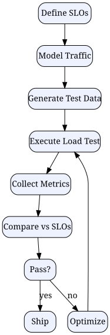

# Performance Testing for AI Applications in 2026: A Practical Guide for Testers

*Reading time: 7 min · 1,380 words*

> AI-powered applications demand a new kind of performance testing. This guide covers the metrics that matter for LLM endpoints—TTFT, inter-token latency, token throughput, and cost per request—and shows testers how to design realistic load tests with streaming-aware tooling in 2026.

## Table of Contents
- [Introduction](#introduction)
- [Why AI performance testing is different](#why-ai-performance-testing-is-different)
  - [Non-deterministic responses](#non-deterministic-responses)
  - [Streaming responses](#streaming-responses)
  - [Variable cost](#variable-cost)
  - [Shared infrastructure](#shared-infrastructure)
- [Core metrics for AI applications](#core-metrics-for-ai-applications)
  - [Latency budgets](#latency-budgets)
- [Building a load test for an LLM endpoint](#building-a-load-test-for-an-llm-endpoint)
  - [Step 1: Model real user traffic](#step-1-model-real-user-traffic)
  - [Step 2: Generate representative test data](#step-2-generate-representative-test-data)
  - [Step 3: Choose your tooling](#step-3-choose-your-tooling)
  - [Step 4: Instrument observability](#step-4-instrument-observability)
  - [Step 5: Define pass/fail criteria](#step-5-define-passfail-criteria)
- [Real-world example: testing a customer support copilot](#real-world-example-testing-a-customer-support-copilot)
- [Common pitfalls](#common-pitfalls)
- [Tooling landscape in 2026](#tooling-landscape-in-2026)
- [The shift to continuous performance testing](#the-shift-to-continuous-performance-testing)
- [Conclusion](#conclusion)
- [Key Takeaways](#key-takeaways)
- [Frequently Asked Questions](#frequently-asked-questions)

## Introduction

AI-powered applications have moved from prototypes to production workloads. By 2026, most enterprises run LLM-backed features—chatbots, code assistants, summarizers, search copilots—that must meet strict service-level objectives (SLOs). But performance testing these systems is fundamentally different from testing a traditional REST API.

When you load-test a classic microservice, a response is a single, finite payload. When you load-test an LLM endpoint, each response streams tokens over time, latency varies with input length and model size, and the cost of a single request can be 10–100x that of a typical API call. This guide explains how testers can adapt their craft to AI workloads in 2026.

## Why AI performance testing is different

### Non-deterministic responses

Unlike a database query, an LLM can return different outputs for the same prompt across runs. Performance characteristics vary too: token generation speed depends on cache state, batch composition, and hardware. Your assertions must tolerate variance while still enforcing SLOs.

### Streaming responses

Most modern LLM APIs stream tokens. Your tests must measure not just total response time but time-to-first-token (TTFT) and inter-token latency. A response that completes in 3 seconds but takes 2 seconds to emit its first token feels broken to users.

### Variable cost

Inference cost scales with tokens. A performance test that ignores tokens-per-request will miss runaway spend. Cost testing is now part of performance engineering, not just a finance concern.

### Shared infrastructure

Many teams share GPU pools or use serverless inference. Performance under load can degrade due to noisy neighbors, rate limits, and autoscaling lag. Your load tests must reflect real contention rather than idealized conditions.

## Core metrics for AI applications

| Metric | Definition | Typical target |
|---|---|---|
| Time to First Token (TTFT) | Latency from request to first output token | < 500 ms for interactive UX |
| Inter-token latency | Time between successive tokens | < 50 ms for chat |
| Tokens per second | Throughput per request | Depends on model |
| Requests per second | Aggregate throughput | Depends on SLO |
| Error rate | % of failed or timed-out requests | < 0.1% |
| Cache hit rate | % of prompts served from prefix cache | > 60% |
| Cost per request | $ per successful completion | Budget-driven |

### Latency budgets

A good rule of thumb: end-to-end user-perceived latency should stay under 2 seconds for interactive features. That budget includes network, auth, retrieval (if RAG), and model inference. Break the budget into segments so you know which layer is eating your time.

## Building a load test for an LLM endpoint

### Step 1: Model real user traffic

Don't just replay a fixed prompt set. Capture production traffic distributions: prompt lengths, session patterns, peak hours. Use anonymized logs to build a realistic workload model. A test that only sends short prompts will miss the tail latency caused by long-context requests.

### Step 2: Generate representative test data

Use synthetic data generation to create diverse prompts—short vs long, simple vs complex, with system prompts—without leaking PII. Vary the token counts across a realistic distribution rather than using a single canonical prompt.

### Step 3: Choose your tooling

- **k6** — great for protocol-level load testing with JS scripting; supports streaming checks.
- **Locust** — Python-based, easy to extend with custom clients for SSE/streaming.
- **Gatling** — powerful for large-scale simulations.
- **Custom harnesses** — for token-level assertions and cost tracking.

### Step 4: Instrument observability

Capture token counts, TTFT, and inter-token latency via OpenTelemetry spans. Correlate with backend metrics (GPU utilization, queue depth). Without correlation, you cannot tell whether a latency spike came from the model or from your retrieval layer.

### Step 5: Define pass/fail criteria

Assert against SLOs: p95 TTFT, p99 error rate, max cost per request. Make the criteria explicit in your test script so a failed run produces an actionable signal, not just a red dashboard.

## Real-world example: testing a customer support copilot

Imagine a support copilot built on a RAG pipeline: user question → embedding search → context assembly → LLM completion → answer. The team defined these SLOs:

- p95 TTFT ≤ 800 ms
- p95 total response ≤ 4 s
- Error rate ≤ 0.5%
- Cost per resolved ticket ≤ $0.30

The tester built a k6 script that:

1. Generated 5,000 realistic support queries from anonymized logs.
2. Mixed short (20-token) and long (1,200-token) contexts.
3. Ran a 15-minute soak at 50 concurrent users.
4. Tracked tokens per request and asserted the cost budget.

Results exposed a problem: when the embedding cache was cold, retrieval added 1.2 s of latency, blowing the TTFT SLO. The fix—pre-warming the cache and adding a prefix-cache layer—cut p95 TTFT to 620 ms.

> **Note:** Always run baseline tests before and after optimization. Without a baseline, you cannot attribute improvements to a specific change.

## Common pitfalls

- **Testing only happy paths** — include malformed inputs, empty contexts, and rate-limit scenarios.
- **Ignoring streaming** — measuring only total time hides poor TTFT.
- **Using unrealistic concurrency** — 10,000 virtual users hitting a single GPU pool will produce misleading results.
- **Forgetting cold starts** — serverless inference has cold-start penalties; test warm and cold pools separately.
- **Not budgeting for cost** — a load test that runs for hours can rack up significant inference spend. Use cost-aware tooling and cap test duration.

## Tooling landscape in 2026

Several platforms now offer AI-specific load testing:

- **Grafana k6** with streaming extensions.
- **Azure Load Testing** with LLM endpoint templates.
- **AWS Distro for OpenTelemetry** for trace correlation.
- **LangSmith / Langfuse** for LLM observability (latency, tokens, cost).
- **Promptfoo** for eval-driven regression alongside performance gates.

## The shift to continuous performance testing

In 2026, performance testing is no longer a release-gate chore. Teams embed lightweight load tests into CI/CD pipelines, running them on every merge to a staging environment. Golden signals—TTFT, tokens/sec, error rate—are tracked in dashboards with alerting. This shift means testers must write performance tests that are fast, deterministic enough, and cheap to run repeatedly.

## Conclusion

Performance testing AI applications requires new metrics, new tools, and new mental models. But the fundamentals remain: define SLOs, model real traffic, measure continuously, and optimize iteratively. Testers who master AI performance testing will be indispensable as AI becomes the default interface for software.

## Key Takeaways

- Measure TTFT and inter-token latency, not just total response time.
- Model real production traffic—prompt distributions matter as much as concurrency.
- Treat cost per request as a first-class performance metric.
- Use streaming-aware load testing tools like k6 or Locust.
- Baseline before optimizing; always compare against a known reference.
- Embed performance gates in CI/CD for continuous feedback.

## Frequently Asked Questions

Q: How is load testing an LLM different from load testing a normal API?
A: LLM responses stream tokens over time, so you must measure TTFT and inter-token latency. Also, inference cost scales with token count, making cost a key metric.

Q: What is a good TTFT target?
A: For interactive chat UX, aim for under 500 ms p95. For background tasks, a few seconds may be acceptable.

Q: Can I use k6 for LLM load testing?
A: Yes. k6 supports HTTP and can handle streaming responses with custom checks. You may need to add scripts to parse SSE chunks and count tokens.

Q: How do I avoid huge costs during load tests?
A: Use smaller models for early tests, cap concurrency, limit test duration, and use caching to reduce repeated inference. Monitor spend in real time.

Q: Do I need GPUs to run these tests?
A: No—the test runner itself is lightweight. You're sending requests to the inference service; the GPUs are on the backend.

## Frequently Asked Questions

**Q: How is load testing an LLM different from load testing a normal API?**

A: LLM responses stream tokens over time, so you must measure TTFT and inter-token latency. Also, inference cost scales with token count, making cost a key metric.

**Q: What is a good TTFT target?**

A: For interactive chat UX, aim for under 500 ms p95. For background tasks, a few seconds may be acceptable.

**Q: Can I use k6 for LLM load testing?**

A: Yes. k6 supports HTTP and can handle streaming responses with custom checks. You may need to add scripts to parse SSE chunks and count tokens.

**Q: How do I avoid huge costs during load tests?**

A: Use smaller models for early tests, cap concurrency, limit test duration, and use caching to reduce repeated inference. Monitor spend in real time.

**Q: Do I need GPUs to run these tests?**

A: No—the test runner itself is lightweight. You're sending requests to the inference service; the GPUs are on the backend.

## Key Takeaways

- Measure TTFT and inter-token latency, not just total response time.
- Model real production traffic—prompt distributions matter as much as concurrency.
- Treat cost per request as a first-class performance metric.
- Use streaming-aware load testing tools like k6 or Locust.
- Baseline before optimizing; always compare against a known reference.
- Embed performance gates in CI/CD for continuous feedback.

## Related Articles

- LLM evals and regression testing for AI features
- Load testing RAG pipelines and vector databases
- Cost optimization and FinOps for AI inference
- Testing AI agents under production concurrency

<!-- Cover image prompts (for editors):
  - A modern performance testing dashboard showing latency curves, token throughput, and cost-per-request charts for an AI application, dark UI with teal accents, 2026 analytics style
  - A QA engineer running a load test against an LLM endpoint, with streaming token output visible on screen and a GPU utilization graph beside it, realistic office setting
  - A diagram-style illustration of a RAG pipeline with latency budget annotations at each stage: retrieval, context assembly, model inference, and streaming response
-->